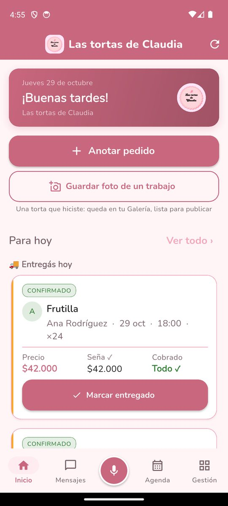
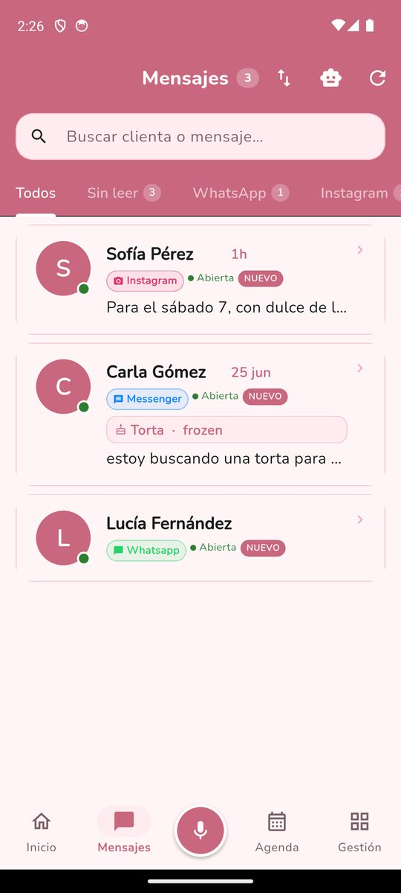
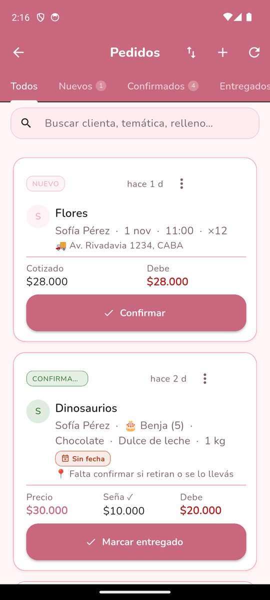
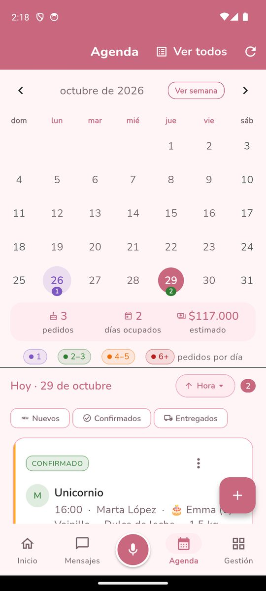
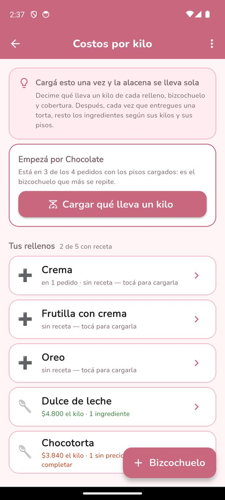
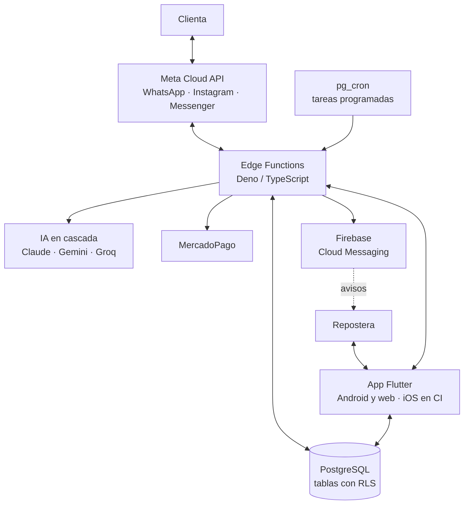
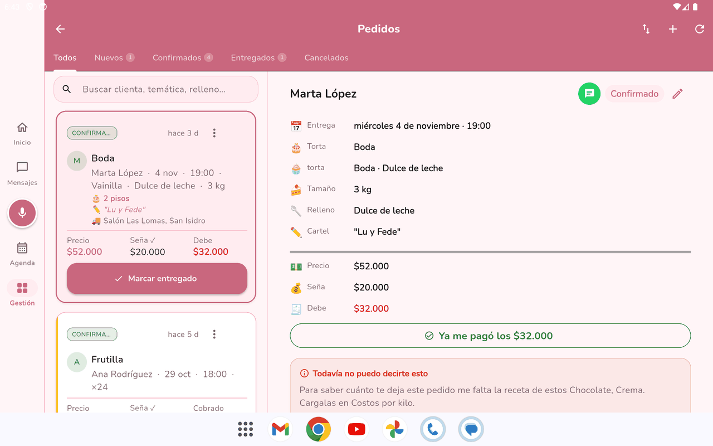

# SousChef

**Asistente inteligente y gestión para reposteras artesanales.** Atiende los mensajes de las
clientas por WhatsApp, Instagram y Messenger, toma los pedidos y organiza el negocio (pedidos,
producción, precios, agenda, clientas, recetas, stock y cobros) desde una sola app.

**En producción desde julio de 2026** · [souschefvirtual.com](https://souschefvirtual.com) ·
[recorrido en video](https://dilaciolautaro.github.io/portfolio/)

  
  
  
  
  

> Este repositorio es la presentación del proyecto. El código fuente es privado y propietario;
> lo muestro a pedido en procesos de selección. Contacto: [portfolio](https://dilaciolautaro.github.io/portfolio/) ·
> [LinkedIn](https://www.linkedin.com/in/lautaro-di-lacio)

**En esta página:** [Qué hace](#qué-hace) · [Arquitectura](#arquitectura) · [Decisiones de diseño](#decisiones-de-diseño) · [En números](#en-números) · [Stack](#stack) · [Calidad](#calidad) · [Manual de usuario](#manual-de-usuario)

## Qué hace

- **Bot de atención:** responde consultas simples, toma el pedido (fecha, porciones, temática,
  relleno) y le pasa la conversación a la dueña cuando hace falta. Nunca da precios ni toca la plata.
- **Gestión del negocio:** pedidos y sus estados, producción por día, semana y mes, calendario,
  clientas, calculadora de precios, recetas e insumos, stock, lista de compras y saldos a cobrar.
- **Motor proactivo:** avisa qué producir mañana, qué comprar, a quién cobrarle y cuándo suben los
  insumos, sin escribirle a ninguna clienta sin aprobación.
- **Asistente personal, por voz o texto:** hace tareas dentro de la app; lo delicado queda en
  *Pendientes* esperando el OK de la dueña.

## Arquitectura

Se lee como cinco escalones, de lo reactivo a lo proactivo:

| Escalón | Qué hace |
|---|---|
| 1. Entrada | Recibe el webhook de Meta, valida la firma, ubica el negocio dueño del número y persiste el mensaje |
| 2. Bot reactivo | Clasifica la intención y decide el carril: responder, preparar un borrador o escalar a la dueña |
| 3. Asistente de trastienda | Le responde a la dueña sobre su propio negocio, con function-calling contra la base |
| 4. Proactividad | Funciones programadas que empujan avisos sin que nadie pregunte |
| 5. Datos y cumplimiento | Alta de canales, borrado de datos a pedido de Meta y retención a 180 días |

Los tres webhooks son adaptadores finos: toda la lógica del bot vive en un único módulo
compartido, así los tres canales se comportan igual y una corrección se hace una sola vez.

## Decisiones de diseño

- **El bot no dice precios. Ninguno.** Cotizar es el trabajo que la repostera no quiere delegar, y
  la regla es verificable: se puede comprobar que ninguna respuesta lleva un importe. Una regla
  difusa ("que cotice cuando esté seguro") no se puede probar ni auditar.
- **Nada que involucre dinero se hace solo.** El bot prepara; la dueña resuelve. Confirmar,
  rechazar o cobrar pasa por *Pendientes*, redactado y listo para aprobar con un toque.
- **El aislamiento entre negocios vive en la base, no en el código.** Cada tabla tiene Row-Level
  Security, y un disparador de esquema la activa sola en las tablas nuevas para que ninguna quede
  expuesta por olvido.
- **Las claves no salen del backend.** Los modelos de IA, Meta y MercadoPago se llaman desde las
  Edge Functions; la app nunca tiene una clave privada.
- **El precio del plan Pro está anclado al dólar,** con banda de sanidad sobre la cotización, caché
  y redondeo hacia arriba, y queda fijo al momento de contratar.
- **Una sola app, un solo código:** Flutter para Android y web, con layout adaptado a tablet
  (riel lateral y pantallas partidas en lista y detalle).

  

## En números

| | |
|---|---|
| Módulos de la app | 25 |
| Edge Functions | 37 |
| Migraciones de base | 218 |
| Canales de mensajería | 3 |
| Archivos de test de la app | 73 |

Contado sobre la rama principal el 15/11/2026.

## Stack

| Capa | Tecnología |
|---|---|
| App | Flutter / Dart (Android y web; iOS compila en GitHub Actions) · Riverpod, GoRouter, Material 3 |
| Base de datos | Supabase: PostgreSQL + PL/pgSQL, RLS multi-tenant, Storage, Realtime |
| Backend | Supabase Edge Functions (Deno / TypeScript) |
| IA | Cascada entre Claude, Gemini y Groq, siempre desde el backend |
| Canales | Meta Cloud API: WhatsApp, Instagram y Messenger |
| Pagos | MercadoPago (suscripción) |
| Push | Firebase Cloud Messaging |
| Auth | Supabase Auth (email y Google OAuth) con hCaptcha |
| Observabilidad | Langfuse para la IA y Sentry en la app |

## Calidad

- Tests de la app con `flutter test` y tests de las funciones compartidas del backend.
- Suite de evaluaciones del bot para verificar su comportamiento ante conversaciones de ejemplo.
- CI en GitHub Actions: análisis, tests y compilación de iOS.
- Webhooks con verificación de firma y esquema de base versionado por migraciones.

## Manual de usuario

Para quien usa la app, no para quien la desarrolla: el [manual de usuario](docs/manual/README.md)
recorre SousChef en seis partes, con capturas sacadas con una cuenta de prueba y datos inventados.

---

© 2026 Lautaro Di Lacio. Todos los derechos reservados.
