# Manual de uso de SousChef

*Tu asistente para atender clientas y organizar tus pedidos de repostería*

**Autor:** Lautaro Di Lacio
**Fecha:** 29 de octubre de 2026

<!-- Regla para quien mantiene este manual: «El manual (y su captura) va en el mismo commit que cualquier cambio de barra, Inicio o menú». Las figuras desactualizadas se marcan con «📷 (captura pendiente)» y se listan en SOUSCHEF_manual_pantallas/README.md. -->

---

## Índice

1. [¿Qué es SousChef y cómo te ayuda?](#1-qué-es-souschef-y-cómo-te-ayuda)
2. [Cómo entrar y dar de alta tu negocio (tu primer día)](#2-cómo-entrar-y-dar-de-alta-tu-negocio-tu-primer-día)
3. [Conectar tus canales (WhatsApp, Instagram y Facebook)](#3-conectar-tus-canales-whatsapp-instagram-y-facebook)
4. [Lo que vendés: tu catálogo y tus combos](#4-lo-que-vendés-tu-catálogo-y-tus-combos)
5. [La pantalla de inicio: tu resumen del día](#5-la-pantalla-de-inicio-tu-resumen-del-día)
6. [Mensajes y el asistente que atiende solo](#6-mensajes-y-el-asistente-que-atiende-solo)
7. [Buscar y ordenar en cualquier lista](#7-buscar-y-ordenar-en-cualquier-lista)
8. [Pendientes: aprobá todo con un toque](#8-pendientes-aprobá-todo-con-un-toque)
9. [Tus pedidos y su detalle](#9-tus-pedidos-y-su-detalle)
10. [La agenda / calendario](#10-la-agenda--calendario)
11. [Producción: qué hacer mañana, esta semana y este mes](#11-producción-qué-hacer-mañana-esta-semana-y-este-mes)
12. [Tus clientas](#12-tus-clientas)
13. [Cuánto cobrar y precios atrasados](#13-cuánto-cobrar-y-precios-atrasados)
14. [Recetas, ingredientes y alacena](#14-recetas-ingredientes-y-alacena)
15. [Comprar esta semana](#15-comprar-esta-semana)
16. [Cobros y saldos pendientes](#16-cobros-y-saldos-pendientes)
17. [Configuración: cómo atiende tu asistente (envíos, seña y retiro)](#17-configuración-cómo-atiende-tu-asistente-envíos-seña-y-retiro)
18. [Los avisos automáticos que vas a recibir](#18-los-avisos-automáticos-que-vas-a-recibir)
19. [El asistente por voz](#19-el-asistente-por-voz)
20. [Tu plan: SousChef Free y Pro](#20-tu-plan-souschef-free-y-pro)
21. [Preguntas frecuentes](#21-preguntas-frecuentes)
22. [Si algo no anda](#22-si-algo-no-anda)

---

## 1. ¿Qué es SousChef y cómo te ayuda?

SousChef es como tener una ayudante que nunca se cansa. Trabaja para vos las 24 horas y hace tres cosas principales:

**1. Atiende a tus clientas por vos.** Cuando alguien te escribe por WhatsApp, Instagram o Messenger preguntando por una torta, SousChef le responde solo: saluda, contesta si tenés lugar para esa fecha, te dice los horarios, los rellenos que ofrecés… y le va pidiendo con amabilidad los datos del pedido (para cuándo lo quiere, cuántas porciones, la temática). Todo con onda, como responderías vos. Y como **conoce tu catálogo**, ofrece lo que VOS vendés y pregunta solo lo que hace falta: por una docena de alfajores no le va a preguntar el relleno a nadie.

**2. Te organiza los pedidos.** Cada conversación que termina en un pedido queda anotada solita: con la fecha, el tema, las porciones, la clienta y todo lo que hace falta. Nada se pierde ni se te olvida.

**3. Te avisa lo importante en el momento justo.** Te manda un aviso cuando tenés entregas mañana, cuando hay que salir a comprar insumos, cuando una clienta te quedó debiendo plata, cuando subió el precio de un ingrediente… sin que tengas que estar revisando nada.

> **Lo más importante que tenés que saber:** SousChef **nunca le pasa NINGÚN precio a la clienta**. Ni el de las tortas, ni el de los combos, ni el recargo de un relleno premium. Aunque le pregunten "¿cuánto sale?", el asistente responde con cariño que el presupuesto se lo confirmás vos, y te pasa todos los datos para que vos pongas el precio. La única excepción es la **lista de rellenos**, que se manda tal cual la tenés cargada (es la misma que copiás desde la app). **Vos siempre tenés la última palabra.**

---

## 2. Cómo entrar y dar de alta tu negocio (tu primer día)

  <figure>
    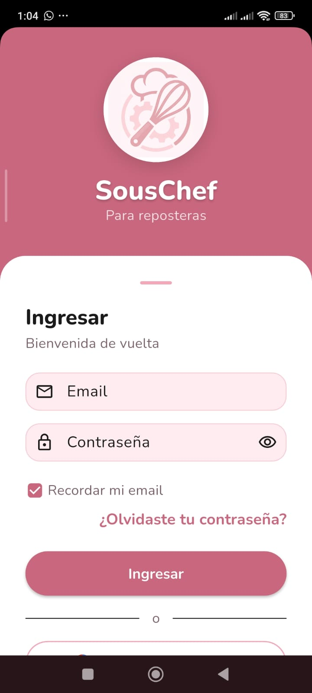
    <figcaption>La pantalla de entrar: tu correo, tu contraseña y el ojo para verla. Más abajo está la opción de entrar con Google (en la app para iPhone, por ahora, no).</figcaption>
  </figure>

### Entrar a la app

1. Abrí la app de SousChef en tu celular.
2. En la pantalla de bienvenida vas a ver el logo y dos maneras de entrar.
3. Escribí tu **correo electrónico** y tu **contraseña**, y tocá **Ingresar**.
4. Si preferís, podés entrar con tu **cuenta de Google** con un solo toque, sin acordarte de ninguna contraseña.
5. Si todavía no tenés cuenta, la creás ahí mismo con tu correo. En dos minutos estás adentro.

> **En la app para iPhone**, por ahora se entra solo con correo y contraseña: el botón de Google no aparece. En el navegador del iPhone sí.

**La política de privacidad y los términos.** Al pie de la pantalla de entrar —deslizando hasta abajo— está el enlace **Política de privacidad**. Se abre en el navegador y cuenta qué datos guarda SousChef, para qué los usa y cómo pedir que se borren. Donde aparece el botón de Google, se lee *"Al continuar con Google aceptás la Política de privacidad"*: entrar con Google la primera vez ya te crea la cuenta. En la pantalla de crear cuenta está al final, en *"Al crear tu cuenta aceptás los Términos del servicio y la Política de privacidad"*: cada una se abre tocándola, y crear la cuenta desde ahí, sea con tu correo o con Google, es aceptar las dos. Después las tenés siempre en **Configuración → Legal** (te lo cuento en la [sección 17](#17-configuración-cómo-atiende-tu-asistente-envíos-seña-y-retiro)).

### El "no soy un robot"

Al entrar puede aparecerte un cuadrito que dice **"Soy humano"** (o "No soy un robot") para que
lo toques; si te pide elegir imágenes, la consigna está en español. Es una verificación de
seguridad: evita que alguien use un programa para probar contraseñas contra tu cuenta hasta
acertar.

Desde la computadora **no vas a ver nada**: se resuelve solo, de fondo. Que no aparezca no
significa que esté apagado.

Si no puede verificarte, te dice *"No pudimos verificar que no sos un robot"*. Casi siempre es
la conexión: esperá unos segundos y probá de nuevo.

### Si te olvidaste la contraseña

1. Escribí tu correo en el campo de arriba. **Este paso primero**, o te va a decir
   *"Ingresá tu email arriba para recuperar la contraseña"*.
2. Tocá **¿Olvidaste tu contraseña?**
3. Te llega un correo con un link. Abrilo desde el mismo celular.
4. Escribí la contraseña nueva **dos veces**, iguales. Mínimo **6 caracteres**.

Si no te llega, fijate en el correo no deseado.

### Si no te deja entrar

Estos son los carteles que podés ver, y qué significa cada uno:

| Lo que dice | Qué pasa | Qué hacer |
|---|---|---|
| **"Confirmá tu email primero"** | Creaste la cuenta pero no abriste el correo de confirmación. **Es la causa más común** | Buscá el correo de SousChef —revisá el spam— y tocá el link. Después entrá normalmente |
| **"Email o contraseña incorrectos"** | Alguno de los dos está mal | Fijate que el correo no tenga espacios de más. Si no te acordás, usá *¿Olvidaste tu contraseña?* |
| **"Este email ya tiene cuenta"** | Estás intentando registrarte con un correo que ya usaste | Andá a **Ingresar** en vez de crear cuenta |
| **"La contraseña debe tener al menos 6 caracteres"** | Es corta | Poné una más larga |
| **"Las contraseñas no coinciden"** | Las dos casillas del registro tienen textos distintos | Escribilas de nuevo, con cuidado |
| **"No se pudo conectar. Verificá tu internet"** | No hay señal, o está muy lenta | Probá con wifi, o esperá y volvé a intentar |

### El asistente de configuración (el alta, en cuatro pasos)

  <figure>
    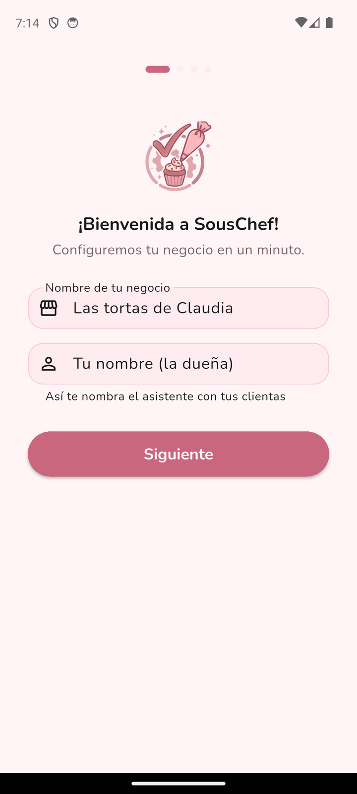
    <figcaption>Paso 1 del alta: «¡Bienvenida a SousChef!», el nombre de tu negocio y tu nombre (la dueña), con el que el asistente te nombra ante tus clientas.</figcaption>
  </figure>
  <figure>
    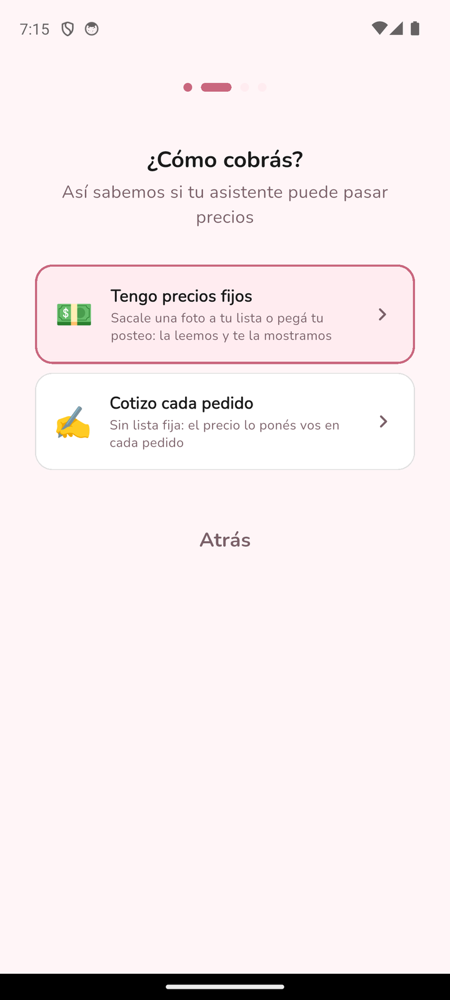
    <figcaption>Paso 2, «¿Cómo cobrás?»: 💵 Tengo precios fijos (le sacás una foto a tu lista y la leemos) o ✍️ Cotizo cada pedido (el precio lo ponés vos en cada uno).</figcaption>
  </figure>
  <figure>
    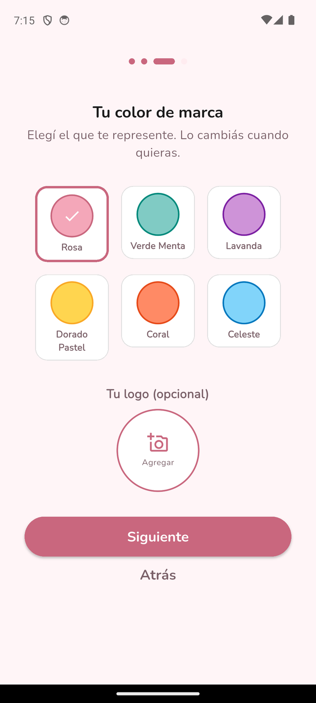
    <figcaption>Paso 3, «Tu color de marca»: elegís la paleta (la cambiás cuando quieras) y, si querés, subís tu logo.</figcaption>
  </figure>
  <figure>
    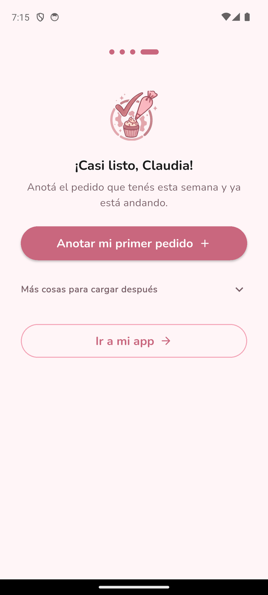
    <figcaption>Paso 4, «¡Casi listo!»: Anotar mi primer pedido, «Más cosas para cargar después» (plegado) e Ir a mi app.</figcaption>
  </figure>

La primera vez que entrás, SousChef te lleva de la mano por **cuatro pasos**. Ninguno es obligatorio a la perfección: todo se puede cambiar después.

1. **¡Bienvenida a SousChef!** Solo dos datos: el **Nombre de tu negocio** y **Tu nombre (la dueña)** —así te nombra el asistente con tus clientas—. Tocás **Siguiente**.
2. **¿Cómo cobrás?** Dos caminos, elegí el tuyo:
   - **💵 Tengo precios fijos:** le sacás una foto a tu lista de precios o pegás tu posteo, la app la lee y te la muestra para que confirmes (te lo cuento con detalle en la [sección 4](#4-lo-que-vendés-tu-catálogo-y-tus-combos)). Cuando termina, te dice *"¡Listo! Tus productos quedaron en el catálogo."* y tocás **Siguiente**.
   - **✍️ Cotizo cada pedido:** si no tenés una lista fija y el precio lo ponés vos en cada pedido. Pasás directo al paso siguiente.
3. **Tu color de marca.** Elegís el color de la app y, si querés, subís **Tu logo (opcional)** con **Agregar**.
4. **¡Casi listo!** El botón grande es **Anotar mi primer pedido**: abre el formulario de pedido (si todavía no tenés clientas, primero te pide los datos de la clienta) y, cuando lo guardás, entrás al Inicio con tu pedido ya anotado. Lo demás va plegado en **Más cosas para cargar después**: desplegalo cuando quieras para **Conectar canales**, **Mis ingredientes**, **Recetas** o **Catálogo**. Y si querés entrar sin anotar nada, tocás **Ir a mi app**.

> **Consejo:** después del alta, pasá un minuto por **Configuración** para cargar tu **valor de la hora de trabajo**, tu **margen de ganancia** y tu **máximo de pedidos por día**. Con esos datos SousChef calcula tus precios de verdad y cuida que no te sobrecargues. Si te lo salteás, tranquila: la calculadora te lo va a recordar con un cartelito cuando vea que seguís con el valor de ejemplo.

Ese es el recorrido completo de una repostera nueva: **crear la cuenta → los cuatro pasos del alta → tu primer pedido anotado → cuando quieras, conectar los canales**. Desde el primer día la app ya te sirve para organizarte; con los canales conectados, además atiende por vos.

---

## 3. Conectar tus canales (WhatsApp, Instagram y Facebook)

  <figure>
    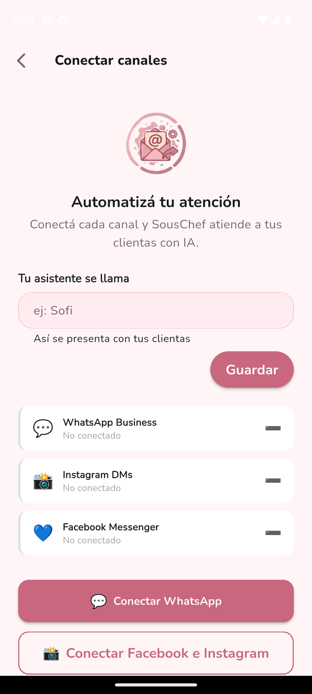
    <figcaption>Conectar canales: arriba, «Tu asistente se llama» con el nombre que elegís y Guardar; abajo, los tres canales (WhatsApp Business, Instagram DMs y Facebook Messenger) con su estado —acá, todavía sin conectar— y los dos botones: Conectar WhatsApp y Conectar Facebook e Instagram. Cuando un canal queda conectado, aparece con su tilde verde.</figcaption>
  </figure>

Para que SousChef pueda atender a tus clientas, primero tenés que conectar tus redes. Esto se hace **una sola vez** y es lo que le da "manos" al asistente para leer y responder los mensajes.

### ¿Para qué sirve?

Una vez conectado, todos los mensajes que te lleguen por WhatsApp, Instagram o Messenger van a caer dentro de SousChef. El asistente los va a leer, responder y ordenar por vos. Sin conectar, la app te sirve igual para organizarte, pero no puede contestar sola.

### Cómo conectar

1. Andá a **Configuración → Conectar canales** (o, en el último paso del alta, desplegá **Más cosas para cargar después** y tocá **Conectar canales**).
2. Ahí vas a ver **dos botones**, uno para cada cosa:
   - **Conectar WhatsApp:** se abre el **asistente oficial de Meta** (la empresa dueña de WhatsApp). Iniciás sesión con tu cuenta de **Facebook**, elegís tu negocio y **verificás tu número** de WhatsApp. Es el proceso oficial, el mismo que usan todos los negocios.
   - **Conectar Facebook e Instagram:** un segundo botón para Messenger e Instagram. Iniciás sesión en Facebook, seleccionás tu cuenta o Página, autorizás los permisos y volvés a la app automáticamente.
3. Cuando termina, vas a ver una tilde verde 🎉 en cada canal que quedó conectado.

> **Tranquila:** SousChef se encarga de la parte técnica. Vos solo tenés que iniciar sesión y decir "sí, autorizo".

Si todavía no aceptaste que tus datos pasen por la inteligencia artificial, antes de abrir Facebook aparece la hoja **Antes de usar el asistente** (te la cuento en la [sección 19](#19-el-asistente-por-voz)): conectar es que el asistente empiece a leer lo que te escriben tus clientas. Con **Ahora no**, no se abre nada.

### Ponele nombre a tu asistente

Arriba de los canales está **Tu asistente se llama**. Escribís un nombre (por ejemplo, *Sofi*) y tocás **Guardar**. Así se presenta con tus clientas: *"Soy Sofi, asistente de Claudia"*. Si no le ponés nombre, se presenta como siempre: *"el asistente de Claudia"*.

Lo podés cambiar cuando quieras, acá o en **Configuración** (*¿Cómo querés llamar a tu asistente?*). Un detalle: si le ponés tu propio nombre, sigue presentándose como *"el asistente de…"*, para que la clienta no crea que está hablando con vos. Y si querés que vuelva a presentarse como siempre, borrá el nombre en Configuración y guardá (en Conectar canales no se puede dejar vacío).

### Tus canales son tuyos y de nadie más

Cada negocio queda conectado con **sus propias credenciales**. Eso quiere decir que tus mensajes salen **únicamente por TUS canales**: lo tuyo nunca se mezcla con otro negocio que también use SousChef, y las respuestas de tu asistente le llegan a tus clientas desde tu número y tus cuentas.

### Sobre las reconexiones

Las conexiones de Meta **caducan cada tanto** (más o menos cada 60 días). No te preocupes por acordarte: SousChef revisa esto todos los días y, si una conexión está por vencerse o dejó de funcionar, te manda un aviso, *"⚠️ Revisá la conexión de tus canales"*, que te dice qué pasa y termina con *"Reconectá desde Configuración para no perder mensajes"*. Cuando lo veas, solo repetís el paso de conectar y listo.

---

## 4. Lo que vendés: tu catálogo y tus combos

  <figure>
    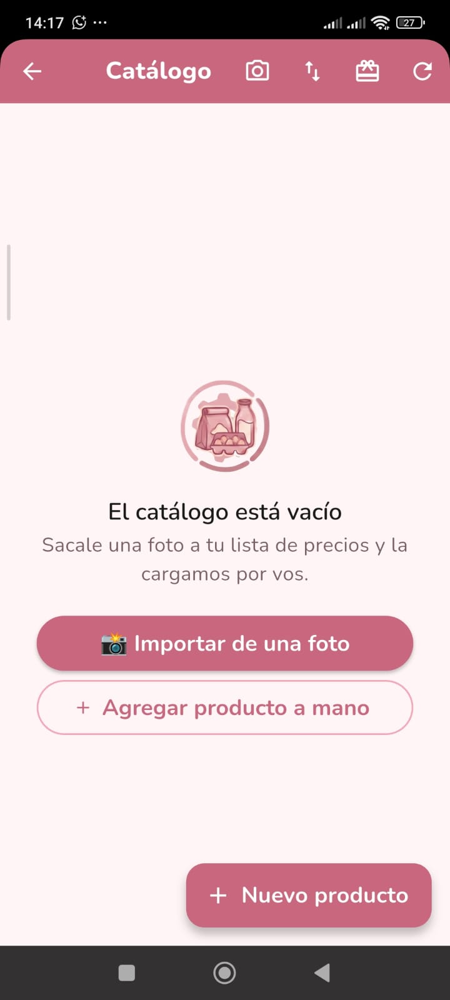
    <figcaption>Así te recibe el Catálogo el primer día: te ofrece el camino corto, importar de una foto de tu lista de precios.</figcaption>
  </figure>
  <figure>
    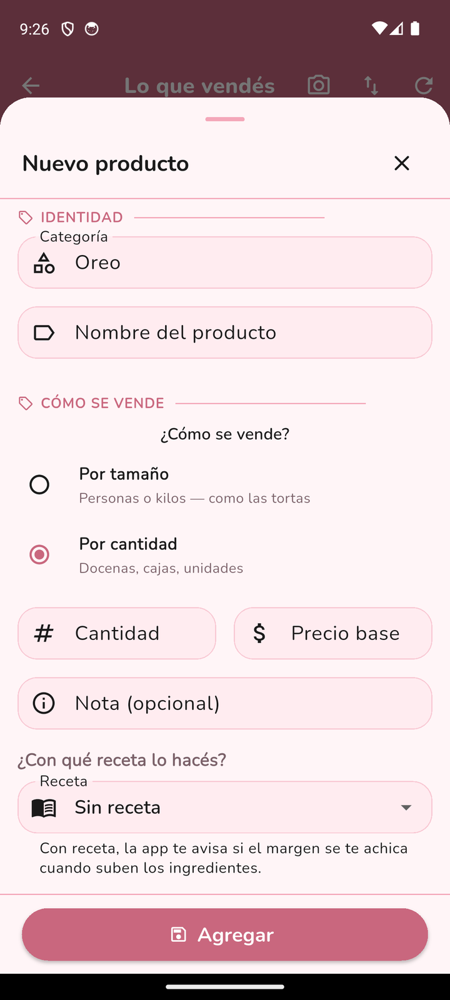
    <figcaption>Cargar un producto a mano: categoría, nombre, y si se vende por tamaño (personas o kilos) o por cantidad (docenas, unidades).</figcaption>
  </figure>

**Lo que vendés** es la lista de lo que ofrecés: tortas, docenas de cupcakes, cajas de alfajores, boxes, promos… Es lo que tu asistente usa para ofrecer y para saber **qué preguntarle** a cada clienta. Es **una sola pantalla con dos pestañas**: **Productos** (tu catálogo) y **Combos y promos**. La encontrás en **Gestión** (Tu negocio → Lo que vendés) o como **Lo que vendés** en Mis herramientas, al final del Inicio.

  <figure>
    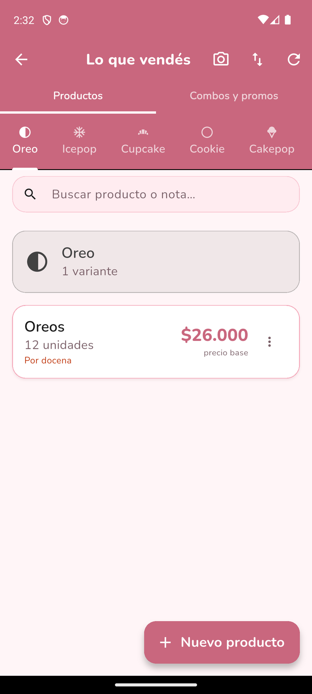
    <figcaption>Lo que vendés: una sola pantalla con las pestañas Productos y Combos y promos. En Productos, las categorías arriba, el buscador y cada producto con su precio base; abajo, Nuevo producto.</figcaption>
  </figure>

**En la tablet acostada** (salvo las más chicas, de 8") Lo que vendés se ve partida, en las dos pestañas: a la izquierda la lista —en Productos, con las categorías arriba y el buscador— y a la derecha el formulario del producto o del combo que tocás (o que elegís con **Editar** en el ⋮), que queda marcado en la lista. Lo cambiás ahí mismo y lo guardás: la lista se pone al día y lo seguís viendo al lado (en Productos, **Cancelar** vacía el lado derecho). **Nuevo producto** y **Nuevo combo** van abajo de la lista y abren el formulario vacío a la derecha; al guardarlo, el nuevo queda marcado. En un combo, al lado del precio ves cuánto te cuesta hacerlo. Con la tablet parada y en el teléfono, **Editar** y los botones de alta abren el formulario desde abajo, como siempre.

### La estrella: importar tu lista de precios de una foto 📸

Si ya tenés tu lista de precios armada (en papel, en una imagen, en un posteo de Instagram), **no hace falta tipear nada**. Miralo así: le sacás una foto y listo.

1. Tocá el botón **📸** — lo tenés en **Lo que vendés** (bien grande si está vacío, y siempre en la barra de arriba) y también en el alta, en el paso "¿Cómo cobrás?", eligiendo **Tengo precios fijos**.
2. Elegí **Sacale una foto a tu lista** (y después **"Sacar la foto ahora"** o **"Elegir de la galería"**) o, si lo que tenés es el texto —por ejemplo, el posteo de Instagram con tus precios—, **Pegá el texto** y tocá **Leer la lista**.
3. SousChef lee la lista y te muestra **todos los productos que encontró**, con su nombre y su precio. Si en la lista figuraban tus **rellenos**, también los reconoce — y si tenían **recargo premium**, se lo anota.
4. Revisás la ventanita **Esto encontré en tu lista**: cada producto tiene su **tilde** ✔️. Destildá lo que no quieras cargar.
5. Tocá **Cargar N productos** (o *Cargar N productos y M rellenos*), y todo cae en tu **catálogo**, donde después editás cualquier cosa con los formularios normales.

> **Tres cosas para que estés tranquila:**
> - **Nada se guarda sin tu confirmación.** Vos siempre ves la lista antes y elegís qué entra.
> - **SousChef jamás inventa un precio.** Solo copia lo que se ve en la foto o en el texto. Si algo no tiene precio visible, queda sin precio para que lo completes vos.
> - **No duplica nada.** Si un producto de la foto ya está en tu catálogo, lo saltea y te avisa. Podés importar la misma lista dos veces sin miedo.
>
> Si la foto salió borrosa o no se entiende, te lo dice y le sacás otra. Sin drama.

### Cómo se vende cada producto (esto es importante)

Cada producto de tu catálogo declara **cómo se vende**, y eso cambia lo que el asistente pregunta:

- **Por tamaño** — *personas o kilos, como las tortas*. El asistente pregunta para cuántas personas (o cuántos kilos), la temática y el relleno.
- **Por cantidad** — *docenas, cajas, unidades*. El asistente pregunta solo **cuántas** y **para cuándo**. Nada de porciones ni relleno: una caja de alfajores no lleva relleno a elección.

Cuando creás o editás un producto lo elegís con dos tarjetas bien claras. Si lo importaste de una foto, SousChef lo deduce solo y vos lo corregís si hace falta. Y al elegir la **categoría**, el selector te sugiere el vocabulario de tu rubro (tortas, cupcakes, postres…), para que todo tu catálogo hable el mismo idioma.

### La receta de cada producto: el puente a tus costos

En el formulario de cada producto está la pregunta **¿Con qué receta lo hacés?**, con el selector **Receta**. Enganchale su receta y ese producto queda conectado a tus **costos reales**. Ese enganche es el puente que enciende todo lo demás:

- **Precios atrasados** puede avisarte cuando ese producto pierde margen.
- Los **combos** que lo incluyen pueden calcular su costo.
- La **actualización de precios de 1 toque** puede recalcularle el precio.

Sin receta, el producto se vende igual; solo que SousChef no puede decirte cuánto te cuesta.

### La pestaña "Combos y promos"

Los combos y las promos viven en la **segunda pestaña** de esta misma pantalla.

- Un combo se arma **eligiendo productos de tu catálogo**: así SousChef sabe qué incluye y cuánto te cuesta.
- Abajo de cada combo ves **cuánto te cuesta hacerlo y cuánto te queda**, por ejemplo *"Te cuesta $9.918 · queda $20.082 (67%)"*: en verde si te queda 40 % o más. Si a algún producto le falta la receta o tiene ingredientes sin precio, no te muestra lo que te queda (sería un número inventado): te dice *"Te cuesta al menos $9.918"* y qué falta completar, *"Falta la receta de Budín, o sus ingredientes no tienen precio"* (fijate que el producto tenga su receta y que sus ingredientes tengan precio) o *"Crema mantecol tiene ingredientes sin precio"*. Si no puede calcular nada, te dice *"No sé cuánto te cuesta: falta la receta de…"*.
- Si un combo quedó escrito como **texto libre** (sin productos enganchados), lo ves con un cartelito: **"sin costo — tocá Editar y elegí los productos"**. Lo abrís, elegís los productos, y listo: ya tiene costo.
- El asistente puede ofrecerlos: dice **qué incluye** cada combo y que conviene más que por separado — **nunca el precio** ([sección 6](#6-mensajes-y-el-asistente-que-atiende-solo)).

### Promos por ocasión (campañas)

Tus productos y combos pueden tener una **ocasión** (día del padre, san valentín, día del amigo…) y una **fecha de fin**. Con eso:

- Cuando una clienta pregunta *"¿tenés algo para el día del padre?"*, el asistente **ofrece lo que está vigente** para esa ocasión.
- Las promos **vencidas dejan de ofrecerse solas**: no tenés que acordarte de borrarlas, y el asistente nunca ofrece la promo del año pasado.
- Lo que no tiene ocasión ni fechas es tu catálogo de todo el año, y se comporta como siempre.

**Cómo se carga.** Al final del formulario de un producto o de un combo hay una sección **"¿Es de temporada?"**: tocás la ocasión (Día del Padre, Día de la Madre, San Valentín, Día del Amigo, Navidad, Pascua) y, si querés, elegís **hasta cuándo lo ofrecés**. Si no tocás nada, es de todo el año.

En la lista, los de campaña muestran un renglón chico con la ocasión y la fecha; cuando la fecha ya pasó dice **"ya pasó, no se ofrece"** — así entendés por qué el asistente dejó de ofrecerlo, sin abrir nada. Para volver a usarlo el año que viene, entrás y le cambiás la fecha. Y el botón de **copiar la lista de combos** deja afuera los vencidos, para que no pegues la promo de San Valentín en julio.

---

## 5. La pantalla de inicio: tu resumen del día

  <figure>
    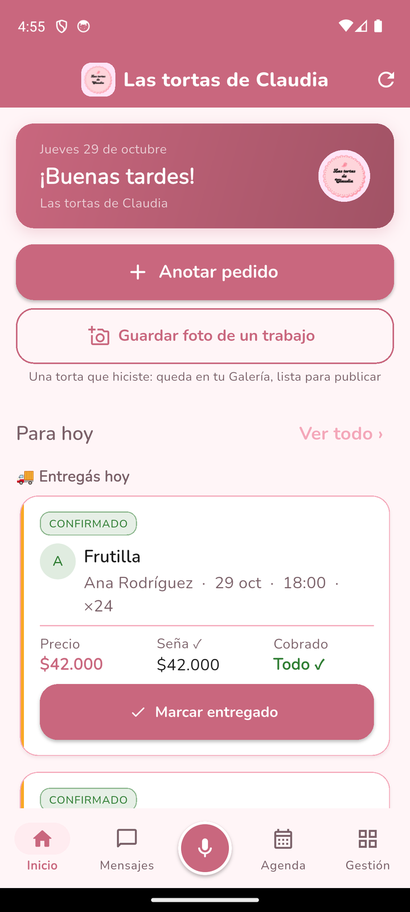
    <figcaption>Lo primero que ves al abrir: el saludo, el botón grande «Anotar pedido» con «Guardar foto de un trabajo» debajo, y Para hoy con los pedidos que necesitan algo tuyo.</figcaption>
  </figure>
  <figure>
    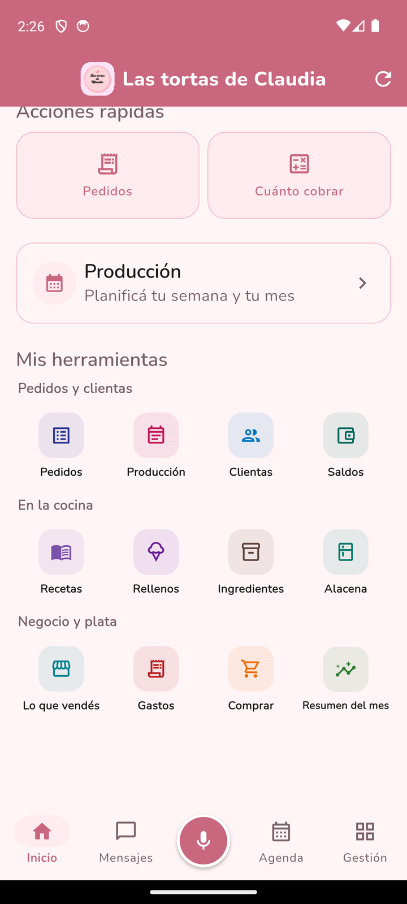
    <figcaption>Al final del Inicio, «Mis herramientas» en tres grupos: Pedidos y clientas, En la cocina, y Negocio y plata. Abajo, la barra con sus cinco lugares.</figcaption>
  </figure>

Es la primera pantalla que ves al entrar. Está pensada para que arranques por **lo que tenés que hacer hoy** y, más abajo, tengas los números y los atajos.

### Qué vas a encontrar (de arriba para abajo)

1. **Tu saludo** (*¡Buenos días!*, *¡Buenas tardes!* o *¡Buenas noches!*), la fecha de hoy, el nombre de tu negocio y tu logo.
2. **Anotar pedido**, el botón grande: abre el formulario para cargar un pedido ([sección 9](#9-tus-pedidos-y-su-detalle)). Debajo, **Guardar foto de un trabajo**: una foto (o un video) de una torta que hiciste, que queda en tu **Galería** lista para publicar, sin tener que ir a buscarla; te pregunta si querés **Tomar foto**, **Elegir una foto** o **Subir un video**.
3. **Para hoy:** los pedidos que necesitan algo tuyo, en los mismos cuatro grupos de la pantalla Para hoy ([sección 9](#9-tus-pedidos-y-su-detalle)):
   - 🔴 **Vencidos — marcá si ya entregaste**
   - 🚚 **Entregás hoy**
   - 📝 **Esperan un sí o un no — de cualquier fecha**
   - 📅 **Sin fecha de entrega — ponele una**

   Cada grupo muestra hasta **cinco** pedidos. Si hay más, tocás **Ver N más ›** (o **Ver todo ›**, al lado del título) y se abre la pantalla Para hoy completa. Si no queda nada, te dice **¡Estás al día! 🎉**
4. **Resumen del día:** cuatro números (en la tablet acostada, los cuatro en una fila), y cada uno se toca:
   - **Pedidos hoy** → abre **Para hoy**.
   - **Pedidos abiertos** → los que todavía no entregaste ni cancelaste; abre **Pedidos**.
   - **Facturado mes** → cuánto llevás vendido este mes; abre el **Resumen del mes**.
   - **Sin leer** → las conversaciones en las que te escribieron en los últimos dos días; abre **Mensajes**.
5. **Mañana** y **Comprar esta semana:** dos tarjetas que aparecen solo si hay algo. **Mañana** te dice cuántas entregas y cuánto hay para producir (*"3 entregas · 2 a producir"*); si te pasaste de lo que podés hacer, se pone ámbar y dice **Mañana: día cargado**. Te lleva a **Producción**, en la pestaña Mañana. **Comprar esta semana: 5 ítems**, con el costo estimado, te lleva a la lista de compras ([sección 15](#15-comprar-esta-semana)).
6. **Alertas**, solo si hay: *"⚠️ 2 ingredientes subieron de precio"* (las descartás con la ✕ o deslizándolas) y *"🛒 3 ingredientes necesitan reposición"* (tocala y vas a Mis ingredientes).
7. **Acciones rápidas:** **Pedidos** y **Cuánto cobrar**.
8. **Producción** — *"Planificá tu semana y tu mes"*: abre Producción en la pestaña Semana ([sección 11](#11-producción-qué-hacer-mañana-esta-semana-y-este-mes)).
9. **Mis herramientas**, al final, en tres grupos de cuatro:
   - **Pedidos y clientas:** Pedidos · Producción · Clientas · Saldos
   - **En la cocina:** Recetas · Rellenos · Ingredientes · Alacena
   - **Negocio y plata:** Lo que vendés · Gastos · Comprar · Resumen del mes

**Configuración** no está entre los atajos del Inicio: la encontrás en **Gestión**, con la ruedita de arriba o al final de todo.

### Cómo la usás

- Tocá cualquier número o tarjeta para ver el detalle.
- Tocá **Anotar pedido** para cargar un pedido en segundos.
- Deslizá hacia abajo (tirá de la pantalla) para **actualizar** Para hoy, los números y las alertas. La flechita circular de arriba hace lo mismo.

### La barra de abajo

En la parte de abajo tenés cinco lugares, siempre a mano:

1. **Inicio** (esta pantalla)
2. **Mensajes** (las charlas con tus clientas, [sección 6](#6-mensajes-y-el-asistente-que-atiende-solo))
3. **El micrófono**, el botón redondo del medio: con un toque se abre el **Asistente**, para hablarle o escribirle ([sección 19](#19-el-asistente-por-voz))
4. **Agenda** (el calendario de entregas, [sección 10](#10-la-agenda--calendario))
5. **Gestión** (todo lo demás: pedidos, clientas, recetas, compras, el asistente, tu plan y la configuración — [sección 14](#14-recetas-ingredientes-y-alacena)). En este manual, cuando decimos *"el menú"*, es Gestión.

**En una tablet** la barra no va abajo: está parada al costado izquierdo, con los mismos cinco lugares en el mismo orden (Inicio arriba, el micrófono en el medio, Gestión abajo). Cuando el manual dice *"la barra de abajo"*, en la tablet es esa columna. La tablet se puede usar parada o acostada: la app gira con ella. En el teléfono sigue todo igual, siempre parado.

  <figure>
    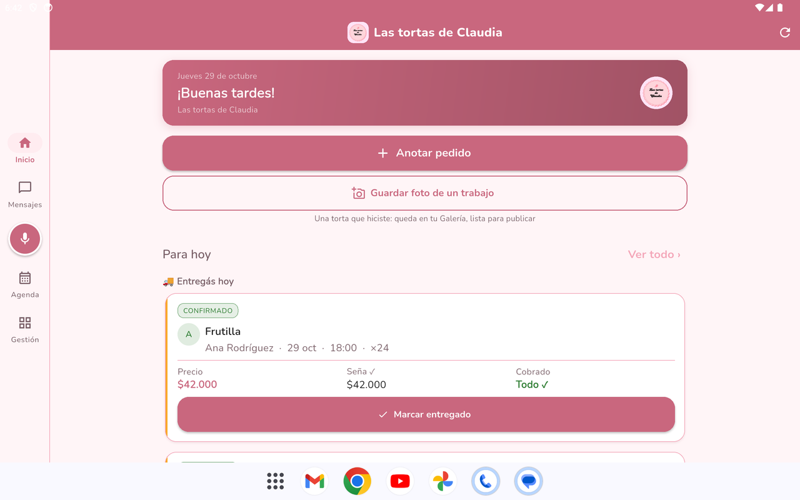
    <figcaption>En la tablet acostada, el Inicio con la columna de la izquierda (Inicio · Mensajes · micrófono · Agenda · Gestión) en vez de la barra de abajo; el contenido va al medio, con un ancho cómodo de leer.</figcaption>
  </figure>

En la tablet esa columna queda a mano también adentro de las demás pantallas (Pedidos, Clientas, Para hoy, Producción…), así pasás de una a otra sin volver atrás. Si la pantalla es de Gestión, queda marcada Gestión; las que se abren tanto desde el Inicio como desde Gestión, como Para hoy, no marcan ninguno. La única que va sin la columna es la del Asistente, que es justamente adonde lleva el micrófono.

En la tablet las pantallas no se estiran de punta a punta: listas, tarjetas y formularios van al medio, con un ancho cómodo de leer, y se pueden deslizar tocando en cualquier parte, también en los costados. La excepción es la entrada y el alta de cuenta: ahí el formulario es una tarjeta blanca al medio y se desliza tocando arriba de ella.

Lo mismo pasa si usás SousChef **desde el navegador en una ventana ancha**, como la de una notebook: la barra queda parada al costado y las pantallas van al medio. Si la ventana es muy grande (un monitor), la app se ve en el medio con forma de teléfono y la barra abajo, como siempre. Lo que este manual dice de «la tablet» (la barra al costado, los cuatro números del Inicio en una fila, las pantallas partidas en lista y ficha, la Agenda por semana cuando la pantalla es bajita) vale también para la web en una ventana ancha.

### Atajos desde el ícono de SousChef

Sin abrir la app, **mantené apretado el ícono de SousChef** en la pantalla del celular y aparecen sus accesos directos. Tocás uno y la app se abre directo en esa pantalla.

- **En Android** arrancan cinco: **Mensajes**, **Agenda**, **Cuánto cobrar**, **Recetas** y **Gastos**. Mientras usás la app, el teléfono va poniendo primero las últimas pantallas que abriste (también **Galería**, **Dónde comprar más barato**, **Catálogo** o **Configuración**); cuando cerrás SousChef del todo, vuelven las cinco de siempre. Cuántos se ven depende del teléfono.
- **En el iPhone** son cuatro: **Mensajes**, **Agenda**, **Cuánto cobrar** y **Recetas**. Además, Siri y la búsqueda del iPhone aprenden qué pantallas usás y te las sugieren.

---

## 6. Mensajes y el asistente que atiende solo

  <figure>
    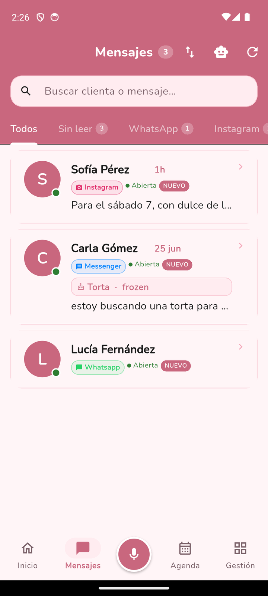
    <figcaption>Mensajes: las conversaciones de tus tres canales en un solo lugar, con el buscador arriba y las pestañas Todos / Sin leer / WhatsApp / Instagram.</figcaption>
  </figure>

**Mensajes** (el segundo lugar de la barra de abajo) junta todas tus conversaciones de WhatsApp, Instagram y Messenger en un solo lugar. Ya no tenés que andar saltando de una app a otra.

### Cómo se ve

- Arriba hay pestañas para filtrar: **Todos**, **Sin leer**, **WhatsApp**, **Instagram**, **Messenger**.
- Cada conversación muestra: la foto o inicial de la clienta, su nombre, por qué canal te escribió (con un color: WhatsApp verde, Instagram rosa, Messenger azul), en qué estado está y la última línea del mensaje.
- Si hay un pedido en esa charla, ves un resumen chiquito (la tortita, las porciones, la fecha).
- Las conversaciones **nuevas o sin leer** tienen un cartelito de aviso para que no se te pasen.

**En la tablet acostada** (salvo las más chicas, de 8") Mensajes se ve partida: a la izquierda la lista de conversaciones y a la derecha el chat que tocás, que queda marcado en la lista; lo leés y le respondés ahí mismo, sin perder la lista de vista. Con la tablet parada y en el teléfono, tocar una conversación abre el chat entero, como siempre. Lo que escribiste para responder y todavía no mandaste no se pierde: sigue ahí si girás la tablet y, también en el teléfono, si salís del chat y lo volvés a abrir, mientras no te vayas de Mensajes. Cada conversación guarda lo suyo.

  <figure>
    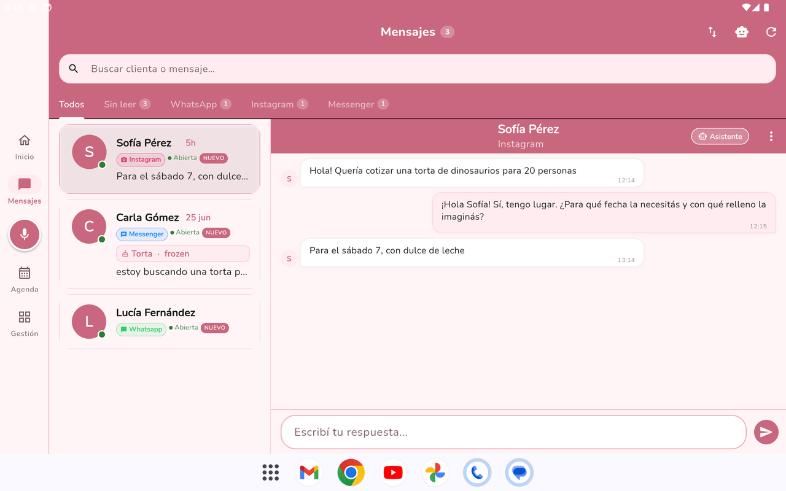
    <figcaption>Mensajes partida en la tablet acostada: a la izquierda la lista de conversaciones (la elegida queda marcada) y a la derecha el chat, con su pastilla Asistente y el campo para responder.</figcaption>
  </figure>

### El buscador que encuentra lo dicho hace tiempo

Arriba tenés un **buscador** que no busca solo por nombre: busca **dentro de las conversaciones**, en todo el historial. ¿Te acordás de que alguien te habló de una "torta de unicornio" hace dos meses pero no te acordás quién? Escribí "unicornio" y SousChef revisa todos tus chats (lo hace la base de datos, así que es al instante) y te muestra la conversación **con el mensaje exacto donde apareció**. También podés ordenar la lista con el ícono **⇅** (más recientes o por nombre).

### Cómo atiende el asistente (solo, por vos)

Este es el corazón de SousChef. Cuando una clienta te escribe, pasa esto **automáticamente**:

1. **Espera unos segundos** por si la clienta manda varios mensajes seguidos, así responde una sola vez a todo junto (y no la bombardea con respuestas sueltas).
2. **Entiende qué quiere** la clienta: si es un saludo, si pregunta horarios, si quiere hacer un pedido, si tiene un reclamo, etc.
3. **Responde según el caso:**
   - Si pregunta algo simple (horarios, si tenés lugar tal fecha, ubicación), **le contesta al toque**.
   - Si quiere hacer un pedido, **mira tu catálogo y pregunta solo lo que hace falta**: para una **torta**, la fecha, las porciones (o los kilos), la temática y el relleno — y si la clienta pide **pisos**, anota el bizcochuelo y los rellenos **de cada piso**. Para una **docena o una caja**, pregunta solo **cuántas y para cuándo**, y el pedido cierra.
   - Si la clienta dice **a dónde hay que llevarle el pedido**, esa **dirección de entrega queda anotada en el pedido** solita.
   - Si manda una **nota de voz**, la escucha y la entiende igual.
   - Si manda una **foto de una torta**, la mira, reconoce qué tan compleja es y te la deja anotada como referencia del pedido.

### Lo que el asistente NUNCA hace

**Nunca da NINGÚN precio.** Esto abarca todo:

- El precio de tus productos: si preguntan "¿cuánto sale?", responde algo como *"El presupuesto exacto te lo confirma [tu nombre] 💕 Contame los detalles y se lo paso para que te pase el precio."*
- El precio de los **combos**: dice **qué incluye** cada combo y que *"conviene más que por separado"*, pero el monto no.
- El recargo de los **rellenos premium**: los nombra como *"(premium)"*, sin decir cuánto es el adicional.

La **única excepción** es la **lista de rellenos**: esa se manda **tal cual** la tenés cargada, porque es la misma lista que vos copiás y pegás desde la app.

Así vos ponés el precio con toda la información y sin apuros.

### Tus datos para cobrar: los manda el asistente por vos

Cuando una clienta ya cerró el pedido y quiere **transferirte o señar**, muchas veces te pide "pasame tu alias / CBU". Para que no tengas que estar copiando y pegando siempre lo mismo, cargás **una sola vez** tus datos de cobro y el asistente se los manda solo a la clienta cuando se los pide.

- Andá a **Configuración** y cargá tu bloque de datos de cobro de **Mercado Pago**: titular de la cuenta, **Alias**, **CBU/CVU** y **CUIT**.
- Listo. Cuando una clienta pida los datos para pagar, el asistente se los pasa **tal cual los cargaste** (sin que la inteligencia artificial los toque, así es imposible que se deformen).
- Si en algún momento cambian tus datos, los actualizás ahí mismo y el asistente ya empieza a mandar los nuevos.

> **Ojo:** esto es solo para pasar tus datos de cobro. El asistente **sigue sin dar precios**: el monto se lo confirmás vos.

Lo mismo pasa con tu **dirección de retiro**: si la cargaste en Configuración, el asistente la manda **letra por letra como la escribiste**. Y si no la cargaste, no comparte ninguna dirección y te deriva la consulta (más detalle en la [sección 17](#17-configuración-cómo-atiende-tu-asistente-envíos-seña-y-retiro)).

### Cuándo te pasa la conversación a vos

El asistente sabe cuándo tiene que llamarte. Te pasa la conversación (y te avisa) cuando:

- La clienta se enoja, tiene un reclamo o **pide hablar con vos directamente**.
- Ya tiene todos los datos del pedido y hace falta que vos pongas el precio. Para ahorrarte las cuentas, te deja armado un **borrador de presupuesto** con los precios de **TU catálogo** y **TUS recargos de rellenos** (no una lista fija). Es un borrador para vos: la clienta no ve ningún precio hasta que vos lo mandes.
- **Pasaron 15 minutos** y la conversación te quedó esperando sin respuesta: te manda un aviso urgente *"🔔 [Clienta] sigue esperando"* para que no se te escape.

Si te pasó la conversación y pasan unas **6 horas** sin que le hayas escrito nada a la clienta, el asistente le manda **una sola vez** un "perdón la demora": le cuenta que estás con las manos en la masa y que apenas te desocupes le confirmás el presupuesto. No cotiza ni dice ningún precio, y lo ves en el chat. Este mensaje sale solo, sin pasar por Pendientes.

### Rechazar un presupuesto

Dentro del chat, la tarjeta del pedido tiene la opción de **rechazarlo** (por ejemplo, si no llegás con esa fecha). Cuando rechazás:

- El pedido **se cierra siempre**, pase lo que pase.
- SousChef intenta avisarle a la clienta con un mensaje amable. Si no se puede avisar (WhatsApp solo deja responder dentro de las 24 horas del último mensaje de la clienta — es una regla de Meta, no de SousChef), **el pedido queda cerrado igual** y la app te lo aclara con un cartel, para que sepas que a la clienta no le llegó el aviso y le escribas vos si querés.

### Pausar el asistente

En la parte de arriba de Mensajes hay un botón con un robotito 🤖. Si lo tocás, **pausás las respuestas automáticas** en todos los canales (queda naranja para que sepas que está pausado). Útil si querés atender todo vos por un rato. Tocalo de nuevo para reactivarlo.

Cada chat tiene además, arriba a la derecha, una pastilla que dice **Asistente** o **Manual**. Cuando respondés a mano en una conversación, el asistente se calla **en esa charla** para no pisarte, y la pastilla pasa a **Manual** (en naranja). Si querés que la vuelva a atender, tocá la pastilla y vuelve a **Asistente**. Y si pausaste el asistente con el robotito, la pastilla de todos los chats dice **Pausado**: ahí no hay nada que tocar en el chat, lo reactivás con el robotito.

---

## 7. Buscar y ordenar en cualquier lista

Casi todas las listas de SousChef se manejan igual, así aprendés una vez y te sirve en toda la app:

- **El buscador** 🔍 está arriba de la lista. Escribís y filtra al instante.
- **El ícono ⇅** (al lado del buscador) abre las opciones de **orden**. Elegís el criterio que quieras, y si **volvés a tocar el mismo criterio, se da vuelta** (de ↑ a ↓ y viceversa). Por ejemplo: "Precio" una vez te muestra los más caros primero; tocás "Precio" de nuevo y van los más baratos primero.
- Muchas listas tienen además **chips de filtro** (botoncitos que prendés y apagás) para quedarte solo con lo que te interesa.

### Dónde lo tenés y qué podés hacer en cada lista

| Lista | Buscás por… | Ordenás por… / Filtros |
|---|---|---|
| **Pedidos** | clienta, temática, festejado, relleno y **dirección de entrega** | fecha de entrega, más nuevos, precio, clienta |
| **Para hoy** | clienta o temática (el buscador aparece cuando hay cinco pedidos o más) | fecha, clienta |
| **Pendientes** | texto o clienta | chips **Mensajes a clientas** / **Recordatorios** / **Confirmables** |
| **Saldos** | — | saldo, clienta, total del pedido |
| **Clientas** | nombre, teléfono | varios órdenes + chips **Con pedidos** / **Frecuentes 3+** |
| **Mensajes** | ¡dentro de las conversaciones! (todo el historial) | más recientes, nombre |
| **Mis ingredientes** | nombre, **marca y proveedor** | orden + chips **Queda poco** / **En promo** / **Sin precio** |
| **Recetas** | nombre **e ingrediente** ("¿cuáles llevan frutilla?") | costo + chips por familia y **Sin costo** |
| **Dónde comprar más barato** | ingrediente o marca | nombre, mayor ahorro, precio |
| **Lo que vendés** (pestaña Productos) | producto o nota | nombre, precio, unidades |
| **Lo que vendés** (pestaña Combos y promos) | — | — (es una lista sin buscador ni orden) |
| **Mi alacena** | ingrediente | urgencia, nombre, cantidad, mínimo + chips **Se acabó** / **Queda poco** / **Sin mínimo** |
| **Comprar esta semana** | ingrediente | como viene, nombre, costo estimado + **Ocultar comprados** |
| **Gastos** | descripción o categoría | fecha, monto, categoría + chips por categoría |
| **Rellenos que ofrecés** | nombre o qué tiene | orden manual, nombre, adicional + chips **Activos** / **Ocultos** / **Premium** |
| **Galería** | temática, trabajo o clienta | más recientes, nombre, clienta |
| **Agenda (lista del día)** | — | hora, estado, monto, clienta + filtros por **estado** (**Nuevos** / **Confirmados** / **Entregados**); cada pedido con la misma tarjeta de Pedidos |

> **Un detalle que está bueno:** en Pedidos, aunque busques u ordenes, los **contadores de las pestañas** (Todos, Nuevos, Confirmados…) siguen mostrando los números correctos de lo que estás viendo. Nada de números que no cierran.

---

## 8. Pendientes: aprobá todo con un toque

  <figure>
    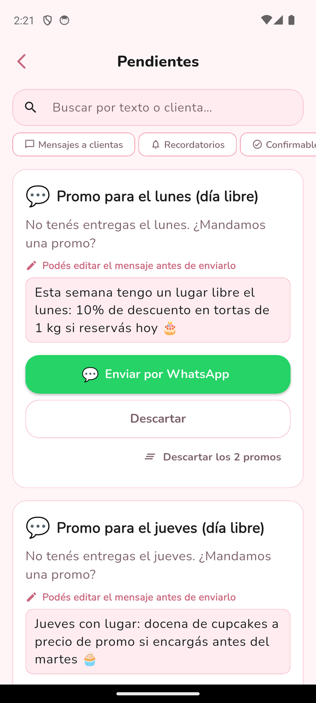
    <figcaption>Acá SousChef te deja las cosas listas para que vos las apruebes. Cuando hay varias del mismo tipo, abajo de la tarjeta aparece «Descartar los N…» para sacarlas todas de una.</figcaption>
  </figure>

**Pendientes** es donde SousChef te deja preparadas cosas para que vos las revises y confirmes. La regla de oro es simple:

> **SousChef propone, vos decidís.** Nada se envía ni se ejecuta sin que vos lo apruebes.

### Qué vas a encontrar acá

- **Mensajes ya escritos, listos para enviar.** Por ejemplo, un seguimiento a una clienta que pidió presupuesto y no volvió a responder. El mensaje ya está redactado con tu estilo; vos lo leés, lo editás si querés, y tocás **Enviar por WhatsApp** o **Descartar**.
- **Acciones preparadas.** Por ejemplo, reprogramar un pedido a otra fecha, o aplicar nuevos precios. Vos tocás **✅ Confirmar** (o **✅ Aplicar**) o **Descartar**.
- **Recordatorios:** el cumpleaños de una clienta, o algo que pospusiste. Los resolvés con **Hecho** o los dejás para mañana con **Posponer**.

**Los agradecimientos, las promos y los avisos de saldo solo aparecen si los prendés.** De fábrica vienen apagados, para que Pendientes no se te llene de tarjetas que no pediste. Si los querés, están en **Configuración → Asistente proactivo**:

- **Agradecer después de entregar:** al marcar un pedido entregado te deja un gracias listo para mandar, pidiendo una foto o una reseña.
- **Promos para días libres:** los lunes, si te queda un día sin pedidos en la semana, te deja una promo armada.
- **Avisar el saldo a la clienta:** el día de la entrega te deja un mensaje listo para recordarle lo que falta pagar. Lo mandás vos.

### Cómo lo usás

1. Entrá a **Pendientes** desde **Gestión → Tu asistente → Pendientes**, desde la campanita 🔔 del asistente, o tocando el aviso que te llegó al celular.
2. Leé cada tarjeta con calma. Arriba tenés un buscador (*Buscar por texto o clienta…*) y los filtros **Mensajes a clientas**, **Recordatorios** y **Confirmables**.
3. Si es un mensaje: revisalo, editalo si querés cambiar algo, y **Enviá** o **Descartá**.
4. Si es una acción: tocá **Confirmar** para que se haga, o descartala.
5. Si es un recordatorio y no lo querés resolver ahora, **Posponer** te lo vuelve a mostrar al día siguiente.

### Descartar varias de una

Si tenés varias tarjetas del mismo tipo, abajo de cada una aparece un botón como **Descartar los 5 agradecimientos** (o *los 3 seguimientos*, *los 2 avisos de cobro*…). Te pregunta antes —*"Desaparecen de Pendientes. Los pedidos no se tocan."*— y las saca todas juntas.

### Lo viejo se va solo

No hace falta que limpies: los pendientes **vencen solos** cuando ya no tienen sentido. Un agradecimiento, a la semana; una promo, a los diez días; el seguimiento de un presupuesto, cuando el pedido se confirma, se cancela o se le pasa la fecha; un recordatorio de cobro, cuando la clienta ya pagó. Lo demás, al mes sin tocarlo.

---

## 9. Tus pedidos y su detalle

  <figure>
    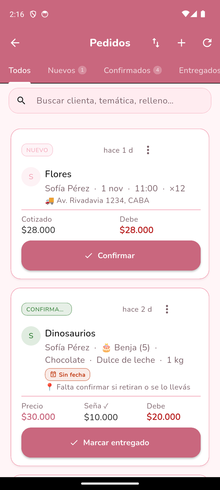
    <figcaption>La lista de pedidos con la tarjeta de siempre: estado, clienta, fecha y hora, relleno y kilos, la fila Precio / Seña / Debe y el botón grande Confirmar o Marcar entregado.</figcaption>
  </figure>
  <figure>
    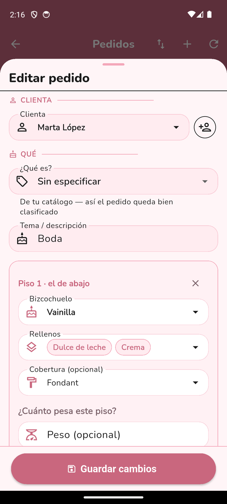
    <figcaption>Anotar un pedido (acá, editando uno ya cargado: el formulario es el mismo): arriba, la clienta y qué es: el tema y, piso por piso, el bizcochuelo, los rellenos y la cobertura.</figcaption>
  </figure>
  <figure>
    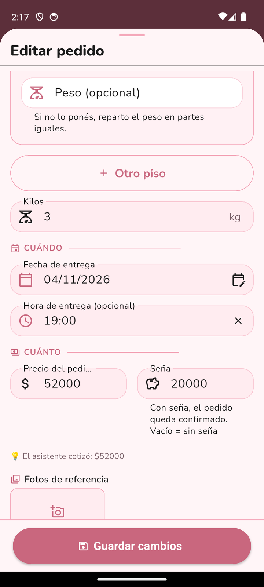
    <figcaption>Enseguida, «Otro piso» y los kilos, y después cuándo y cuánto: la fecha y la hora de entrega, el precio y la seña, y las fotos de referencia.</figcaption>
  </figure>
  <figure>
    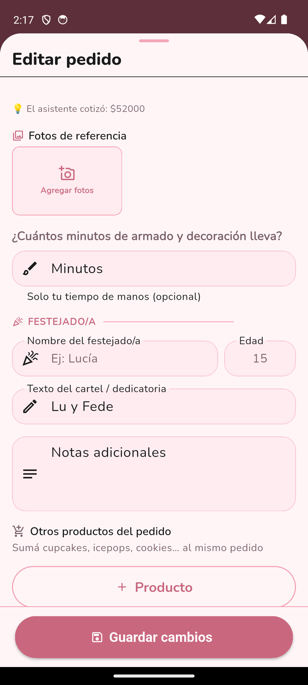
    <figcaption>Más abajo, lo que se completa después: los minutos de armado, el festejado, el cartel, las notas y los otros productos del pedido.</figcaption>
  </figure>
  <figure>
    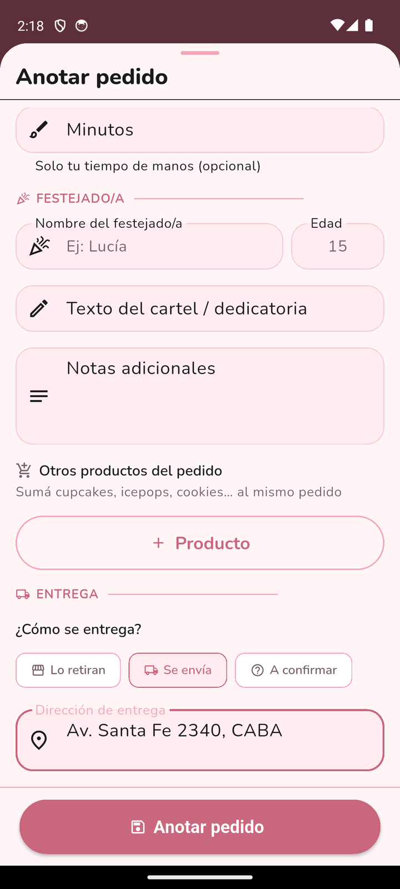
    <figcaption>El final del formulario: cómo se entrega (Lo retiran / Se envía / A confirmar) y el botón Anotar pedido.</figcaption>
  </figure>

Acá tenés **todos tus pedidos ordenados**, con pestañas para verlos por estado.

### Para hoy: tu día en una sola pantalla

  <figure>
    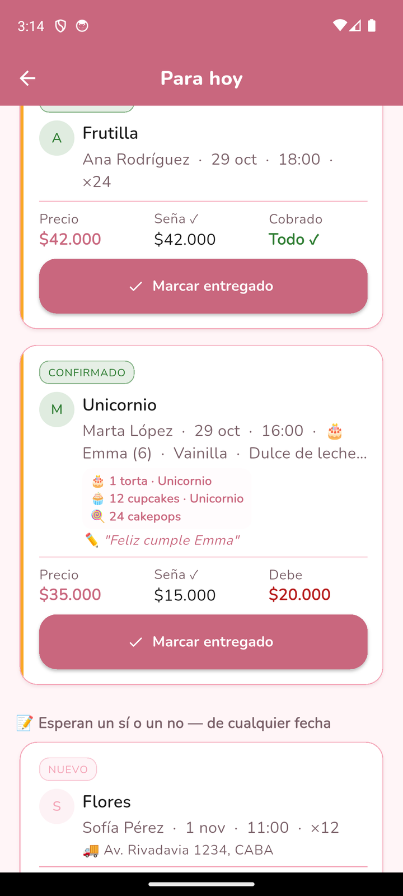
    <figcaption>Para hoy como pantalla propia: cada grupo con sus pedidos y el botón que corresponde (acá, 🚚 Entregás hoy con Marcar entregado y 📝 Esperan un sí o un no). En la tarjeta ves la cantidad (×24, ×12), lo que debe, la dirección si se envía y, si el pedido lleva más de una cosa, la lista con la cantidad de cada una.</figcaption>
  </figure>

**Para hoy** junta los pedidos que necesitan que hagas algo **ahora**, con un botón para cada caso. Lo ves **arriba de todo en el Inicio** (hasta cinco por grupo) y también como **pantalla propia**, que se abre con **Ver todo ›**, con el número **Pedidos hoy** del Inicio o desde **Gestión → Tu negocio → Para hoy**. Te ordena lo que importa en **cuatro grupos**:

- 🔴 **Vencidos — marcá si ya entregaste:** entregas que quedaron atrás sin marcar. Casi siempre ya las entregaste y te faltó el toque: **Marcar entregado** y listo.
- 🚚 **Entregás hoy:** las entregas de la jornada, cada una con su **Marcar entregado**.
- 📝 **Esperan un sí o un no — de cualquier fecha:** los presupuestos sin respuesta, para que ningún "¿te confirmo mañana?" quede en el olvido. Cada uno tiene **Confirmar** y **Canceló** (antes de cancelar te pregunta).
- 📅 **Sin fecha de entrega — ponele una:** pedidos confirmados que llegaron sin fecha (los del asistente o los viejos). Sin fecha no aparecen en la Agenda ni en los días de Producción (ahí solo te avisa cuántos hay), así que **Ponerle fecha** te abre el formulario para cargarla.

Las tarjetas son **las mismas de Pedidos y de la Agenda** (te las cuento más abajo), pero sin el menú ⋮: acá cada una trae solo el botón que corresponde. Tocás una y se abre la **ficha** del pedido (en *Sin fecha*, el formulario, para que cargues la fecha).

**En la tablet acostada** (salvo las más chicas, de 8") la pantalla Para hoy se ve partida: la lista a la izquierda y, a la derecha, la ficha del pedido que tocaste, que queda marcado en la lista (también los de *Sin fecha*: la fecha se la ponés con su botón **Ponerle fecha**). Para cambiar algo del pedido, el lápiz de arriba de la ficha (**Editar pedido**) abre el formulario. Con la tablet parada y en el teléfono, todo como siempre.

  <figure>
    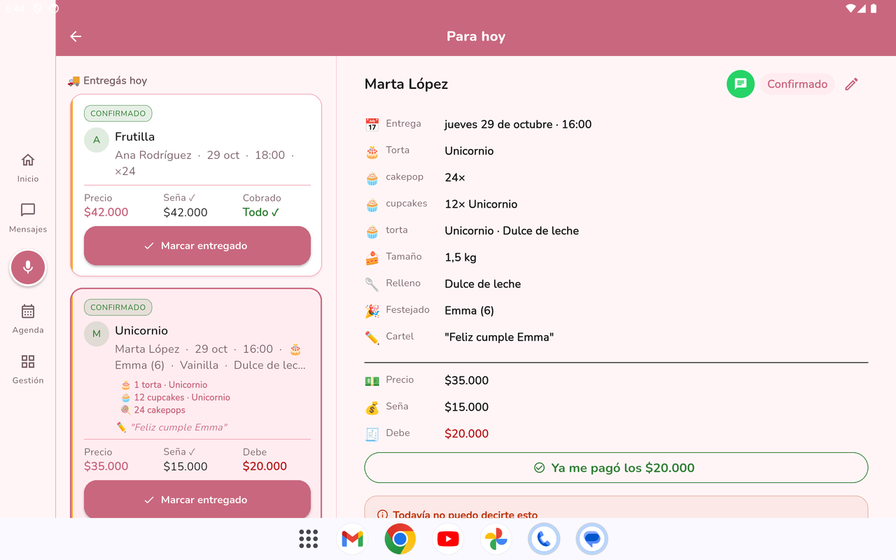
    <figcaption>Para hoy partida: la lista a la izquierda, con la torta y lo que lleva (1 torta · 12 cupcakes · 24 cakepops), y a la derecha la ficha del pedido que tocaste.</figcaption>
  </figure>

En la pantalla propia, cuando tenés **cinco o más** pedidos esperando, arriba aparece el buscador (*Buscar clienta o temática…*) y el orden por **Fecha** o **Clienta**. Cuando no queda nada, te dice **¡Estás al día! 🎉**

### Cómo llegás a todos tus pedidos

Tenés la pantalla de "todos los pedidos" siempre a mano:

- Desde el **Inicio**: con el número **Pedidos abiertos**, con **Pedidos** en las acciones rápidas, o con **Pedidos** en Mis herramientas.
- Desde **Gestión**, en la sección **Tu negocio**, tocando **Pedidos**.
- Desde la **Agenda**, con el botón **Ver todos**.

### Las pestañas

Un pedido tiene **cuatro estados** —Nuevo, Confirmado, Entregado y Cancelado— y las pestañas te los muestran:

- **Todos**
- **Nuevos** (presupuestos: falta el sí de la clienta)
- **Confirmados**
- **Entregados**
- **Cancelados**

Cada pestaña te cuenta sola cuántos pedidos hay. Y arriba tenés el **buscador** (por clienta, temática, festejado, relleno o dirección) y el ícono **⇅** para ordenar por fecha de entrega, más nuevos, precio o clienta ([sección 7](#7-buscar-y-ordenar-en-cualquier-lista)).

**En la tablet acostada** (salvo las más chicas, de 8") Pedidos se ve partida: a la izquierda la lista de siempre, con el buscador, y a la derecha la **ficha** del pedido que tocás, que queda marcado en la lista. Para editarlo, el lápiz de arriba de la ficha (**Editar pedido**) abre el formulario de siempre. Si el pedido sale de la lista que estás viendo (otra pestaña, la búsqueda, lo borraste), la ficha se cierra sola. Con la tablet parada y en el teléfono, tocar un pedido abre el formulario, como siempre.

  <figure>
    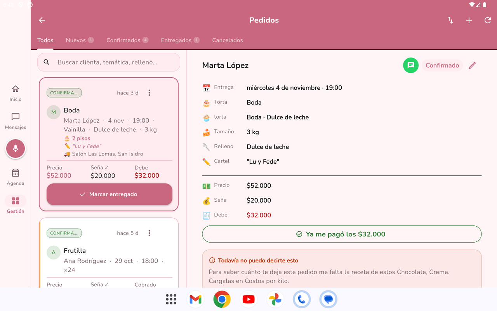
    <figcaption>Pedidos partida: a la izquierda la lista con el buscador y las pestañas, con el pedido tocado marcado; a la derecha su ficha (entrega, torta, tamaño, relleno, cartel, la plata y el botón «Ya me pagó»), con el lápiz arriba para editarlo.</figcaption>
  </figure>

### Cómo se ve cada pedido: la misma tarjeta en todos lados

Un pedido se ve con **la misma tarjeta** en Pedidos, en la Agenda y en Para hoy, así lo reconocés al toque esté donde esté:

- Arriba, el **estado**: NUEVO, CONFIRMADO, ENTREGADO o CANCELADO, y el menú de los **tres puntos ⋮** para cambiarlo (en Pedidos y en la Agenda). En Pedidos, también hace cuánto entró.
- La **temática** y, debajo, la **clienta**, la **fecha y la hora** de entrega, el **festejado** con su edad, la cantidad (×2, ×3…), el **bizcochuelo**, el **relleno** y los **kilos**.
- Si es de varios pisos, *"🎂 3 pisos"* (y cuántos son falsos); si el pedido lleva **más de una cosa**, la lista completa con la **cantidad de cada una** (*"🎂 1 torta · Unicornio"*, *"🧁 12 cupcakes · Flores"*, *"🍭 24 cakepops"*); el texto del **cartel**; y si se envía, la **dirección** con el camioncito 🚚 (o *"🚚 Se lo llevás — falta la dirección"*). Si todavía no se sabe, *"📍 Falta confirmar si retiran o se lo llevás"*.
- Si un pedido abierto todavía no tiene fecha, un cartelito ámbar **Sin fecha**.
- La plata en una fila: **Precio** (o **Cotizado**, si todavía no hay uno acordado), la **Seña** que dejó (o *No dejó*) y lo que **Debe**, en rojo —o **Cobrado: Todo ✓**—. Un pedido abierto que todavía no tiene precio dice **Sin precio**, en ámbar: es lo primero que tenés que resolver.
- Un botón grande para el paso que sigue: **Confirmar** en los nuevos y **Marcar entregado** en los confirmados.
- Si ya lo entregaste y te quedó debiendo, en Pedidos y en la Agenda aparece **Me pagó los $…**: lo tocás cuando te transfiere y el pedido queda saldado.

La tarjeta **no tiene tacho**: para borrar un pedido lo abrís y bajás hasta el final del formulario (te lo cuento más abajo, en *El botón "Eliminar pedido"*).

El **borde de color** de la izquierda te avisa la urgencia:
- **Rojo:** el pedido está vencido (la fecha pasó y no lo marcaste entregado).
- **Ámbar:** es para hoy o mañana.
- **Sin color:** todo tranquilo.

### La ficha del pedido

Desde **Para hoy** y desde **Producción**, tocar un pedido abre su **ficha**: todo el pedido de un vistazo y sin riesgo de cambiar nada sin querer —la entrega, la torta, los productos, el tamaño, el relleno, el festejado, el cartel, las notas, el precio, la seña y lo que debe—, con un botón **Ya me pagó los $…** si queda saldo. Al lado del nombre de la clienta, el botoncito verde abre WhatsApp con ella (si tiene su número cargado). Si el pedido tiene precio, también ves **Lo que te queda**: el precio menos los ingredientes, el armado y tu mano de obra; si falta una receta o el precio de algún ingrediente, en vez del número te dice qué falta. Al pie están **todas las fotos de referencia**: la portada grande y las demás en una tira de miniaturas; tocás cualquiera y se ve en grande. En la tablet acostada (salvo las más chicas, de 8"), Para hoy y Pedidos la muestran al costado de la lista, sin hoja: el lápiz de arriba (**Editar pedido**) abre el formulario y, si la ficha no pudo cargar el pedido (por la señal), **Reintentar** lo vuelve a buscar; en Producción se sigue abriendo desde abajo. (En el teléfono y con la tablet parada, desde Pedidos tocar un pedido abre directamente el formulario para editarlo; desde la Agenda, siempre.)

### Compartir una foto desde WhatsApp (Android)

  <figure>
    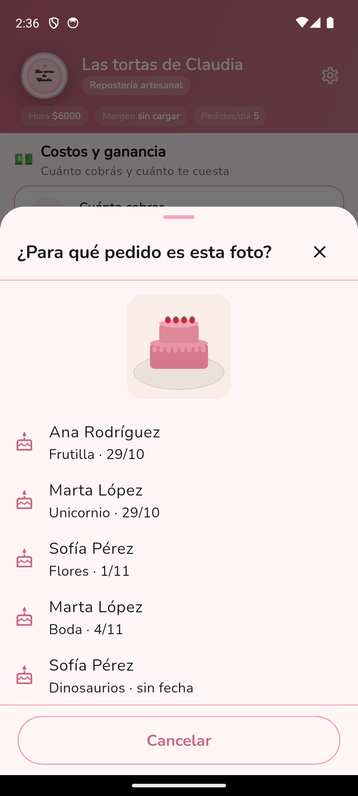
    <figcaption>La hoja que abre SousChef cuando compartís una foto desde WhatsApp: «¿Para qué pedido es esta foto?», con la miniatura y la lista de tus pedidos abiertos; tocás uno y la foto queda como referencia de ese pedido.</figcaption>
  </figure>

¿La clienta te mandó por WhatsApp la foto de la torta que quiere? No hace falta guardarla y buscarla después:

1. En WhatsApp, mantené apretada la foto y tocá **Compartir**.
2. Elegí **SousChef** en la lista de apps.
3. Se abre SousChef con la pregunta **¿Para qué pedido es esta foto?** y la lista de tus pedidos abiertos. Tocás el de esa clienta.
4. Listo: *"Foto guardada en el pedido de…"*. La vas a ver en la ficha y en el formulario del pedido.

Si el pedido de esa clienta todavía no está, cerrá con **Cancelar**, anotalo y volvé a compartir la foto (y si no tenés ningún pedido abierto, la app misma te lo dice). Cada pedido guarda hasta **10 fotos**. Por ahora esto anda solo en Android.

### Cargar un pedido: el formulario se adapta a lo que vendés

El formulario sigue el orden de la charla con la clienta: **Clienta → Qué → Cuándo → Cuánto → Fotos**, y después lo que se completa más tarde (minutos de armado, festejado, cartel, notas, otros productos y cómo se entrega). Así lo que se pacta primero queda arriba, a la vista.

Arriba de todo elegís la **clienta**. Tocás el campo y se abre una ventanita con un **buscador**: escribís las primeras letras del nombre y la encontrás al toque, tengas 5 clientas o 200. También podés dejar el pedido **Sin clienta asignada**, o crear una nueva con el botoncito de al lado.

Después viene el selector **"¿Qué es?"**: elegís el producto de **tu catálogo** (la torta, la docena de cupcakes, la caja de alfajores…). Y según lo que elijas, **el formulario cambia solo** para pedirte únicamente lo que hace falta:

**Si es algo que se vende por cantidad (docenas, cajas, boxes):**

Aparece solamente **"¿Cuántas?"**, con botones **−** y **+** para ajustar el número. Eso, más la fecha, la entrega y los precios. **Dos datos y listo** — nada de porciones ni rellenos para una caja de alfajores.

**Si es una torta (se vende por tamaño):**

Aparece el **bloque de la torta**, que se arma piso por piso:

- Cada **piso** es una tarjetita rosada. Con un solo piso ni te enterás (la palabra "piso" no aparece); si la torta lleva más, tocás **"Otro piso"** y agregás hasta **6**.
- El piso tiene **dos campitos iguales**: **Bizcochuelo** y **Rellenos**. Tocás cualquiera de los dos y se abre una ventanita baja con las opciones para tocar.
- En **Bizcochuelo** están **Chocolate**, **Vainilla**, los sabores que **ya usaste antes** (la app se los acuerda), **Falso**, y la ficha **"Otro…"** para los que salen poco (marmolado, red velvet…). Tocás uno y la ventanita se cierra sola.
- En **Rellenos** aparecen los tuyos como fichas: tocás los que lleva (hasta **3 por piso**) y **Listo**. Nada de tipear "ddl con nuez" de memoria: tocás y queda.
- Si improvisaste uno que no está en tu lista, tocás la ficha **"Otro…"** y lo escribís. Es una ficha más, al lado de los otros.
- **"Otro…"** abre otra ventanita igual, desde abajo, con el campo listo para escribir y **Cancelar / Agregar**. Todas las ventanitas del pedido se ven iguales y ninguna te tapa la pantalla: si tenés muchos rellenos, la lista scrollea adentro de la ventanita.
- Abajo de los rellenos está la **Cobertura (opcional)** y, si la torta tiene varios pisos, **¿Cuánto pesa este piso?** (si no lo ponés, el peso se reparte en partes iguales). Las dos se pueden dejar vacías.
- En **Cobertura** elegís con qué va cubierto ese piso: **Sin cobertura**, las que ya cargaste en **Costos por kilo** y, de arranque, **Buttercream**, **Fondant** y **Ganache**. Una de las de arranque se puede elegir aunque todavía no tenga receta, pero hasta que cargues qué lleva un kilo no cuenta en lo que te deja el pedido: la ficha te avisa que le falta.

**¿Qué es el piso "falso"?** En criollo: es un piso **de mentira, solo decorativo** — el clásico piso de telgopor forrado que se pone para que la torta se vea más alta e imponente. Como no lleva torta de verdad: **no gasta insumos, no suma porciones y no te pide rellenos**. Por eso "Falso" es una opción más del bizcochuelo: lo elegís y ese piso queda marcado como decorativo, listo.

Todo esto queda guardado **bien estructurado** (piso por piso), y el resumen se ve clarito en la tarjeta del pedido y en tu producción.

### La entrega: ¿lo retiran o se lo llevás?

Cada pedido tiene sus chips de **entrega**: **Lo retiran** / **Se envía** / **A confirmar**.

- Si elegís **"Se envía"**, aparece el campo de la **dirección de entrega**. Esa dirección después se ve en la tarjeta del pedido (🚚) y hasta podés **buscar pedidos por dirección**.
- Si la clienta le dijo la dirección al asistente por chat, **ya viene anotada** — no la tenés que copiar de la conversación.

### Cuándo, cuánto y las fotos

- **Cuándo:** la **Fecha de entrega** y la **Hora de entrega (opcional)**. La fecha es obligatoria para anotar un pedido nuevo: si te la olvidás, el formulario te lleva hasta el campo y te pide *"Elegí la fecha de entrega"*. Un pedido sin fecha no aparece en la Agenda ni en los días de Producción; en Para hoy lo ves en el grupo **Sin fecha de entrega — ponele una** (o en **Esperan un sí o un no**, si todavía no lo confirmaste), para que no se pierda. (Los viejos que quedaron sin fecha se ven con el cartelito **Sin fecha**.)
- **Cuánto:** el **Precio del pedido** y la **Seña**. Si cargás seña, el pedido queda **confirmado** solo; vacío, queda como nuevo hasta que lo confirmes. Si lo que cargaste es un **combo**, su precio se propone solo: lo dejás o lo pisás. Si el asistente ya había cotizado, abajo te lo recuerda (*"💡 El asistente cotizó: $…"*).
- **Fotos de referencia:** hasta **10** por pedido. La primera es la portada (la que se ve grande en la ficha del pedido); tocás una para verla grande y la ✕ la saca.

Al anotar un pedido **no hay que elegir el estado**: nace como nuevo (o confirmado, si tiene seña). El desplegable **Estado** aparece recién cuando lo editás, junto con el **historial de cambios** (qué se modificó y cuándo).

### El detalle del pedido (lo demás)

Más abajo completás lo que no hace falta pactar en el momento:

- Los **minutos de armado y decoración** (solo tu tiempo de manos; es opcional).
- El **festejado/a**, su **edad** y el **texto del cartel / dedicatoria**, más **notas adicionales** (alergias, colores especiales…).
- **Otros productos del pedido** (te lo cuento acá abajo).
- **¿Cómo se entrega?** (lo viste arriba).

### Un pedido puede tener varios productos

A veces una clienta no te pide solo una torta: te pide **una torta + 12 cupcakes + 24 ice pops** y algún adicional, todo para el mismo día. Podés cargar todo eso dentro del mismo pedido.

En el formulario, más abajo, vas a ver la sección **"Otros productos del pedido"**. Ahí sumás cada producto extra:

- Elegís **qué es** (las categorías salen de **tu** catálogo) o directamente un producto tuyo.
- Le ponés la **cantidad**, y si querés la **temática** y el **relleno**.
- Repetís para cada producto que lleve el pedido.

Así el pedido queda completo de verdad: en la tarjeta del pedido (en Pedidos, en la Agenda y en Para hoy) ves **la lista entera con la cantidad de cada cosa** —*"🎂 1 torta · Unicornio"*, *"🧁 12 cupcakes"*, *"🍧 24 paletas"*—, y después esos cupcakes y esos ice pops también aparecen en tu **producción** y en la **lista de compras**, no solo la torta principal.

### El botón "Eliminar pedido"

Las tarjetas no tienen tacho. Si necesitás borrar un pedido, lo abrís desde Pedidos o la Agenda y el botón **"Eliminar pedido"** está **abajo de todo**, grande y bien separado del botón **Guardar cambios**. Así no lo tocás sin querer: para borrar tenés que bajar a propósito hasta el final del formulario.

### Los estados de un pedido (el camino que recorre)

Un pedido pasa por **cuatro estados**, así de simple:

1. **Nuevo** → un presupuesto: el asistente está juntando los datos, o ya le pasaste un precio a la clienta y falta el sí.
2. **Confirmado** → la clienta dijo que sí (o dejó seña).
3. **Entregado** → se lo diste a la clienta. ✅

(O **Cancelado**, si no se concretó.)

**Al entregar, te pregunta por la plata.** Cuando tocás **Marcar entregado** en un pedido con precio, aparece *"Entregado ✓"* con la cuenta hecha (el pedido, lo que dejó de seña y lo que le cobrás hoy) y la pregunta *"¿[Clienta] te pagó todo?"*:

- **Sí, me pagó $…** → queda todo cobrado y los avisos de cobranza de ese pedido se apagan solos.
- **Me quedó debiendo** → escribís cuánto, y lo vas a ver en el pedido y en Saldos hasta que te pague (ahí lo saldás con **Me pagó**).

Si cerrás la pregunta sin elegir, el pedido queda como cobrado, que es lo que pasa casi siempre.

Podés avanzar el estado con el botón grande de la tarjeta, o con el menú de los **tres puntos ⋮** en Pedidos y en la Agenda, sin tener que abrir el detalle. Cuando marcás un pedido como **Confirmado**, SousChef te reserva el cupo de producción de ese día y te avisa si el día quedó muy cargado.

---

## 10. La agenda / calendario

  <figure>
    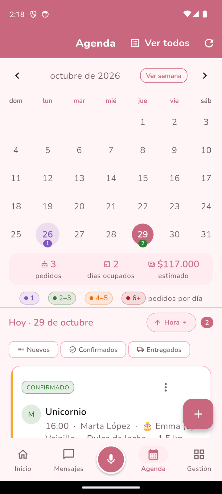
    <figcaption>El calendario del mes: cada día con entregas muestra cuántos pedidos hay, con el color según qué tan cargado está. Abajo, la barra con sus cinco lugares.</figcaption>
  </figure>
  <figure>
    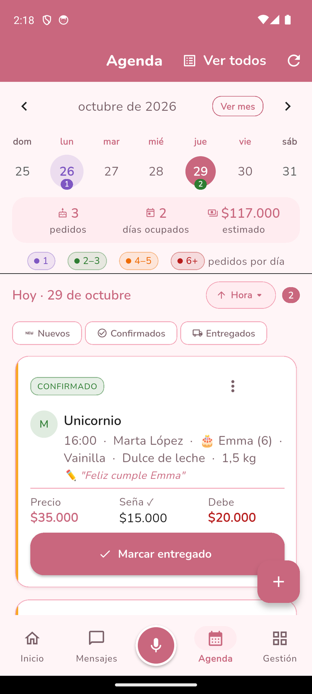
    <figcaption>Abajo del calendario, los pedidos del día que tocaste, con la misma tarjeta de Pedidos (la hora primero).</figcaption>
  </figure>

El calendario te muestra **cuándo tenés entregas** y qué tan cargado está cada día.

- Podés verlo por **semana** o por **mes**. **En la tablet acostada** (salvo las más chicas, de 8") la Agenda se ve partida: a la izquierda el mes entero, con su resumen y los colores de cada día, y a la derecha los pedidos del día que tocaste, así ves las dos cosas a la vez; tocar un pedido lo abre para editarlo, como siempre. En una de 8" acostada el mes entero no entra: ahí se ve sólo la semana, y al pararla vuelve el botón para ver el mes.
- Cada día con entregas se pinta según **cuántos pedidos tiene**: lila (tranquilo), verde, ámbar (cargado) y rojo (te pasaste de tu máximo). Abajo del calendario, la leyenda *pedidos por día* te dice cuántos son cada color. En la lista del día, el estado de cada pedido va con su color: NUEVO con el de tu paleta, CONFIRMADO en verde y ENTREGADO en gris.
- Los colores de **carga** de cada día (qué tan lleno está) son **proporcionales a TU máximo de pedidos por día**, el que configuraste en Configuración. Si tu máximo son 6, un día con 6 se ve completo; si tu máximo son 2, con 2 ya está al tope. La agenda se adapta a tu ritmo, no al de otra.
- Debajo de cada día con entregas ves **el número de pedidos** (un día con ocho dice 8).
- Si tocás un día, ves **los pedidos de ese día** con **la misma tarjeta de Pedidos** ([sección 9](#9-tus-pedidos-y-su-detalle)): como el día ya está elegido, en vez de la fecha arranca por la **hora**. Tiene el mismo botón **Confirmar** o **Marcar entregado**, y **Me pagó los $…** si te quedaron debiendo. Arriba, los **filtros por estado** (**Nuevos**, **Confirmados**, **Entregados**) para quedarte solo con lo que te interesa, y el orden: **Hora**, **Estado**, **Monto** o **Clienta**.
- Con el botón **"Ver todos"** saltás a la lista completa de pedidos.

  <figure>
    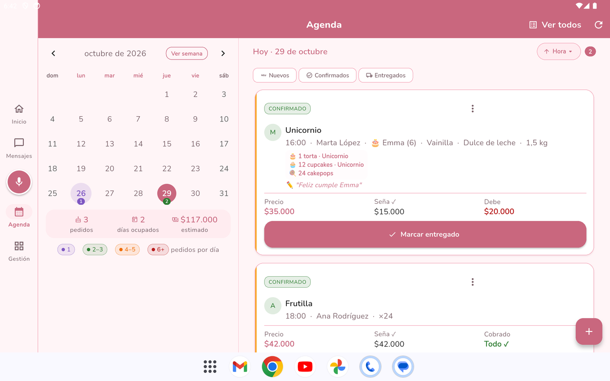
    <figcaption>La Agenda partida: a la izquierda el mes entero con su resumen y los colores de cada día; a la derecha los pedidos del día que tocaste, con la misma tarjeta de siempre.</figcaption>
  </figure>

Sirve para ver de un pantallazo tu semana sin abrir pedido por pedido.

---

## 11. Producción: qué hacer mañana, esta semana y este mes

  <figure>
    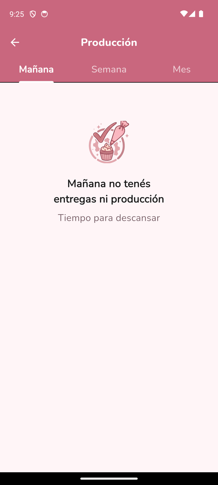
    <figcaption>Cuando no tenés nada para mañana, SousChef te lo dice con todas las letras.</figcaption>
  </figure>
  <figure>
    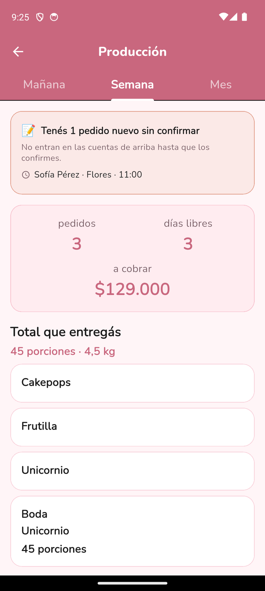
    <figcaption>El plan de la semana: cuántos pedidos, cuántos días libres y cuánta plata hay a cobrar.</figcaption>
  </figure>

*(Se abre desde el Inicio —la tarjeta **Mañana**, la tarjeta **Producción** ("Planificá tu semana y tu mes") o **Producción** en Mis herramientas— o desde **Gestión → Tu negocio → Producción**.)*

Es una pantalla completa para planear tu trabajo, con **tres pestañas**: **Mañana**, **Semana** y **Mes**. Es tu tablero para saber qué te espera y no llevarte sorpresas.

### Las tres pestañas

- **Mañana:** las entregas de mañana y todo lo que tenés que producir para ese día.
- **Semana:** los próximos días de un tirón, para organizar la semana completa.
- **Mes:** el mes entero, pero **ordenado semana por semana** (no 31 tarjetas sueltas), así lo leés cómodo y ves cómo se reparte el trabajo.

### Qué te muestra cada pestaña

- **Alertas primero (lo que necesita tu atención):**
  - Un **día muy cargado**, que se pasó de lo que podés producir.
  - Pedidos **sin precio** todavía.
  - Pedidos **confirmados que no tienen fecha de entrega**, para que les pongas fecha.
- **Los pedidos nuevos que todavía no confirmaste** van aparte: *"Tenés 2 pedidos nuevos sin confirmar"*. No entran en las cuentas hasta que los confirmes.
- **Un resumen general:** cuántos pedidos hay, cuántas porciones (o kilos), cuánto tenés para cobrar y cuántos días libres te quedan.
- **Total que entregás**: el resumen de lo que hay que hacer, por tipo de producto y bien clarito, por ejemplo: *"🧁 12 cupcakes · 🎂 2 tortas"*. Incluye **todos los productos** del pedido (los cupcakes, los ice pops, no solo la torta principal). Los **pisos falsos no suman**: son decorativos, no se hornean.
- **El día más cargado** del período, para que lo tengas presente.
- **El detalle día por día** (en el mes, **Semana por semana**): en cada día, lo que **Preparás** (lo que se hornea antes) y lo que **Decorás y entregás**. Un día sin nada dice **Día libre**.

Es la mejor forma de arrancar la semana sabiendo exactamente qué te espera, y de no quedarte sin tiempo un día que se te llenó de pedidos.

---

## 12. Tus clientas

  <figure>
    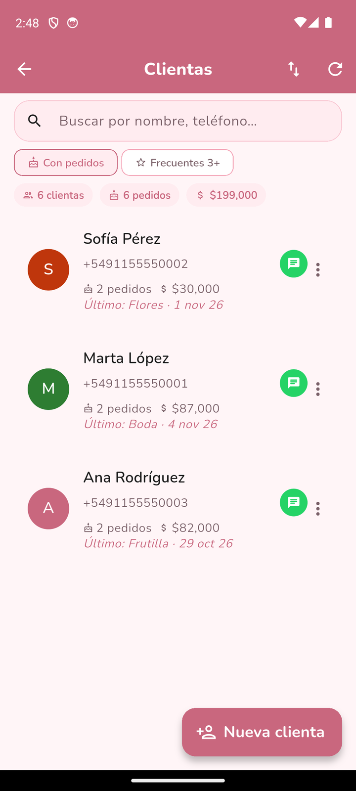
    <figcaption>Tu agenda de clientas (la pantalla ahora se llama «Clientas»), con el buscador y los chips "Con pedidos" y "Frecuentes 3+" (acá, con "Con pedidos" activo).</figcaption>
  </figure>
  <figure>
    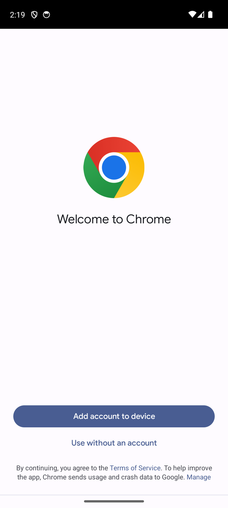
    <figcaption>Arriba de la lista de Clientas, los totales de tu negocio: cuántas clientas, cuántos pedidos y cuánta plata.</figcaption>
  </figure>
  <figure>
    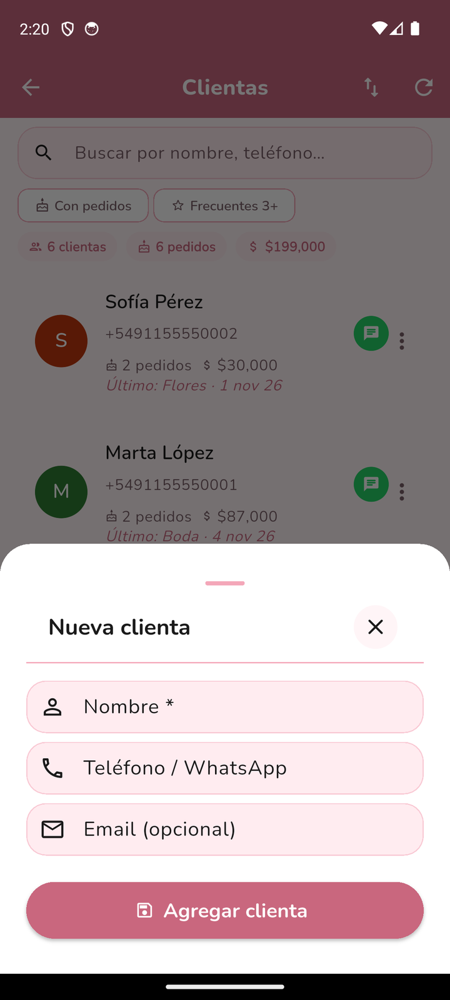
    <figcaption>Dar de alta una clienta es escribir el nombre —lo único obligatorio—, el WhatsApp y, si querés, el email; después tocás «Agregar clienta».</figcaption>
  </figure>

*(Gestión → Tu negocio → Clientas, o **Clientas** en Mis herramientas del Inicio)*

Es tu **agenda de clientas**. De cada una guardás:

- Nombre y teléfono de WhatsApp.
- Historial de pedidos (los últimos, cuánto gastó en total, en qué estado están).
- Desde cuándo es clienta y su primer pedido.

Tenés un **buscador** para encontrar a cualquiera al instante, el ícono **⇅** para ordenar la lista, y dos chips muy útiles: **"Con pedidos"** (las que alguna vez te compraron) y **"Frecuentes 3+"** (las que ya te hicieron tres pedidos o más — tus mejores clientas, para mimarlas). Al lado de su nombre, el botoncito verde abre WhatsApp con ella. También podés editar o borrar sus datos (una clienta con pedidos cargados no se puede borrar: primero borrá sus pedidos o pasáselos a otra). Así nunca te olvidás de una clienta ni de lo que le gusta pedir.

**Una clienta, una sola ficha.** Si cargás una clienta con un teléfono que ya tenés anotado, la app te avisa en vez de crearla de nuevo, aunque el número esté escrito distinto (con o sin el 15, el 0 o el +54 9). En Clientas aparece *«Ya tenés a Lucía con ese teléfono»* debajo del número. Si la cargás con **Nueva clienta** desde un pedido, aparece *«Ya la tenías: Lucía»* y el botón cambia a **Elegir a Lucía**, así el pedido queda en su ficha de siempre. Cuando una clienta que ya tenés anotada te escribe por WhatsApp, el asistente también la reconoce por el número. Las fichas repetidas que ya tenías se juntaron en una sola, con todos sus pedidos. Si de verdad es otra persona con el mismo número (por ejemplo, mamá e hija), cargala sin teléfono.

**En la tablet acostada** (salvo las más chicas, de 8") Clientas se ve partida: a la izquierda la lista, con el buscador y los chips, y a la derecha la **ficha** de la clienta que tocás, que queda marcada en la lista; con el lápiz y el tacho de arriba de la ficha la editás o la borrás. Ahí el botón **Nueva clienta** va abajo de la lista. Con la tablet parada y en el teléfono, tocarla abre la ficha desde abajo, como siempre.

---

## 13. Cuánto cobrar y precios atrasados

  <figure>
    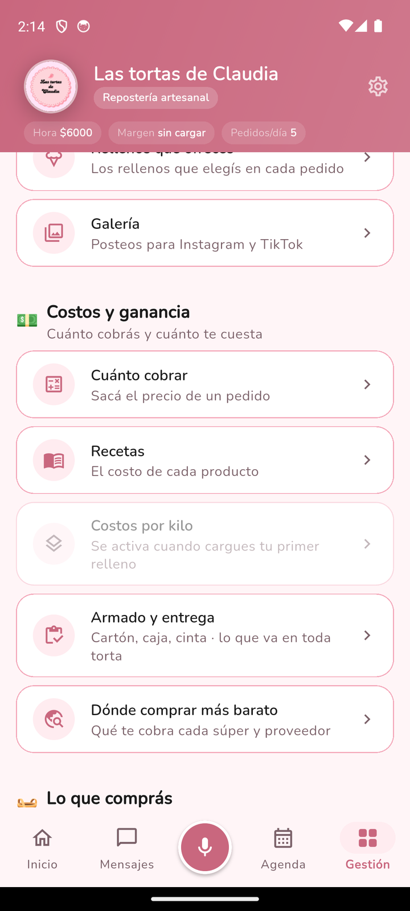
    <figcaption>En Gestión, «Costos y ganancia» junta las herramientas de plata: Cuánto cobrar, Recetas, Costos por kilo, Armado y entrega y Dónde comprar más barato. Costos por kilo se ve atenuado hasta que cargues tu primer relleno.</figcaption>
  </figure>
  <figure>
    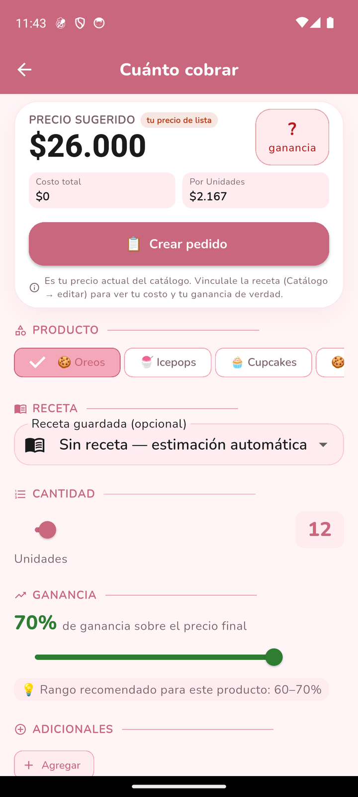
    <figcaption>Cuánto cobrar: elegís el producto, la cantidad (porciones o unidades) y la ganancia, y te devuelve el precio sugerido con el costo detallado.</figcaption>
  </figure>
  <figure>
    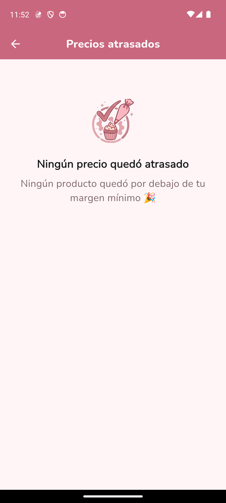
    <figcaption>Precios atrasados cuando ningún producto quedó por debajo de tu margen mínimo.</figcaption>
  </figure>

### Cuánto cobrar

Desde **Gestión → Costos y ganancia** (o desde las acciones rápidas del Inicio) entrás a **Cuánto cobrar**. Sirve para poner precio en 10 segundos:

1. Elegí el producto: la calculadora usa **los productos y precios de TU catálogo** (no una lista fija), así que lo que ves es lo tuyo.
2. Poné la cantidad (porciones, kilos o docenas, según cómo se venda el producto).
3. SousChef te muestra el **costo base + el costo de tu trabajo + tu margen = precio final**.
4. Sumá adicionales si corresponde: **Velas**, **Topper**, **Packaging**, **Moño**, **Flores** (y los tuyos, con **Nuevo adicional**). Cada uno suma al precio.

La calculadora ya tiene en cuenta cuánto cobrás por hora y tu margen, así que el precio te sale justo, sin que trabajes gratis.

**¿De dónde sale el costo?** Depende del producto que elijas:

- Si el producto tiene su **receta enganchada** ([sección 4](#4-lo-que-vendés-tu-catálogo-y-tus-combos)), el **costo real** aparece solo, calculado con tus ingredientes.
- Si **no tiene receta**, la calculadora te muestra **tu precio de lista**, con su cartelito ("tu precio de lista") y la ganancia en **"?"** — porque sin receta no hay costo con qué comparar. Lo que **nunca** hace es multiplicar un precio como si fuera un costo: mejor un "?" honesto que un número inventado.

> **El cartelito del valor hora:** si todavía no cargaste TU valor de la hora de trabajo, la calculadora está usando el **valor de ejemplo ($800)** y te lo avisa con un cartel arriba de todo. Tocá el cartel y te lleva directo a **Configuración** para poner el tuyo. Hasta que no lo cargues, el costo de tu mano de obra es "de mentira" — vale la pena el minuto que lleva.

### Precios atrasados (cuando sube la inflación)

Cuando suben tus ingredientes, SousChef revisa los productos que tienen receta y, si alguno quedó por debajo de tu margen mínimo, te avisa: *"📈 Tenés precios atrasados"*. En **Precios atrasados** (Gestión → Tu asistente) ves cada producto con su margen, el precio de **Ahora**, el **Sugerido** y lo que te cuesta, y el botón **Aplicar $…** para cambiarlo. Nada cambia hasta que lo tocás.

---

## 14. Recetas, ingredientes y alacena

Todo esto está en **Gestión**, el último lugar de la barra de abajo. Arriba ves el nombre y el logo de tu negocio, tu hora, tu margen y tus pedidos por día (con la ruedita ⚙️ para ir a Configuración). Debajo, todo ordenado por lo que más usás:

- 🛍️ **Tu negocio** → Pedidos · Agenda · Clientas · Saldos · Para hoy · Producción · Lo que vendés (pestañas **Productos** | **Combos y promos**) · Rellenos que ofrecés · Galería
- 💵 **Costos y ganancia** → Cuánto cobrar · Recetas · Costos por kilo · Armado y entrega · Dónde comprar más barato
- 🧺 **Lo que comprás** → Mis ingredientes · Mi alacena · Comprar esta semana · Gastos
- 🔔 **Tu asistente** → Pendientes · Precios atrasados · Resumen del mes
- ⭐ **Tu plan** → SousChef Pro
- Y al pie, **Configuración** (*"Logo, colores, costos y agenda"*).

**Lo que todavía no puede usarse se ve atenuado**, con el motivo en lugar de la descripción, pero **igual abre** y la pantalla te explica qué cargar:

- **Costos por kilo:** *"Se activa cuando cargues tu primer relleno"*.
- **Armado y entrega:** *"Se activa cuando cargues tu primer ingrediente"*.
- **Comprar esta semana** y **Precios atrasados:** *"Se activa cuando cargues tu primer producto"*.

### Recetas

  <figure>
    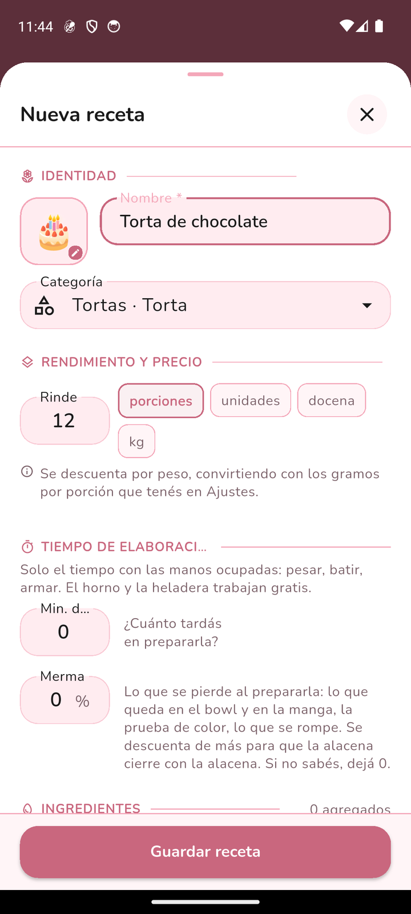
    <figcaption>Crear una receta: emoji y nombre, categoría, cuánto rinde y en qué se mide.</figcaption>
  </figure>
  <figure>
    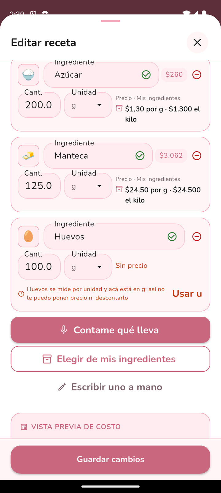
    <figcaption>La misma hoja, más abajo: los ingredientes con su precio sacado de Mis ingredientes, el botón «Contame qué lleva» y la vista previa de costo.</figcaption>
  </figure>

Cargá tus recetas con sus **ingredientes y cantidades**. SousChef te calcula solo el **costo total** y el **costo por porción**. Sin recetas cargadas, es difícil saber cuánto cobrar; con ellas, tenés el número exacto.

- Tocá **Nueva receta** para crear una.
- Elegí un emoji, ponele nombre y agregá los ingredientes con su cantidad y unidad: con **Contame qué lleva** (la dictás), **Elegir de mis ingredientes** o **Escribir uno a mano**.
- La **categoría** se elige con **un solo desplegable**: se abre una hoja con las **familias** como secciones (Tortas, Individuales, Postres, Horno y budines, Para eventos), una sección **"Tuyas"** con tus categorías propias, y una ficha **"➕ Crear otra"** que se convierte en un campito: escribís el nombre, Enter, y listo.
- Tocá una receta para editarla. En el listado, cada ingrediente aparece con **su emoji real**, y los precios se leen enteros, nunca partidos en dos renglones.
- Para **eliminar** una receta tenés su botón, que te pide confirmación en un recuadro antes de borrar nada.
- Si una receta es en realidad la de un relleno o un bizcochuelo, en su **⋯** está **Es un relleno o bizcochuelo — moverla**: la pasa a **Costos por kilo**.
- Con el buscador podés buscar **por nombre o por ingrediente** ("¿qué recetas llevan frutilla?"), ordenarlas por **nombre, costo o más nuevas** (⇅), y filtrarlas por **familia** — **Tortas · Individuales · Postres · Horno y budines · Para eventos**, más **Otro** para lo que no encaja — o con **Sin costo**, que te muestra las que todavía no se pueden costear porque les faltan ingredientes o precios.

**En la tablet acostada** (salvo las más chicas, de 8") Recetas se ve partida: a la izquierda la lista, con el buscador y los filtros, y a la derecha la receta que tocás entera —sus ingredientes, cuánto cuesta hacerla y el desglose—, que queda marcada en la lista; arriba de la receta tenés **Editar**, **Otro tamaño** y el **⋯** para moverla o eliminarla. Ahí el botón **Nueva receta** va abajo de la lista. Con la tablet parada y en el teléfono, tocar una receta la despliega en su lugar, como siempre.

#### "Contame qué lleva": dictá la receta

  <figure>
    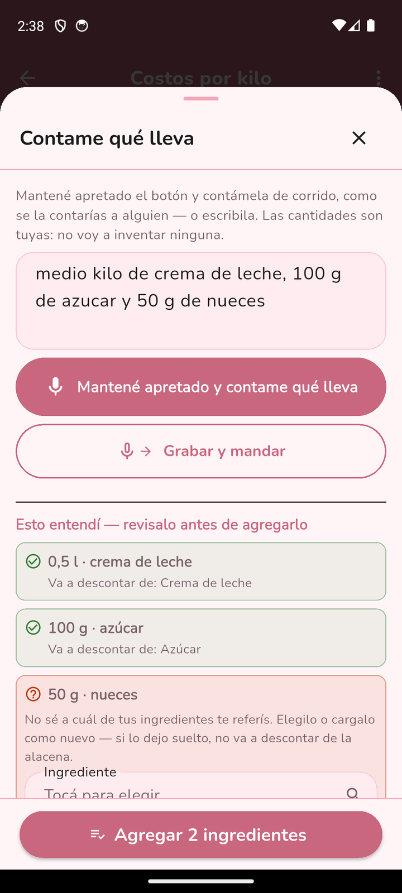
    <figcaption>Contame qué lleva: arriba lo que dictaste (o escribiste) y el botón para mantener apretado; debajo, «Esto entendí — revisalo antes de agregarlo»: dos ingredientes reconocidos con lo que se va a descontar y uno en ámbar porque no sabe a cuál de tus ingredientes te referís.</figcaption>
  </figure>

En la receta (y en Costos por kilo) tocá **Contame qué lleva**. **Mantené apretado el botón, hablá y soltá** cuando termines: *"medio kilo de crema, 300 g de dulce de leche y 100 de nueces"* (también la podés escribir). Al soltar, la app la interpreta y te muestra **Esto entendí — revisalo antes de agregarlo**; revisás y tocás **Agregar N ingredientes**.
Las cantidades son tuyas: no inventa ninguna. Si en algún ingrediente no dijiste la cantidad, queda marcado *"falta la cantidad"* y no se agrega: sumala al texto (por ejemplo, *"200 g de nueces"*) y tocá **Volver a interpretar**. Si no sabe a cuál de tus ingredientes te referís, **te pregunta**: lo elegís o lo cargás como nuevo. Y no repite: aunque hagas pausas, lo que sale dos veces igual (mismo ingrediente y misma cantidad) lo ves una sola vez; si nombrás el mismo ingrediente con cantidades distintas (100 g para el bizcochuelo y 50 g para el almíbar), quedan dos filas, una por cada uso.

**Grabar y mandar**, para cuando el dictado se corta. Debajo del botón de dictar está **Grabar y mandar**: lo tocás una vez, contás la receta entera con las pausas que necesites (el botón se pone rojo y cuenta: *Grabando… 0:12 · tocá para mandar*) y lo volvés a tocar. La app pasa el audio a texto (*Transcribiendo…*), lo suma a lo que ya había en el campo y lo interpreta igual que lo dictado. Usalo cuando el dictado te corta a la mitad o no te entiende: necesita internet y graba hasta dos minutos (a los dos minutos se manda sola). Si no entendió el audio te avisa y lo que habías escrito queda como estaba.

#### El precio de cada ingrediente sale de Mis ingredientes

Cuando enganchás un ingrediente de tu lista, su precio **no se escribe**: aparece como un dato (*Precio · Mis ingredientes*). Si está mal, lo corregís en Mis ingredientes. Si la receta lo pide en otra medida (gramos de algo que comprás por unidad), la fila te avisa en ámbar y te ofrece **Usar u** (o la medida que corresponda): cambia la unidad y vacía la cantidad para que la escribas de nuevo. Y como los precios cambian, en el menú **⋮** de Recetas tenés **Actualizar costos con los precios de hoy**: primero te muestra qué va a cambiar y recién si aceptás lo guarda.

**Centímetros cúbicos.** Un cc (o cm³) es lo mismo que un ml: en el selector de unidad lo ves como **ml (cc)**, y si dictás *"200 cc de leche"* queda en 200 ml. Las medidas de cocina —**taza**, **cucharada** y **cucharadita**— se pueden poner en la receta, pero no se convierten a gramos ni a ml (una taza de harina y una de leche no pesan lo mismo): una fila así no toma el precio de tu ingrediente ni se descuenta de la alacena hasta que la pases a g o ml.

#### El botón "Otro tamaño": la misma receta, para otro rinde

  <figure>
    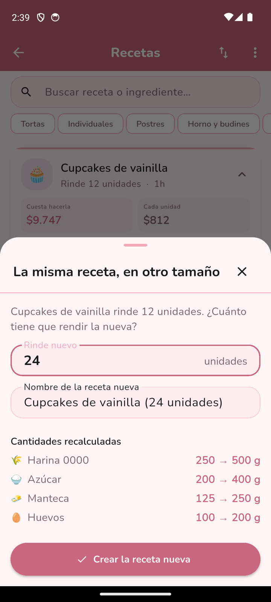
    <figcaption>Otro tamaño: le decís cuánto tiene que rendir la receta nueva y, antes de crearla, te muestra el nombre que le va a poner y las cantidades recalculadas, ingrediente por ingrediente.</figcaption>
  </figure>

¿Tenés la receta de tu budín para 1 kg y te piden uno más grande? No la copies a mano: abrí la receta y tocá **"Otro tamaño"**.

1. Elegís el **rinde nuevo** (las porciones o los kilos que querés).
2. Ves las **cantidades recalculadas** en proporción, antes de confirmar.
3. Lo que se cuenta **por pedido** (la caja, la vela) **no se multiplica**: sigue siendo uno.
4. Al confirmar, **se crea como una receta nueva** — la original queda intacta.

### Mis ingredientes

  <figure>
    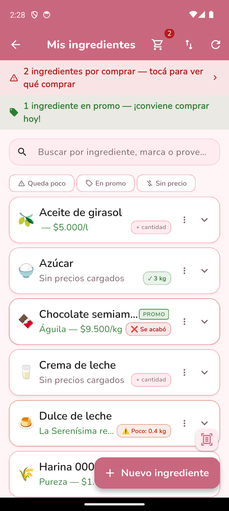
    <figcaption>Mis ingredientes: tus insumos con la marca y el precio actual de cada uno. Arriba buscás y filtrás con Queda poco, En promo o Sin precio.</figcaption>
  </figure>
  <figure>
    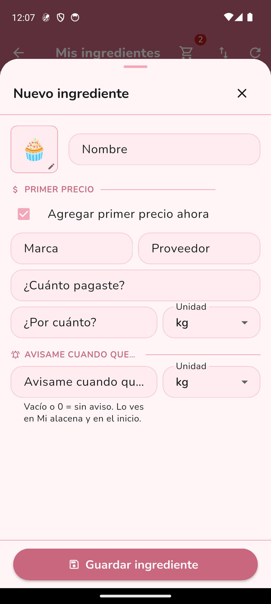
    <figcaption>Cargar un insumo nuevo: nombre con emoji y la unidad en que lo medís.</figcaption>
  </figure>
  <figure>
    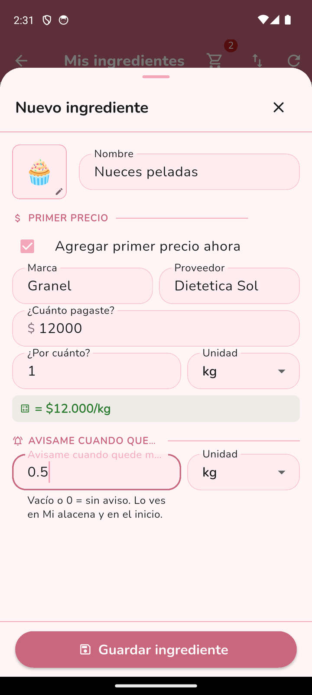
    <figcaption>La hoja Nuevo ingrediente: el nombre, el primer precio (marca, proveedor, cuánto pagaste y por qué cantidad, con el precio por kilo calculado) y, al final, si querés, «Avisame cuando quede…» con el mínimo.</figcaption>
  </figure>
  <figure>
    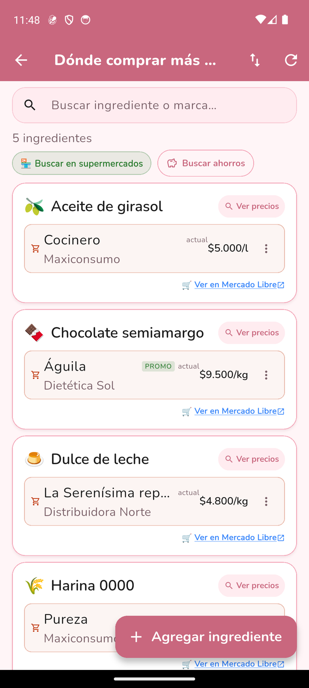
    <figcaption>El comparador: cada insumo con su marca, proveedor y precio por kilo.</figcaption>
  </figure>
  <figure>
    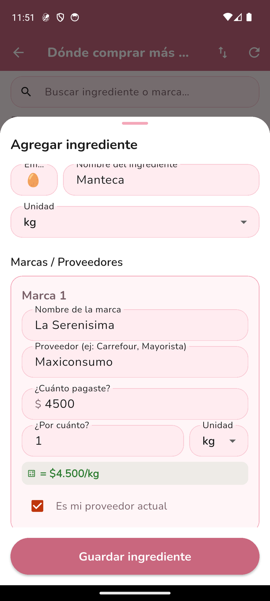
    <figcaption>Agregar un insumo al comparador.</figcaption>
  </figure>

Es la lista de tus **insumos con sus precios actuales**. Podés:

- Ver cuáles están **en oferta**, con **poco stock** o **sin stock** — y filtrar con los chips **Queda poco**, **En promo** y **Sin precio**.
- Buscar cualquier ingrediente, también **por marca o por proveedor** ("¿qué le compro a Distribuidora López?").
- **Escanear una factura** con la cámara: SousChef lee los ítems y los precios solo, así no cargás nada a mano. Abajo, al lado de **Importar**, está la casilla **Anotar esta compra en Gastos**, ya tildada y con el monto: si la dejás así, al importar la compra queda anotada en Gastos (lo que tildaste, no la lechuga ni el detergente). Destildá la casilla si es una lista de precios o una compra que ya anotaste a mano. Si te olvidaste, en la pantalla final está **No era un gasto, sacarlo**.
- Debajo de esa casilla está la **Fecha del gasto**: es la fecha con que se va a anotar la compra, y te dice si es la del ticket o la de hoy. Si el ticket es viejo o la fecha se leyó mal, tocala y elegí la correcta en el calendario. Cuando SousChef no pudo leer bien la fecha del ticket, te lo avisa para que la revises. Si importaste sin anotar el gasto, la fecha vuelve a aparecer en la pantalla final, junto a **Registrar como gasto**.
- Las facturas que escaneaste antes sin cargar el gasto están en **Facturas escaneadas** (el ícono de arriba en la pantalla de escanear). Con **Cargar las N como gasto** van todas de una, cada una con la fecha que ves en la lista. Quedan aparte, para que las abras y decidas, las que parecen el mismo ticket escaneado dos veces y las que dicen **revisá la fecha**. Al abrir una factura, antes de registrarla ves su **Fecha del gasto** y la podés cambiar. Y las que importaste sin anotar el gasto, las que sacaste con **No era un gasto** y las que volviste a cargar al stock porque ya las habías cargado figuran como **No es un gasto**: no se cargan en tanda, pero si abrís una la podés registrar igual.

La **unidad** en que medís cada ingrediente (kilos, gramos, litros, unidades…) **se guarda siempre** — también cuando lo cargás a mano — y los botones de **Compré** y **Usé** te ofrecen las unidades correctas para ese ingrediente. Con eso, el costeo convierte bien entre kilos y gramos, y el costo de tus recetas da lo que tiene que dar.

Tener los precios al día es lo que hace que el costo de tus recetas sea real.

Al cargar o editar un ingrediente, al final está **Avisame cuando quede menos de**: ponés la cantidad y la unidad, y cuando el stock baja de ahí lo ves en Mi alacena, en el Inicio y en el aviso de las 10:05 ([sección 18](#18-los-avisos-automáticos-que-vas-a-recibir)). Vacío o en 0, no avisa.

**En la tablet acostada** (salvo las más chicas, de 8") Mis ingredientes se ve partida: a la izquierda la lista, con los avisos, el buscador y los filtros, y a la derecha el ingrediente que tocás, que queda marcado en la lista: cuánto tenés, en qué se mide y sus marcas, con **Editar ingrediente**, **Agregar precio**, **Anotar lo que tengo** y **Eliminar ingrediente** arriba (lo mismo que el menú ⋮). Lo que guardás en esas hojas se ve enseguida en la lista y al lado. Ahí los botones **Nuevo ingrediente** y de escanear van abajo de la lista. **Facturas escaneadas** también: a la izquierda la lista y a la derecha la factura que tocás, con su **Fecha del gasto** y el botón para registrarla; al registrarla, la lista se pone al día y la factura sigue a la vista. Con la tablet parada y en el teléfono, tocar un ingrediente lo despliega en su lugar y tocar una factura la abre en su pantalla, como siempre.

### Mi alacena

  <figure>
    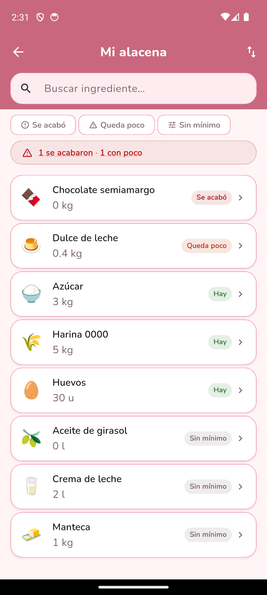
    <figcaption>Mi alacena, el "qué tengo hoy": arriba, el aviso de lo que se acabó o queda poco (y si te alcanza para los pedidos de esta semana); abajo, cada insumo con lo que te queda y su cartelito (Hay, Queda poco, Se acabó o Sin mínimo).</figcaption>
  </figure>

Es el **"qué tengo hoy"** de cada insumo. Muestra la cantidad que tenés y el mínimo que configuraste, con un cartelito que te lo dice con todas las letras:

- **Hay:** estás por encima del mínimo.
- **Queda poco:** bajaste del mínimo.
- **Se acabó:** no te queda nada.
- **Sin mínimo:** todavía no le pusiste un mínimo, así que no te puede avisar.

Arriba de todo te dice si **te alcanza para los pedidos de esta semana** o, si no, qué te falta (*"harina: te faltan 2 kg"*). Así no te agarra desprevenida a la hora de producir. Podés ajustar las cantidades ahí mismo.

**En la tablet acostada** (salvo las más chicas, de 8") Mi alacena se ve partida: a la izquierda la lista, con el buscador, los avisos y los filtros, y a la derecha el ingrediente que tocás, con **¿Cuánto tenés?** y su **Historial** como en la hoja, que queda marcado en la lista. Lo que corregís o anotás ahí se ve enseguida en la lista; si un filtro o la búsqueda lo saca de la lista, el lado derecho se vacía. Con la tablet parada y en el teléfono, tocarlo abre la hoja desde abajo, como siempre.

**Los mínimos, con una sola pregunta.** La primera vez que entrás a Mi alacena te pregunta: *"¿Te aviso cuando quede menos de un cuarto de lo que compraste?"*. Si tocás **Sí, avisame**, SousChef mira la última compra de cada ingrediente y les pone ese mínimo a todos de una (lo que ya hayas puesto a mano no se toca). Si todavía no tenés compras registradas, te lo vuelve a preguntar después de tu próxima compra (cuando escanees un ticket o anotes una compra en la alacena). Con **Ahora no**, no insiste: el mínimo lo ponés cuando quieras desde cada ingrediente, en **Avisame cuando quede menos de**.

**Cambiar cómo se mide.** Tocando un ingrediente, abajo de la cantidad está **Cambiar cómo se mide** (también lo encontrás al editarlo en Mis ingredientes). Sirve para pasar, por ejemplo, la leche de **unidades** a **litros**: elegís **Litros**, te pregunta *"¿Cuánto trae cada unidad?"* (lo que dice el envase: 1 l, 0,5 l…) y pasa juntos lo que tenés, el aviso de poco y el precio. Antes de guardar te muestra cómo queda (*"4 u → 2 l"*, *"$800 la unidad → $1.600 el litro"*).

- **Tus recetas no se tocan.** Si el cambio mueve el precio a otra unidad, te avisa qué recetas usan ese ingrediente: sus costos y el costo por kilo de tus rellenos quedan como están hasta que toques **Actualizar costos con los precios de hoy** o edites esa receta. Las filas que lo piden en la unidad vieja (por ejemplo, "1 u de leche") van a quedar sin precio hasta que las pases a ml o litros; las que lo piden en ml empiezan a costearse.
- **Si está en Armado y entrega**, no te deja cambiarlo de familia (de unidades a kilos, por ejemplo): el costo del armado de cada pedido saldría mal. Sacalo de ahí, cambiá la unidad y volvé a agregarlo.
- Si un ingrediente quedó **partido** —en la alacena se cuenta en unidades pero el precio está por litro— te lo marca en amarillo: las recetas que lo usan en ml no lo pueden descontar. Tocando el aviso lo igualás.

Los desplegables de **Unidad** (al corregir, comprar o usar) te ofrecen sólo unidades de la misma familia —kilos y gramos, litros y ml, unidades y docenas— porque entre familias hace falta saber cuánto trae cada envase, y eso lo pregunta **Cambiar cómo se mide**.

### Costos por kilo: que la alacena se descuente sola

  <figure>
    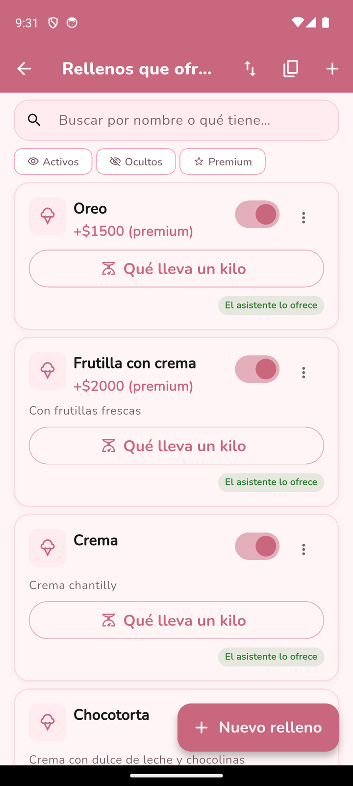
    <figcaption>Tu carta de rellenos, con los filtros Activos / Ocultos / Premium.</figcaption>
  </figure>
  <figure>
    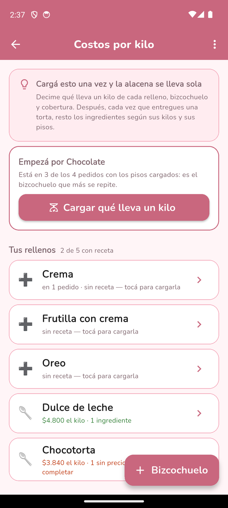
    <figcaption>Costos por kilo: arriba, «Empezá por…» con el que más se repite en tus pedidos y todavía no tiene receta; después tus rellenos con el contador "N de M con receta", cada uno con lo que te cuesta el kilo o "sin receta — tocá para cargarla", y, deslizando, más abajo tus bizcochuelos y tus coberturas, con las que usaste y todavía no tienen receta.</figcaption>
  </figure>
  <figure>
    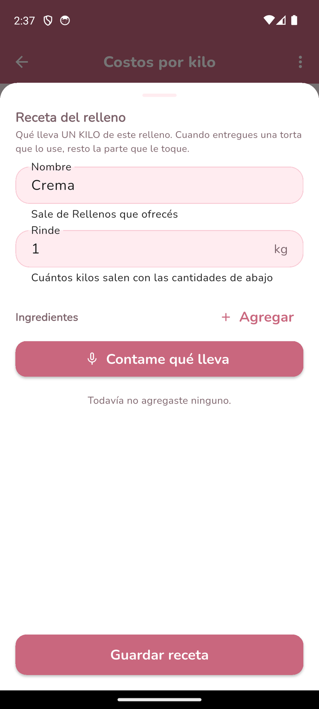
    <figcaption>La receta de UN KILO de un relleno (o de una cobertura): cuántos kilos rinde y qué lleva. Si no querés ir ingrediente por ingrediente, «Contame qué lleva» te deja dictarla.</figcaption>
  </figure>
  <figure>
    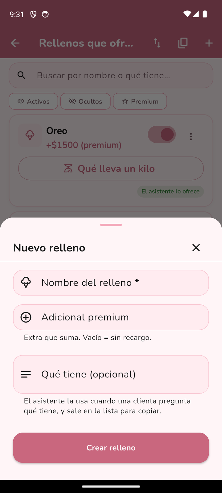
    <figcaption>Cargar un relleno nuevo desde la lista.</figcaption>
  </figure>
  <figure>
    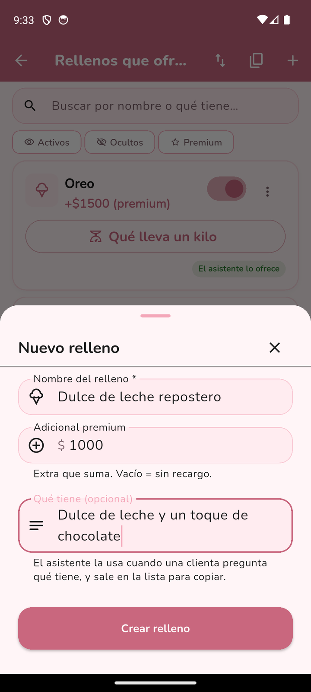
    <figcaption>Son tres campos: el nombre, el adicional premium y qué tiene.</figcaption>
  </figure>

Esta es la parte que te saca de encima el trabajo de anotar cada cosa que usás.

Una torta no se hace con "una receta de torta": se arma con un **bizcochuelo** y uno o varios **rellenos** y, si lleva, una **cobertura** por encima (buttercream, fondant, ganache). Cada uno se mide **por kilo**. Por eso viven en su propia pantalla (**Gestión → Costos y ganancia → Costos por kilo**, o desde el menú **⋮** de Recetas), separados de las recetas de producto como los cupcakes o las cookies.

Ahí ves tu lista de rellenos, cuáles ya tienen receta cargada y cuáles no, tus bizcochuelos y tus coberturas, y los que usaste en pedidos reales pero todavía no cargaste. Tocá cualquiera y decile qué lleva **un kilo** de ese relleno, bizcochuelo o cobertura (también podés dictarlo con **Contame qué lleva**).

- Mientras te quede alguno sin receta que ya usaste en un pedido, arriba te sugiere **por cuál empezar**: *"Empezá por Dulce de leche"*, el que más se repite en tus pedidos (puede ser un relleno, un bizcochuelo o una cobertura), con el botón **Cargar qué lleva un kilo**.
- Cada uno con receta muestra **cuánto te cuesta el kilo**: *"$9.918 el kilo · 2 ingredientes"* en verde. Si a alguno de sus ingredientes le falta el precio, lo marca en ámbar: *"$7.202 el kilo · 1 sin precio — tocá para completar"*. Mientras tanto, los pedidos que llevan ese relleno no te muestran cuánto te dejan —con ese ingrediente en $0 la ganancia saldría de más—: la ficha del pedido te dice cuál es y por qué (*"No le puedo poner precio a Mantecol en Crema mantecol: la receta lo mide distinto de como lo comprás"*) y el **Resumen del mes** te lleva directo a corregirlo con **Revisar Crema mantecol**. Con las coberturas es igual: lo que te cuesta el kilo, el ámbar si falta un precio, y en el Resumen del mes, si es la receta que más pedidos frena, *"Lo que más falta: Buttercream"* con el botón **Cargar qué lleva un kilo**.
- En el menú **⋮** está **Actualizar costos con los precios de hoy**, igual que en Recetas.

**Las coberturas.** Están más abajo, en **Tus coberturas**: las que ya tienen receta y, en **Las usaste y no tienen receta**, las que elegiste en tus pedidos y todavía no cargaste. Tocá una de esas y se abre su receta con el nombre ya puesto; para una que todavía no usaste, tocá **Otra cobertura**. La cobertura va por encima de la torta: cuento unos 150 g por cada kilo de torta (lo dice ahí mismo, debajo de **Tus coberturas** y en su receta), así que vos decime qué lleva **un kilo** de cobertura, como con un relleno, y yo calculo la parte de cada pedido.

**Cargala con el mismo nombre que elegís en el pedido** (si en el pedido dice *Buttercream*, la receta se llama *Buttercream*): así la encuentro. Las mayúsculas no importan. Si después le cambiás el nombre, los pedidos que ya la tenían dejan de encontrarla; por eso, al guardar con otro nombre te pregunto **¿Le cambiás el nombre?**: **Dejar «Buttercream»** guarda lo demás con el nombre de siempre, y **Cambiar igual** la guarda con el nuevo.

**En la tablet acostada** (salvo las más chicas, de 8") Costos por kilo se ve partida: a la izquierda la lista, con la explicación y «Empezá por…» arriba, y a la derecha la receta del relleno, el bizcochuelo o la cobertura que tocás, abierta para cargarla o corregirla, que queda marcado en la lista; al tocar **Guardar receta** la lista se pone al día y te avisa **Receta guardada ✓**. **Cargar qué lleva un kilo** también la abre al costado, si es un relleno. Para uno nuevo, el botón **Bizcochuelo** va abajo de la lista y abre la hoja de siempre; **Otra cobertura** y las coberturas que usaste sin receta también la abren desde abajo. Con la tablet parada y en el teléfono, tocar uno abre su receta desde abajo, como siempre.

Al cargar cada ingrediente elegís **cómo se gasta**, que es lo que hace que las cuentas den bien:

| | Cuándo usarlo | Ejemplo |
|---|---|---|
| **Según el tamaño** | cuanto más grande la torta, más lleva | harina, dulce de leche, crema |
| **Uno por piso** | uno por cada piso, sin importar el peso | el cartón, las varillas |
| **Uno por pedido** | uno solo, sea del tamaño que sea | la caja, la cinta, la vela |

Esto resuelve algo que en la práctica cambia el costo: **una torta de 4 kg de un solo piso y una de 4 kg de tres pisos pesan lo mismo pero no cuestan lo mismo.** La de tres pisos lleva tres cartones y varillas; la de un piso, uno. Marcando el cartón como "por piso", SousChef descuenta tres y no uno y medio.

Y si el mismo cartón te quedó anotado en la receta del bizcochuelo **y** en la del relleno de ese piso, no te preocupes: sigue siendo un cartón. SousChef no lo cuenta dos veces.

**La merma.** En cada receta podés cargar un **porcentaje de merma**: lo que se pierde en el bol, en la manga y en el molde, y nunca llega a la torta. SousChef lo descuenta de más en todo lo que se mide **en peso o en volumen** — harina, crema, esencia. En lo que se cuenta por unidad —cartones, cajas, velas— no lo aplica: un cartón que se te arruina no es merma de preparación, eso lo arreglás con un ajuste de stock. La misma merma se usa para calcular el costo, así que el precio y el stock hablan el mismo idioma.

Si no sabés cuánta merma tenés, **dejala en cero**. Una merma inventada ensucia el costo y el stock a la vez; siempre podés cargarla después, cuando la midas.

### Armado y entrega

  <figure>
    
    <figcaption>Armado y entrega: «Uno por cada piso» (el cartón, las varillas) y «Uno por pedido» (la caja, la cinta), con el botón Agregar para elegirlos de entre tus ingredientes.</figcaption>
  </figure>

En **Gestión → Costos y ganancia → Armado y entrega** tenés juntos los materiales que no son masa ni relleno pero también cuestan plata: lo de **armar** cada torta (el cartón, las varillas de cada piso) y lo de **entregar** cada pedido (la caja, la cinta, el moño). Son los mismos que en las recetas se cuentan "uno por piso" o "uno por pedido" — acá los tenés en un solo lugar, para que ningún costo se te escape.

### Que la alacena se descuente sola

En **Configuración → Asistente proactivo** prendés **Descontar ingredientes al entregar**. A partir de ahí no tenés que anotar nada.

**Cuándo baja.** El stock sale cuando marcás el pedido como **Entregado**. Y si ese día no llegaste a tocar nada, tampoco importa: **varias veces por día SousChef repasa las entregas de la jornada y pone al día lo que falte**. Por eso conviene cargarle siempre **la fecha de entrega** al pedido: sin fecha, ese repaso no lo ve, y el stock solo baja si vos movés el pedido de estado.

**Se descuenta una sola vez.** Podés abrir el pedido, editarlo y guardarlo las veces que quieras: no baja dos veces.

**Desde cuándo cuenta.** El descuento arranca **el día que prendés el interruptor**. Los pedidos con fecha de entrega anterior quedan como están, porque ese consumo ya está reflejado en el stock que venís llevando a mano — si SousChef los descontara todos juntos te dejaría el inventario en cero de un saque. Si lo apagás y lo volvés a prender, vuelve a arrancar desde ese día.

**Si algo no se pudo descontar**, te lo dice en el detalle del pedido con nombre y apellido: un relleno fuera de carta, un bizcochuelo o una cobertura sin receta, una receta que no dice cuánto rinde, un insumo que no tenías cargado, o uno que no te alcanzó. Y si no te alcanzaba, **el stock nunca queda en negativo**: lo baja hasta cero y te avisa cuánto faltó.

**Si un pedido vuelve para atrás** —lo volvés de Entregado a Confirmado, por ejemplo— los insumos **vuelven al stock**: fue un cambio de planes, no un gasto.

**Pero si lo cancelás cuando los insumos ya se habían descontado, no vuelven**: esa mercadería ya la usaste. En el detalle del pedido te queda anotado que se canceló con los insumos ya consumidos, para que entiendas por qué el stock quedó como quedó.

Los ajustes y las compras que cargás a mano **conviven** con todo esto: SousChef nunca los pisa ni los cuenta dos veces.

### Otras cosas del menú

  <figure>
    
    <figcaption>Gestión empieza por «Tu negocio»: Pedidos, Agenda, Clientas, Saldos, Para hoy, Producción, Lo que vendés, Rellenos que ofrecés y Galería, con tu hora, tu margen y tus pedidos por día arriba.</figcaption>
  </figure>
  <figure>
    
    <figcaption>Más abajo, «Tu asistente» (Pendientes, Precios atrasados y Resumen del mes), «Tu plan» y Configuración al pie.</figcaption>
  </figure>
  <figure>
    
    <figcaption>La parte de lo que comprás: Mis ingredientes, Mi alacena, Comprar esta semana y Gastos. Arriba asoma, atenuado y con el motivo, lo que todavía no podés usar.</figcaption>
  </figure>
  <figure>
    
    <figcaption>Combos y paquetes cuando todavía no creaste ninguno.</figcaption>
  </figure>
  <figure>
    
    <figcaption>Un combo nuevo: nombre, precio, cuánto saldría por separado y qué lleva.</figcaption>
  </figure>
  <figure>
    
    <figcaption>Registrar un gasto.</figcaption>
  </figure>
  <figure>
    
    <figcaption>Gastos: cuánto llevás gastado este mes contra el anterior, con la tendencia mes a mes.</figcaption>
  </figure>
  <figure>
    
    <figcaption>Galería: tus fotos y videos de trabajos, con temática, nombre y clienta.</figcaption>
  </figure>
  <figure>
    
    <figcaption>Los tres pasos para armar un posteo: subís fotos, tocás "Generar IA" y elegís el texto que más te gusta.</figcaption>
  </figure>

Todo lo que tiene Gestión, en el orden en que aparece, y dónde está contado:

**🛍️ Tu negocio**
- **Pedidos** (todos tus pedidos, con sus pestañas) → [sección 9](#9-tus-pedidos-y-su-detalle). **Agenda** (*"El calendario de entregas"*) → [sección 10](#10-la-agenda--calendario).
- **Clientas** (*"Tu agenda de clientas"*) → [sección 12](#12-tus-clientas). **Saldos** (*"Lo que te deben"*) → [sección 16](#16-cobros-y-saldos-pendientes).
- **Para hoy** (*"Lo que necesita algo tuyo ahora"*) → [sección 9](#9-tus-pedidos-y-su-detalle). **Producción** (*"Qué hacer mañana, esta semana y este mes"*) → [sección 11](#11-producción-qué-hacer-mañana-esta-semana-y-este-mes).
- **Lo que vendés** (*"Tu catálogo, tus combos y tus promos"*): tus productos y tus combos, en una sola pantalla con dos pestañas — con la foto de tu lista de precios se carga solo ([sección 4](#4-lo-que-vendés-tu-catálogo-y-tus-combos)). También está en Mis herramientas del Inicio.
- **Rellenos que ofrecés** (*"Los rellenos que elegís en cada pedido"*): los sabores disponibles, así el asistente responde con opciones reales. Los mismos que después elegís tocando en el formulario del pedido. También como **Rellenos** en Mis herramientas.
- **Galería** (*"Posteos para Instagram y TikTok"*): tus fotos y videos de trabajos, listas para publicar en redes, organizadas por las categorías de tu catálogo. Para sumar una sin entrar acá, usá **Agregar foto** en el Inicio. **En la tablet acostada** (salvo las más chicas, de 8") la Galería se ve partida: a la izquierda tus fotos, de a tres por fila, y a la derecha en grande la que tocás, que queda marcada, con sus datos y los botones **Armar link** (el link para pasársela a quien te edita el contenido) y **Eliminar**; si tocás la foto grande, se abre encima de todo, como en el teléfono. Con la tablet parada y en el teléfono, tocar una foto la abre encima de todo, como siempre.

**💵 Costos y ganancia**
- **Cuánto cobrar** → [sección 13](#13-cuánto-cobrar-y-precios-atrasados). **Recetas**, **Costos por kilo** y **Armado y entrega** → más arriba en esta sección.
- **Dónde comprar más barato** (*"Qué te cobra cada súper y proveedor"*): el comparador de precios por proveedor. **En la tablet acostada** (salvo las más chicas, de 8") se ve partido: a la izquierda tus ingredientes, cada uno con su marca más barata en un renglón, y a la derecha la tarjeta entera del que tocás, que queda marcado, con todas sus marcas, los precios online y los mismos botones; lo que cambiás ahí se ve enseguida en la lista. **Agregar ingrediente** va abajo de la lista. Con la tablet parada y en el teléfono, las tarjetas completas, como siempre.

**🧺 Lo que comprás**
- **Mis ingredientes** y **Mi alacena** → más arriba. **Comprar esta semana** → [sección 15](#15-comprar-esta-semana).
- **Gastos** (*"Lo que gastaste"*): para anotar gastos varios. La **categoría** la elegís con **chips de un tap** (la de Ingredientes va con su 🥚). Y en la **Tendencia mensual**, si tocás un mes, **los dos recuadros de arriba pasan a ese mes** (cuánto gastaste ese mes y el anterior) y **la lista de abajo se filtra** a ese mes — lo tocás de nuevo y volvés al mes de hoy y a todos los gastos.

**🔔 Tu asistente**
- **Pendientes** → [sección 8](#8-pendientes-aprobá-todo-con-un-toque). **Precios atrasados** → [sección 13](#13-cuánto-cobrar-y-precios-atrasados). **Resumen del mes** (*"Tu cierre automático"*) → [sección 18](#18-los-avisos-automáticos-que-vas-a-recibir).

**⭐ Tu plan**
- **SousChef Pro** (*"Un asistente que entiende más"*; en el iPhone se llama **Tu plan de SousChef**) → [sección 20](#20-tu-plan-souschef-free-y-pro).

Y al pie, **Configuración** → [sección 17](#17-configuración-cómo-atiende-tu-asistente-envíos-seña-y-retiro).

---

## 15. Comprar esta semana

  <figure>
    
    <figcaption>Comprar esta semana: la semana que viene, el total estimado y, por ingrediente, cuánto comprar y cuánto ya tenés. Si el stock alcanza, te lo dice con todas las letras.</figcaption>
  </figure>

*(Gestión → Lo que comprás → Comprar esta semana, o **Comprar** en Mis herramientas del Inicio)*

SousChef mira los pedidos de la semana, cruza lo que necesitás con lo que ya tenés en stock, y te arma **solita la lista de lo que hay que comprar**, con la cantidad y el costo estimado.

- Cada ítem tiene su **casilla para tachar** mientras vas comprando.
- Está con letra grande y emojis para que sea cómoda de leer en el supermercado.

Ya no te vas a olvidar de nada ni vas a comprar de más.

---

## 16. Cobros y saldos pendientes

  <figure>
    
    <figcaption>Saldos en tres partes: lo que cobrás hoy, lo que te deben de antes y lo que falta cobrar al entregar. Cada pedido con su botón «Me pagó».</figcaption>
  </figure>

*(Gestión → Tu negocio → Saldos, o **Saldos** en Mis herramientas del Inicio)*

Acá ves **la plata que te deben**, pedido por pedido, en la pantalla **Saldos a cobrar hoy**. Está partida en tres:

1. **Total a cobrar hoy:** los pedidos que entregás hoy y todavía tienen saldo. Es el mismo número del aviso de la mañana.
2. **Te deben de antes:** pedidos que ya entregaste y quedaron sin cobrar, con *"Se entregó hace 3 días"* en rojo. Quedan acá hasta que los saldes.
3. **Falta cobrar al entregar:** pedidos ya confirmados de los próximos días que todavía tienen saldo (por ejemplo, los que dejaron seña), con *"Entrega el 19/10"*. No suman en el total de hoy: se cobran el día de la entrega.

Cada pedido muestra la clienta, qué es, la seña sobre el total y lo que **falta**, y un botón **Me pagó los $…**: lo tocás cuando te paga (o si te adelantó el saldo) y sale de la lista. Con el ícono **⇅** ordenás por saldo, clienta o total del pedido.

Es tu control de caja: siempre sabés quién te debe y cuánto.

> **Al entregar, te pregunta.** Cuando marcás un pedido como **Entregado**, SousChef te pregunta si te pagó todo ([sección 9](#9-tus-pedidos-y-su-detalle)). Si le decís que sí, la deuda se salda sola y los avisos de cobranza de ese pedido se apagan; si te quedó debiendo, ese saldo aparece acá, en *Te deben de antes*, hasta que toques **Me pagó**.

---

## 17. Configuración: cómo atiende tu asistente (envíos, seña y retiro)

  <figure>
    
    <figcaption>El logo de tu negocio, la paleta de colores, tu nombre y cómo se llama tu asistente («¿Cómo querés llamar a tu asistente?»).</figcaption>
  </figure>
  <figure>
    
    <figcaption>Tu valor por hora, tu margen mínimo, cuántos pedidos por día aceptás y con cuánta anticipación.</figcaption>
  </figure>
  <figure>
    
    <figcaption>El final de Gestión: SousChef Pro y, al pie, Configuración («Logo, colores, costos y agenda»).</figcaption>
  </figure>

En **Configuración**, la tarjeta **Lo que tu asistente tiene que saber** 🧠 le enseña a tu asistente cómo trabajás vos, para que responda como lo harías vos. Todo con botoncitos — sin escribir párrafos.

### Cómo cobrás las tortas

Arriba de todo, *¿Cómo cobrás lo que hacés a pedido?*: **Por kilo**, **Por porciones** o **Por tamaño** (kilo y porciones se pueden marcar juntas). Con kilo aparece **De 1 kilo saco … porciones**: con ese número el asistente pasa *"una torta para 20 personas"* a kilos.

### Los envíos: elegí tu modalidad

¿Hacés envíos? Elegí **una de las cuatro opciones** con un toque, y mirá qué le va a decir el asistente a tus clientas en cada caso:

| Opción | Qué dice el asistente |
|---|---|
| **Lo retiran** | Que no hacés envíos: los pedidos se retiran. |
| **Con envío, lo paga la clienta** | Que hacés envíos a donde la clienta quiera, y que el envío corre por cuenta de ella. |
| **Sin cargo en algunas zonas** | Aparece un campo para que escribas **tus zonas** (ej: "Caballito, Flores"). El asistente dice que a esas zonas el envío va sin cargo, y que a otras zonas se cobra aparte. |
| **A convenir** | Que los envíos los coordinás vos con cada clienta. |

> En **ningún** caso el asistente dice **cuánto** sale un envío. Explica la modalidad, y el monto (si lo hay) lo hablás vos.

### La seña: el "generalmente" es a propósito

Elegís con chips cómo cobrás la reserva: **Pido 30%** / **Pido 50%** / **Otro** (con su campo para poner lo tuyo) / **No pido seña**.

Con eso, el asistente les dice a las clientas: *"**Generalmente** pido X% de seña para reservar la fecha."* ¿Por qué "generalmente" y no "siempre"? Porque la excepción existe: esa clienta de años a la que no le pedís seña. **Esa decisión es tuya** — el asistente da la regla general y no negocia; si alguien pide una excepción, te lo deriva a vos.

Si elegiste "No pido seña", dice que se paga al retirar. Simple.

### La dirección de retiro

Tiene su **campo propio** en Configuración. Y funciona con una regla de oro:

- Si la cargaste, el asistente la manda **TAL CUAL la escribiste**, letra por letra — no pasa por la inteligencia artificial, así que es **imposible** que la deforme y mande a una clienta a otra cuadra.
- Si la dejás **vacía**, el asistente **no comparte ninguna dirección**: cuando le pregunten dónde retirar, te deriva la consulta a vos. Ideal si preferís pasar tu dirección personalmente.

### Tus datos de cobro

Como viste en la [sección 6](#6-mensajes-y-el-asistente-que-atiende-solo): cargás una vez el bloque de Mercado Pago (titular, Alias, CBU/CVU, CUIT) y el asistente lo manda tal cual cuando una clienta pide los datos para transferir. Nunca confirma que un pago llegó — eso lo verificás vos.

### Lo demás de Configuración

- **Horario de atención** (*Desde* y *Hasta*): fuera de ese horario el asistente responde igual, pero le aclara a la clienta que lo ves vos cuando abrís.
- **Asistente proactivo:** las llaves de los avisos y de Pendientes, **Descontar ingredientes al entregar** ([sección 14](#14-recetas-ingredientes-y-alacena)) y, cuando SousChef lo active, **Tu WhatsApp para avisos** ([sección 18](#18-los-avisos-automáticos-que-vas-a-recibir)).
- **Upsell automático:** el asistente sugiere productos complementarios (por ejemplo, cupcakes junto con la torta).
- Al final, **Cerrar sesión**, **Eliminar cuenta** ([sección 21](#21-preguntas-frecuentes)) y la versión de la app ([sección 22](#22-si-algo-no-anda)).

### Legal: la política, los términos y los datos que usa la IA

Casi al final de Configuración, arriba de **Cerrar sesión**, está la tarjeta **Legal**, con tres filas:

- **Política de privacidad** (*"Qué datos guardamos, para qué y cómo pedir que se borren"*): se abre en el navegador, y ahí está qué datos guarda SousChef (los tuyos y los de tus clientas), para qué los usa, con quién los comparte, cuánto tiempo los guarda y cómo pedir que se borren. Es la misma que ves al entrar, al crear tu cuenta, en **Conectar canales** y en la hoja **Antes de usar el asistente**.
- **Términos del servicio** (*"Las condiciones para usar SousChef"*): también en el navegador. Son los que aceptaste al crear tu cuenta.
- **Datos que usa la IA:** dice *"Aceptaste el d/m/aaaa"*, con el día en que aceptaste la hoja **Antes de usar el asistente** ([sección 19](#19-el-asistente-por-voz)), o *"Todavía no aceptaste"* (mientras lo está leyendo, no dice ninguna de las dos). Si aceptaste, al lado está **Retirar**: lo tocás y te dice *"Listo. La próxima vez que uses el asistente te lo vamos a preguntar de nuevo."*, y te aclara que el asistente que atiende a tus clientas sigue funcionando. Desde ese momento, lo que usás vos desde la app (el asistente, el dictado de recetas, las fotos de facturas y de tu lista de precios, los textos de la Galería) no se le manda a la inteligencia artificial hasta que vuelvas a aceptar. Si no hay conexión, te avisa *"No se pudo retirar. Revisá tu conexión y probá de nuevo."*

Si el teléfono no puede abrir la política o los términos, la app te lo avisa con un cartel: probá de nuevo en un rato.

---

## 18. Los avisos automáticos que vas a recibir

  <figure>
    
    <figcaption>El cierre del mes: tu ganancia y cómo viene contra el mes pasado, más ingresos, gastos y margen.</figcaption>
  </figure>
  <figure>
    
    <figcaption>Y el ranking de lo que más vendiste, con la cantidad y el importe de cada uno.</figcaption>
  </figure>

SousChef te manda avisos al celular **en el momento justo**, sin que tengas que estar mirando la app. Los textos son claros y completos: te dicen la clienta, el pedido y la fecha con todas las letras (nada de avisos crípticos a medio armar). Estos son los que vas a recibir:

| Cuándo | Qué te dice |
|---|---|
| **Una vez por día, a la hora que elegiste** | **Tu plan de mañana** — Un resumen de las entregas y lo que tenés que producir. La hora la elegís en Configuración (**Hora del resumen**). Tocándolo entrás a **Producción**, en la pestaña **Mañana**. Si no hay nada, no te molesta. |
| **Todos los días a las 8:05** | **📦 Hoy entregás 2 pedidos** — con hasta tres clientas y lo que llevan (*"Lucía (torta unicornio), Martina (cupcakes)"*). Tocándolo se abre **Para hoy**. Si ese día no entregás nada, no llega. |
| **A las 8:00 y de nuevo a las 17:00** | **Saldos a cobrar hoy** — Los pedidos que entregás hoy con plata pendiente. Si a esa hora ya no queda nada por cobrar, no llega. |
| **A las 9:00 y de nuevo a las 18:00** | **Precios atrasados** — Si algún producto quedó con poco margen por la suba de costos, para que ajustes. |
| **Todos los días a las 10:05** | **🧺 Te queda poco de…** — Hasta tres ingredientes que bajaron del mínimo que les pusiste (*Avisame cuando quede menos de*, en Mis ingredientes), con lo que te queda. Tocándolo se abre **Mi alacena**. No te repite el mismo aviso, salvo que vuelva a bajar. |
| **Los domingos a las 20:00** | **Lista de compras de la semana** — Lo que tenés que comprar. Si no hay nada, silencio. |
| **El primer día del mes** | **Cierre de mes** — Cuánto facturaste, cuánto gastaste, tu ganancia y la comparación con el mes anterior. |
| **Cuando una clienta te escribe** | **💬 Sofía escribió por Instagram** — Te avisa cuando una clienta empieza a escribir o vuelve después de unas horas, aunque el asistente le conteste solo, así sabés qué está pasando sin entrar a mirar. Si el asistente la está atendiendo, el aviso vibra sin sonar. Si esa charla la tenés vos (o apagaste el asistente), suena y te dice que te está esperando. Tocándolo se abre **Mensajes**. |
| **Cuando alguien te deja esperando** | Aviso urgente si una conversación te quedó pendiente más de 15 minutos. |
| **Cuando una clienta no responde** | Te propone un mensaje de seguimiento (en Pendientes) para reflotar un presupuesto. |
| **Los lunes, si lo prendiste** | **Promos para días libres** — Si te queda un día sin pedidos en la semana, te deja en Pendientes una promo armada y un posteo en borrador. Viene **apagado**: lo prendés en Configuración. |
| **Al entregar, si lo prendiste** | **Agradecer después de entregar** — Te deja en Pendientes un gracias listo para mandar a la clienta. Viene **apagado**: lo prendés en Configuración. |
| **Cuando vence una conexión** | Te avisa que reconectes WhatsApp/Instagram/Facebook antes de que deje de andar. |
| **Cumpleaños y recordatorios** | Te recuerda seguimientos que pospusiste (ej: cumpleaños al año siguiente). |

> **Importante:** todos estos avisos son **solo para vos**. SousChef **no le escribe a tus clientas** con nada de esto sin tu aprobación: los seguimientos, las promos, los agradecimientos y los avisos de saldo pasan primero por **Pendientes** para que los revises. La única excepción es el "perdón la demora" de la [sección 6](#6-mensajes-y-el-asistente-que-atiende-solo) (una sola vez, sin precio).

**Cómo apagarlos.** Casi todos dependen de una sola llave: **Resumen de mañana**, en **Configuración → Asistente proactivo**. Si la apagás, dejan de llegar todos —también los de las 8:05 y las 10:05— menos los que son para no perder mensajes (una clienta que te está esperando y una conexión que vence) y el de un ingrediente que subió de precio, que llega cuando entrás a la app. Los agradecimientos van aparte: dependen solo de su propia llave, **Agradecer después de entregar**. Las promos necesitan las dos prendidas: **Resumen de mañana** y **Promos para días libres**; los avisos de saldo a la clienta, **Resumen de mañana** y **Avisar el saldo a la clienta**. Los agradecimientos y las promos vienen apagados.

**También por WhatsApp (cuando SousChef lo active).** Si cargás **Tu WhatsApp para avisos** en **Configuración → Asistente proactivo** —tu número personal, como +54 9 11 1234-5678, no el que atiende tu asistente—, los avisos de las 8:05 y de las 10:05 te llegan además por WhatsApp, desde el número de tu negocio; si lo dejás vacío, siguen llegando sólo al celular. Revisá el número dígito por dígito antes de guardarlo: estos avisos llevan los nombres de tus clientas y lo que te encargaron, y si falta o sobra un dígito le llegan a otra persona. Si no te llega el primero, corregilo en Configuración. Son avisos para leer: no hace falta que los respondas (si respondés, tu asistente te toma como una clienta nueva).

**Cuáles suenan.** Suenan los avisos de una clienta que te está esperando (un pedido listo para confirmar, alguien que te necesita, una charla sin respuesta). Los demás llegan sin sonido: en Android vibran (el de una conexión que vence sí suena); **en el iPhone** no suenan ni prenden la pantalla, y los encontrás en las notificaciones cuando las mires.

**El Resumen del mes.** El aviso del cierre abre **Resumen del mes** (también está en Gestión → Tu asistente y en Mis herramientas): la **Ganancia del mes** y cómo viene contra el mes anterior, **Ingresos**, **Gastos**, **Por pedido** y **Margen**, **Lo que más vendiste** y **Lo que dejaron tus pedidos** (lo que vendiste menos lo que te costó hacerlo).

---

## 19. El asistente por voz

  <figure>
    
    <figcaption>Le preguntás hablando o escribiendo y te contesta (antes de la primera pregunta te ofrece unas sugeridas para empezar). El micrófono para mantener apretado está abajo a la izquierda, al lado de donde escribís.</figcaption>
  </figure>

*(Tocá el botón redondo del micrófono, en el medio de la barra de abajo: se abre la pantalla **Asistente**.)*

¿Tenés las manos en la masa? Hablale a SousChef en vez de escribir. Preguntale cosas como:

- *"¿Qué entrego mañana?"*
- *"¿Quién me debe hoy?"*
- *"¿Qué compro esta semana?"*
- *"¿Cómo me fue este mes?"*

### La primera vez: «Antes de usar el asistente»

  <figure>
    
    <figcaption>La hoja «Antes de usar el asistente»: qué le manda SousChef a la inteligencia artificial y a quién, el aviso sobre el asistente que atiende a tus clientas, el enlace a la política y los botones Acepto / Ahora no.</figcaption>
  </figure>

La primera vez que le hablás o le escribís, antes de mandar nada aparece la hoja **Antes de usar el asistente**. Te cuenta que, para entenderte y contestarte, SousChef usa inteligencia artificial de otras empresas; qué les manda (lo que escribís o dictás y lo que el asistente mira de tu negocio para contestarte, las fotos de tus facturas, de tus listas de precios y de tus trabajos, y tus notas de voz) y a quiénes (Groq, Google Gemini y Anthropic, para entender y responder). También te cuenta que el asistente que atiende a tus clientas usa esa misma inteligencia artificial y guarda en Langfuse un registro de cada mensaje para ver qué anduvo mal. Abajo está **Leer la Política de privacidad**.

- **Acepto:** sigue con lo que ibas a hacer y no te lo vuelve a preguntar. Vale para tu cuenta, también si entrás desde otro teléfono.
- **Ahora no** (o la X, o bajar la hoja): no se manda nada y te dice *"Sin eso el asistente no puede trabajar."* Si habías escrito algo, vuelve al campo. La próxima vez que lo uses, te lo pregunta de nuevo.

Es una sola hoja para todo lo que la app le manda a la inteligencia artificial cuando la usás vos, y con aceptar una vez alcanza para todo:

- el asistente, hablando o escribiendo;
- **Contame qué lleva** (y su **Grabar y mandar**), en las recetas y en Costos por kilo;
- **Escanear factura**, en Mis ingredientes, antes de abrir la cámara o la galería;
- importar tu lista de precios de una foto o del texto, en Lo que vendés y en el alta;
- **Generar IA ✨**, los textos para tus fotos de la Galería;
- **Conectar canales** ([sección 3](#3-conectar-tus-canales-whatsapp-instagram-y-facebook)).

Vale para lo que usás vos desde la app. El asistente que atiende a tus clientas por WhatsApp, Instagram y Facebook es el servicio de tu negocio y sigue trabajando igual (si querés que no conteste, lo pausás con el robotito de Mensajes, [sección 6](#6-mensajes-y-el-asistente-que-atiende-solo)). Lo retirás cuando quieras desde **Configuración → Legal** ([sección 17](#17-configuración-cómo-atiende-tu-asistente-envíos-seña-y-retiro)). Si lo retiraste desde otro teléfono, la hoja vuelve a aparecer la próxima vez y, si aceptás, lo que estabas mandando sale igual: no lo tenés que repetir.

### Apretar para hablar, soltar para mandar

- Ya en la pantalla Asistente, **mantené apretado el micrófono** de abajo a la izquierda (al lado de donde escribís) y hablá: mientras hablás, vas viendo escrito lo que entiende (*"Te escucho… soltá para mandar 🎙️"*).
- **Soltá** y se manda. Si soltás sin haber dicho nada, no manda nada.
- Un toque corto no lo prende: te recuerda *"Mantené apretado el micrófono para hablar 🎙️"*. Así un toque sin querer nunca lo deja escuchando.

El asistente te responde por escrito y **también en voz alta** (ideal cuando estás cocinando). Mientras habla ves *"Estoy hablando · tocá para cortar"*: si la tocás, se calla y te vuelve a escuchar; si apretás el micrófono, se calla y te escucha mientras lo tengas apretado.

**Manos libres.** Cuando termina de leerte una respuesta en voz alta, **vuelve a escuchar solo** (*"Te escucho… hacé una pausa cuando termines 🎙️"*) y manda cuando hacés una pausa larga; un toque corto en el micrófono también lo manda. Es la única vez que el micrófono se prende sin que lo toques: al abrir la pantalla nunca escucha solo, y si te ponés a escribir con el teclado, el manos libres se apaga.

> En **iPhone, desde el navegador**, el teléfono no deja escuchar en vivo: mantenés apretado igual, la app graba (*"Grabando… soltá para mandar 🎙️"*) y al soltar pasa tu nota de voz a texto y la manda. La primera vez, la hoja **Antes de usar el asistente** aparece mientras apretás: después de **Acepto** te dice *"Listo. Ahora mantené apretado el micrófono para hablar 🎙️"* y lo volvés a apretar.

Y no solo contesta preguntas — también **hace**:

- Le podés pedir que **cree un producto o un combo**, y lo deja completito: con su categoría y cómo se vende, y los componentes del combo que ya están en tu catálogo enganchados, con su costo. Si alguno no está (o le dictaste el combo sin decirle qué trae), el combo se crea igual y te avisa que te falta completarlo en la pestaña **Combos y promos**.
- Si le preguntás por tus combos, te dice **qué incluye cada uno y cuánto te cuesta**.
- Si le preguntás por tu plan, te responde el que **de verdad** tenés (Pro o Gratis), sin inventos.
- Y te habla en tu idioma: de "tu alacena" y de "tus ingredientes", no de "stock de insumos".
- Si la respuesta está en otra pantalla, te deja el botón **Abrir pantalla**: te lleva cuando lo tocás, nunca sola.

Si le pedís que haga algo importante (por ejemplo, reprogramar un pedido), te lo va a mostrar como una tarjeta para que **confirmes o descartes** antes de hacerlo. Otra vez: nunca hace nada sin tu OK.

---

## 20. Tu plan: SousChef Free y Pro

  <figure>
    
    <figcaption>La pantalla del plan: qué mejora exactamente el Pro y el precio del mes.</figcaption>
  </figure>

SousChef viene en dos versiones: **Free** (gratis) y **Pro**. Con Free ya tenés toda la app funcionando. **Pro hace que tu asistente entienda más**: cuando está activo, entiende mejor a las clientas, responde con más criterio cuando la consulta es enredada, lee mejor las fotos de las tortas que te mandan y escanea tus facturas con más precisión. En otras palabras, con Pro tu asistente atiende todavía más parecido a como lo harías vos.

Lo importante: **todo lo demás sigue igual** (tus pedidos, tu agenda, tus precios, tus avisos). Pro no agrega pantallas nuevas que tengas que aprender; simplemente hace que el asistente que ya conocés trabaje mejor.

### Cómo ver tu plan y suscribirte

1. Andá a **Gestión** y, casi al final, en **Tu plan**, tocá **SousChef Pro**.
2. Se abre la pantalla de **SousChef Pro**, que te muestra qué mejora.
3. Si querés activarlo, tocá **Mejorar a Pro**: el pago se hace con **Mercado Pago** y es una suscripción que se renueva sola. Si el plan también se vende por año, arriba elegís **Por mes** o **Por año** (con el anual te dice cuánto te queda por mes).
4. Cuando el pago queda confirmado, tu asistente pasa a trabajar en modo Pro. No tenés que tocar nada más.

En esa misma pantalla siempre ves en qué estás: si tenés Pro activo, dice **"Se renueva el {fecha}"**.

### Cómo cancelar (y qué pasa después)

Podés dar de baja el Pro **cuando quieras, desde la misma app**, sin llamar a nadie ni mandar mails:

1. Entrá a **Gestión → Tu plan → SousChef Pro**.
2. Tocá **Cancelar suscripción** y confirmá con **Sí, cancelar**.

**Muy importante y tranquilizador:** cuando cancelás, **no se te corta en el acto**. Seguís con **Pro hasta que termine el período que ya pagaste** (el mes, o el año si pagaste por año). Recién ahí volvés a Free. La pantalla te lo aclara con un cartel: **"Cancelada · seguís con Pro hasta el {fecha}"**. Así nunca pagás de más ni perdés lo que ya abonaste.

> **Nota:** si tu Pro es una **cortesía** que te dieron (no lo estás pagando con Mercado Pago), esa no se cancela desde acá.

> **En el iPhone** (y en la app de Google Play, si algún día la bajás de ahí) el renglón se llama **Tu plan de SousChef** y la pantalla, **Tu plan**: te muestra qué plan tenés, qué incluye y, si es Pro, hasta cuándo. Desde esas apps no se contrata ni se cancela el Pro: eso se hace desde la web de SousChef o desde la app para Android que se instala directo.

---

## 21. Preguntas frecuentes

**¿SousChef le pasa el precio a mis clientas?**
No, nunca. Ni el de los productos, ni el de los combos (dice qué incluyen y que convienen, sin el monto), ni el recargo de un relleno premium (solo dice "premium"). La única excepción es la lista de rellenos, que se manda tal cual la cargaste. El asistente le pide los datos a la clienta y te los pasa para que vos cotices.

**¿Cómo cargo mi lista de precios sin tipear todo?**
Sacale una foto 📸. Desde **Lo que vendés** (o en el alta, en el paso "¿Cómo cobrás?" → **Tengo precios fijos**), tocás el botón de la foto, la sacás o la elegís de la galería (o pegás el texto de tu posteo), y SousChef te muestra los productos que leyó para que confirmes con las tildes. Nada se guarda sin tu OK, jamás inventa un precio, y si un producto ya estaba en tu catálogo lo saltea y te avisa: nada se duplica.

**¿Qué es eso del piso "falso"?**
Es el piso decorativo de toda la vida (el de telgopor forrado, para que la torta se vea más alta). En el formulario lo elegís como una opción más del bizcochuelo: ese piso no gasta insumos, no suma porciones y no lleva rellenos.

**¿Puede mandar mensajes a mis clientas sin que yo sepa?**
No sin que quede a la vista en el chat. Las respuestas de atención (saludos, horarios, pedir datos) las manda solo, y si una conversación que te pasó queda unas 6 horas sin respuesta tuya, le manda a la clienta un único "perdón la demora" (sin precio). Cualquier otro mensaje "de tu parte" (seguimientos, promos) primero aparece en **Pendientes** para que lo apruebes.

**¿Cómo hago para que el asistente le pase mi alias o CBU a una clienta?**
Cargá una sola vez tus datos de cobro de Mercado Pago (titular, Alias, CBU/CVU y CUIT) en **Configuración**. A partir de ahí, cuando una clienta pida los datos para transferir o señar, el asistente se los manda solo, tal cual los escribiste, sin que copies y pegues nada.

**¿El asistente le pasa mi dirección a las clientas?**
Solo si vos la cargaste. La **dirección de retiro** tiene su campo en Configuración y se manda **tal cual la escribiste**. Si la dejás vacía, el asistente no comparte ninguna dirección y te deriva la consulta.

**¿Puedo cargar una torta y también cupcakes en el mismo pedido?**
Sí. En el formulario del pedido, en **"Otros productos del pedido"**, agregás todos los productos que quieras (cupcakes, ice pops, cookies, adicionales), cada uno con su cantidad. La tarjeta del pedido los lista a todos con su cantidad, y después aparecen en tu producción y en la lista de compras.

**Rechacé un presupuesto pero no le llegó el aviso a la clienta. ¿Quedó colgado?**
No: el pedido queda **cerrado siempre**, aunque el aviso no haya podido salir (WhatsApp solo deja responder dentro de las 24 horas del último mensaje — regla de Meta). La app te lo aclara con un cartel para que, si querés, le escribas vos por otro lado.

**¿Qué pasa si quiero atender todo yo un día?**
Tocá el botón del robotito 🤖 en Mensajes para pausar el asistente. Cuando quieras, lo reactivás.

**¿Y si una clienta se enoja o quiere hablar conmigo?**
El asistente lo detecta y te pasa la conversación enseguida, sin meterse.

**¿Se me pueden perder mensajes?**
No. Si una charla te queda esperando más de 15 minutos, te llega un aviso urgente para que no se te escape. Y con el buscador de Mensajes podés encontrar cualquier cosa que se haya dicho, aunque haya sido hace meses.

**¿Cuánto tiempo se guardan las charlas?**
Para cuidar los datos de tus clientas, los mensajes de alguien que nunca te encargó nada se borran solos cuando cumplen 6 meses. La charla con una clienta que tiene pedidos o presupuestos se guarda entera, con sus fotos, mientras ella tenga pedidos cargados. Y la foto de cada pedido se guarda mientras exista el pedido.

**¿Puedo usar dos cuentas en el mismo teléfono?**
Sí. Al **cerrar sesión**, la cuenta que entra después no ve en las pantallas pedidos, clientas ni precios de la anterior. En el teléfono quedan, entre otras cosas, el correo para entrar (si dejaste tildado **Recordar mi email**; viene tildado), el color que elegiste y las copias de las fotos que pasaron por la app, que la otra cuenta no ve. Esas fotos se borran del teléfono si eliminás la cuenta. Y los avisos de la cuenta que salió dejan de llegar a ese teléfono (si cerraste sesión con conexión a internet; y de todas formas, apenas otra cuenta entra en ese teléfono).

**¿Cómo elimino mi cuenta?**
Al final de **Configuración**, **Eliminar cuenta**. Te pregunta dos veces (**Continuar** y **Eliminar todo**) y borra para siempre tu negocio, pedidos, clientas, recetas, conversaciones y canales conectados: no se puede deshacer. Si pagás el Pro con Mercado Pago, la suscripción se da de baja en ese momento, aunque te queden días pagos, y lo que quedaba no se devuelve: la primera pregunta te avisa hasta cuándo lo tenías pago.

**¿Qué diferencia hay entre Free y Pro?**
Con Free tenés toda la app. Con Pro el asistente entiende más: entiende mejor a las clientas y lee mejor las fotos. Lo activás y lo cancelás desde **Gestión → Tu plan → SousChef Pro**, y si cancelás seguís con Pro hasta que termine el período que ya pagaste.

**¿Tengo que revisar la app todo el tiempo?**
No hace falta. SousChef te avisa lo importante en el momento justo. Vos entrás cuando te llega un aviso o cuando querés.

---

## 22. Si algo no anda

Antes de asustarte: **casi nada de lo que ves en esta lista significa que perdiste
información.** Tus pedidos, tus clientas y tus recetas están guardados.

### "Sin conexión" o "Revisá tu conexión y deslizá para reintentar"

La app no pudo hablar con el servidor. Casi siempre es la señal del celular.

**Deslizá la pantalla hacia abajo** con el dedo y soltá: eso la recarga. Si sigue, probá con
wifi. Nada de lo que habías cargado se pierde por esto.

### "Tu sesión no está activa. Cerrá la app y volvé a iniciar sesión"

Aparece a veces mientras hacés los primeros pasos de configuración. **No perdiste nada** y tu
cuenta está bien: lo que pasó es que la app se quedó sin permiso para guardar, normalmente
porque estuvo mucho rato abierta sin uso.

Cerrá la app del todo —no solo la minimices—, abrila de nuevo, entrá con tu correo y seguí
donde estabas.

### El asistente no le contesta a mis clientas

Repasá en este orden, que va de lo más común a lo menos:

1. **¿Está pausado?** Si tocaste el robotito 🤖 de Mensajes, el asistente no
   responde en ningún canal y la pastilla de cada chat dice **Pausado**. Volvé a
   tocar el robotito.
2. **¿Vos le escribiste a esa clienta?** Cuando respondés un chat a mano, el asistente se
   calla **en esa conversación** para no pisarte. Es a propósito: arriba del chat la pastilla
   pasa a **Manual**; tocala para que vuelva a atender.
3. **¿Es fuera de tu horario de atención?** Ahí también contesta, pero le aclara a la clienta
   que lo ves vos cuando abrís: no es que no ande.
4. **¿Conectaste el canal?** Si nunca conectaste WhatsApp, Instagram o Messenger, no hay por
   dónde recibir los mensajes.

Si nada de eso es, avisanos: puede ser que la conexión con WhatsApp o Instagram se haya
vencido y haya que renovarla.

### No me llega ningún aviso al celular

Los avisos llegan **a un solo teléfono**: el último donde iniciaste sesión. Si entraste en un
celular nuevo, el anterior deja de recibirlos.

### No me bajó de la alacena

Está explicado en detalle en la [sección 14](#14-recetas-ingredientes-y-alacena). Lo más común,
en orden: el interruptor está apagado; el pedido no tiene fecha de entrega; o la receta le
falta algún dato. **Abrí el pedido**: si algo no se pudo descontar, ahí te lo dice con nombre
y apellido.

### La leche me aparece en unidades y la quiero en litros

Pasa cuando el ticket no decía cuántos litros traía cada envase: el escáner la carga **por
unidad** (1 u = 1 envase), que es lo único que puede saber. Para pasarla a litros, en **Mi
alacena** tocá la leche → **Cambiar cómo se mide** → **Litros**, y contestá cuánto trae cada
unidad. Está explicado en la [sección 14](#14-recetas-ingredientes-y-alacena).

Una vez en litros, si escaneás un ticket que no dice cuántos litros trae cada envase, el
escáner **no le cambia el precio** (no lo inventa) y te lo dice al terminar: *"A este no le
cambié el precio"*. Esa compra tampoco la puede sumar a la alacena: anotala tocando la leche
en **Mi alacena** → **Compré**, y si ponés **cuánto pagaste**, el precio también queda al día.

### "Hay una versión nueva de SousChef"

Aparece, como mucho una vez por día, cuando salió una versión con arreglos que te conviene
tener. Tocá **Pedirla por WhatsApp** y te la mandamos: se instala encima de la que tenés y no
perdés nada, porque tus datos están guardados en el servidor y no en el teléfono. Si tocás
**Ahora no**, te lo vuelve a recordar otro día. En la versión web el botón dice **Recargar**, y
con eso alcanza.

Si en cambio dice **"Esta versión de SousChef quedó vieja"**, la app no deja seguir hasta que
tengas la nueva. Pasa sólo cuando una versión puede guardar mal algún dato. Lo que ya cargaste
está a salvo.

**¿Qué versión tengo?** Está al final de **Configuración**, abajo de todo y en letra chiquita
(por ejemplo, *Versión del 2/10/2026 15:30*). Si te lo preguntamos, es ese dato.

---

*Cualquier duda, tenés todo a mano en Gestión. SousChef trabaja para vos: vos ponés el toque artesanal, él se encarga del resto. 💕*
