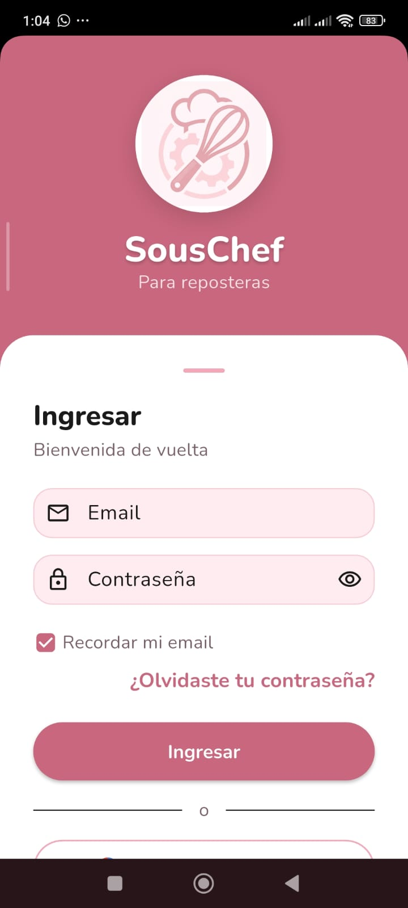
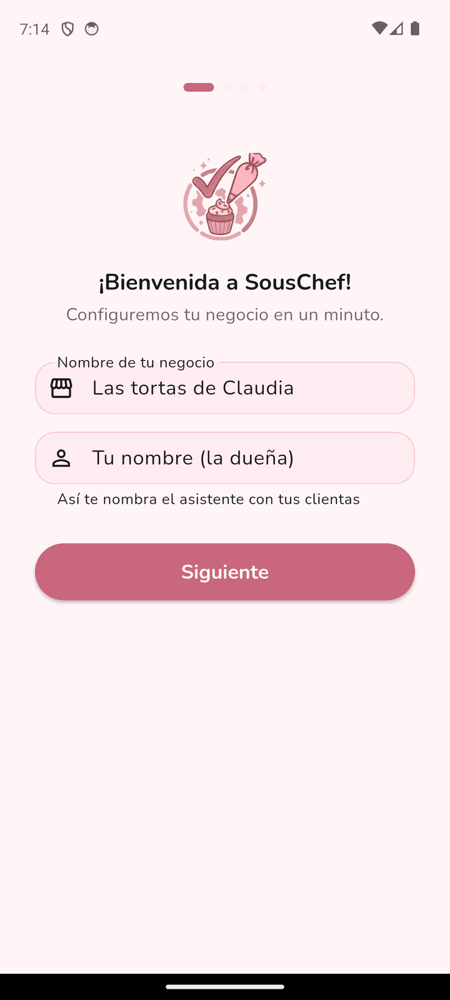
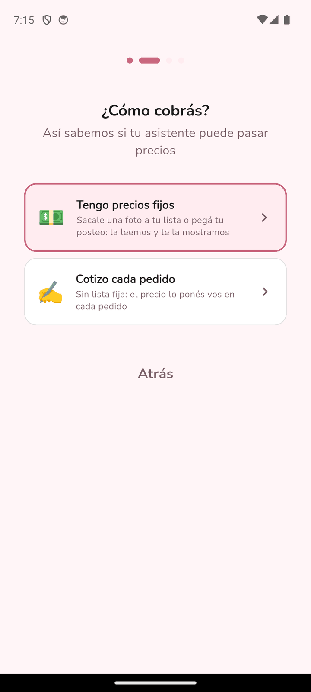
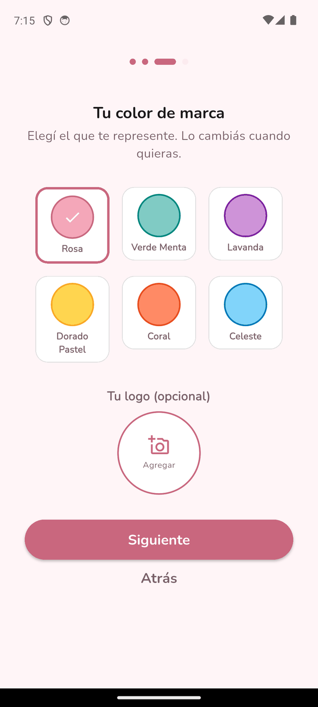
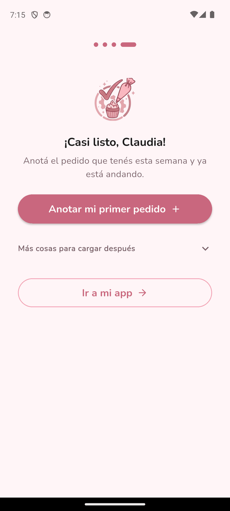
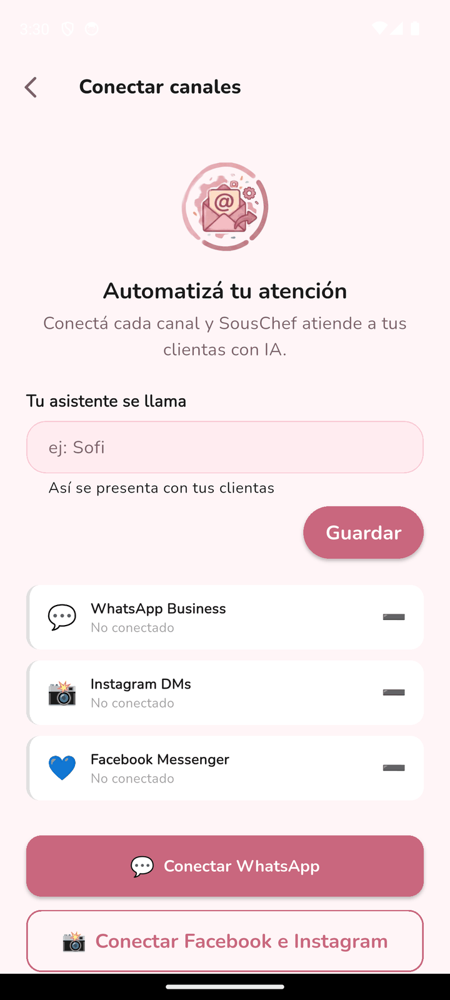
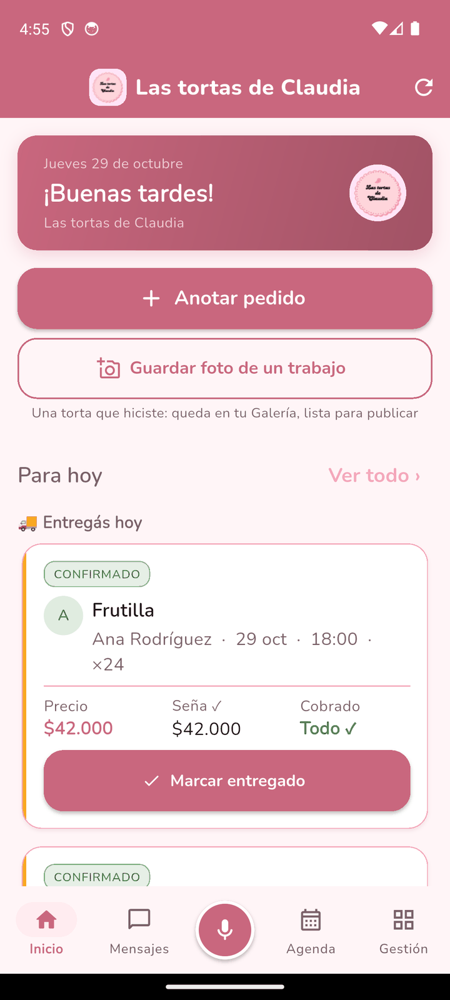
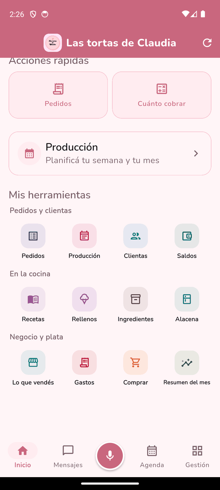
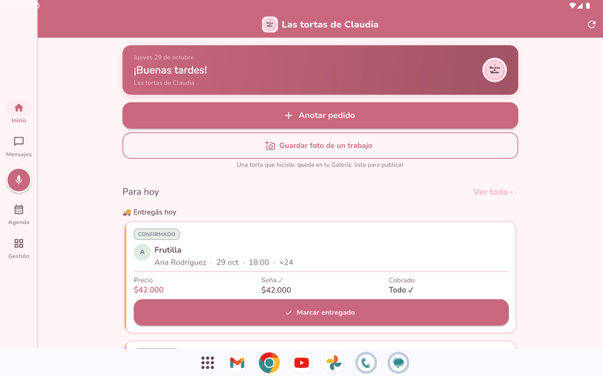
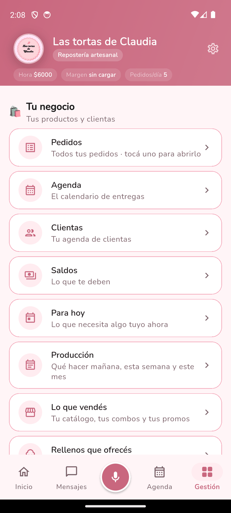

# 1. Primeros pasos

[Índice del manual](README.md) · [Atender clientas →](2-atender-clientas.md)

**En esta parte:** [Entrar y dar de alta tu negocio](#entrar-y-dar-de-alta-tu-negocio) · [Conectar tus canales](#conectar-tus-canales) · [La pantalla de inicio](#la-pantalla-de-inicio) · [Gestión](#gestión-todo-lo-demás) · [Buscar y ordenar en cualquier lista](#buscar-y-ordenar-en-cualquier-lista)

---

## Entrar y dar de alta tu negocio

<table>
  <tr>
    <td width="25%" valign="top"> La pantalla de entrar: tu correo, tu contraseña y el ojo para verla. Más abajo está la opción de entrar con Google (en la app para iPhone, por ahora, no).</td>
  </tr>
</table>

### Entrar a la app

1. Abrí la app de SousChef en tu celular.
2. En la pantalla de bienvenida vas a ver el logo y dos maneras de entrar.
3. Escribí tu **correo electrónico** y tu **contraseña**, y tocá **Ingresar**.
4. Si preferís, podés entrar con tu **cuenta de Google** con un solo toque, sin acordarte de ninguna contraseña.
5. Si todavía no tenés cuenta, la creás ahí mismo con tu correo. En dos minutos estás adentro.

> **En la app para iPhone**, por ahora se entra solo con correo y contraseña: el botón de Google no aparece. En el navegador del iPhone sí.

**La política de privacidad y los términos.** Al pie de la pantalla de entrar —deslizando hasta abajo— está el enlace **Política de privacidad**. Se abre en el navegador y cuenta qué datos guarda SousChef, para qué los usa y cómo pedir que se borren. Donde aparece el botón de Google, se lee *"Al continuar con Google aceptás la Política de privacidad"*: entrar con Google la primera vez ya te crea la cuenta. En la pantalla de crear cuenta está al final, en *"Al crear tu cuenta aceptás los Términos del servicio y la Política de privacidad"*: cada una se abre tocándola, y crear la cuenta desde ahí, sea con tu correo o con Google, es aceptar las dos. Después las tenés siempre en **Configuración → Legal** (te lo cuento en la [sección «Configuración»](6-configuracion-y-ayuda.md#configuración-cómo-atiende-tu-asistente)).

### El "no soy un robot"

Al entrar puede aparecerte un cuadrito que dice **"Soy humano"** (o "No soy un robot") para que
lo toques; si te pide elegir imágenes, la consigna está en español. Es una verificación de
seguridad: evita que alguien use un programa para probar contraseñas contra tu cuenta hasta
acertar.

Desde la computadora **no vas a ver nada**: se resuelve solo, de fondo. Que no aparezca no
significa que esté apagado.

Si no puede verificarte, te dice *"No pudimos verificar que no sos un robot"*. Casi siempre es
la conexión: esperá unos segundos y probá de nuevo.

### Si te olvidaste la contraseña

1. Escribí tu correo en el campo de arriba. **Este paso primero**, o te va a decir
   *"Ingresá tu email arriba para recuperar la contraseña"*.
2. Tocá **¿Olvidaste tu contraseña?**
3. Te llega un correo con un link. Abrilo desde el mismo celular.
4. Escribí la contraseña nueva **dos veces**, iguales. Mínimo **6 caracteres**.

Si no te llega, fijate en el correo no deseado.

### Si no te deja entrar

Estos son los carteles que podés ver, y qué significa cada uno:

| Lo que dice | Qué pasa | Qué hacer |
|---|---|---|
| **"Confirmá tu email primero"** | Creaste la cuenta pero no abriste el correo de confirmación. **Es la causa más común** | Buscá el correo de SousChef —revisá el spam— y tocá el link. Después entrá normalmente |
| **"Email o contraseña incorrectos"** | Alguno de los dos está mal | Fijate que el correo no tenga espacios de más. Si no te acordás, usá *¿Olvidaste tu contraseña?* |
| **"Este email ya tiene cuenta"** | Estás intentando registrarte con un correo que ya usaste | Andá a **Ingresar** en vez de crear cuenta |
| **"La contraseña debe tener al menos 6 caracteres"** | Es corta | Poné una más larga |
| **"Las contraseñas no coinciden"** | Las dos casillas del registro tienen textos distintos | Escribilas de nuevo, con cuidado |
| **"No se pudo conectar. Verificá tu internet"** | No hay señal, o está muy lenta | Probá con wifi, o esperá y volvé a intentar |

### El asistente de configuración (el alta, en cuatro pasos)

<table>
  <tr>
    <td width="25%" valign="top"> Paso 1 del alta: «¡Bienvenida a SousChef!», el nombre de tu negocio y tu nombre (la dueña), con el que el asistente te nombra ante tus clientas.</td>
    <td width="25%" valign="top"> Paso 2, «¿Cómo cobrás?»: 💵 Tengo precios fijos (le sacás una foto a tu lista y la leemos) o ✍️ Cotizo cada pedido (el precio lo ponés vos en cada uno).</td>
    <td width="25%" valign="top"> Paso 3, «Tu color de marca»: elegís la paleta (la cambiás cuando quieras) y, si querés, subís tu logo.</td>
    <td width="25%" valign="top"> Paso 4, «¡Casi listo!»: Anotar mi primer pedido, «Más cosas para cargar después» (plegado) e Ir a mi app.</td>
  </tr>
</table>

La primera vez que entrás, SousChef te lleva de la mano por **cuatro pasos**. Ninguno es obligatorio a la perfección: todo se puede cambiar después.

1. **¡Bienvenida a SousChef!** Solo dos datos: el **Nombre de tu negocio** y **Tu nombre (la dueña)** —así te nombra el asistente con tus clientas—. Tocás **Siguiente**.
2. **¿Cómo cobrás?** Dos caminos, elegí el tuyo:
   - **💵 Tengo precios fijos:** le sacás una foto a tu lista de precios o pegás tu posteo, la app la lee y te la muestra para que confirmes (te lo cuento con detalle en la [sección «Lo que vendés»](4-catalogo-recetas-y-costos.md#lo-que-vendés-catálogo-combos-y-promos)). Cuando termina, te dice *"¡Listo! Tus productos quedaron en el catálogo."* y tocás **Siguiente**.
   - **✍️ Cotizo cada pedido:** si no tenés una lista fija y el precio lo ponés vos en cada pedido. Pasás directo al paso siguiente.
3. **Tu color de marca.** Elegís el color de la app y, si querés, subís **Tu logo (opcional)** con **Agregar**.
4. **¡Casi listo!** El botón grande es **Anotar mi primer pedido**: abre el formulario de pedido (si todavía no tenés clientas, primero te pide los datos de la clienta) y, cuando lo guardás, entrás al Inicio con tu pedido ya anotado. Lo demás va plegado en **Más cosas para cargar después**: desplegalo cuando quieras para **Conectar canales**, **Mis ingredientes**, **Recetas** o **Catálogo**. Y si querés entrar sin anotar nada, tocás **Ir a mi app**.

> **Consejo:** después del alta, pasá un minuto por **Configuración** para cargar tu **valor de la hora de trabajo**, tu **margen de ganancia** y tu **máximo de pedidos por día**. Con esos datos SousChef calcula tus precios de verdad y cuida que no te sobrecargues. Si te lo salteás, tranquila: la calculadora te lo va a recordar con un cartelito cuando vea que seguís con el valor de ejemplo.

Ese es el recorrido completo de una repostera nueva: **crear la cuenta → los cuatro pasos del alta → tu primer pedido anotado → cuando quieras, conectar los canales**. Desde el primer día la app ya te sirve para organizarte; con los canales conectados, además atiende por vos.

---

## Conectar tus canales

<table>
  <tr>
    <td width="25%" valign="top"> Conectar canales: arriba, «Tu asistente se llama» con el nombre que elegís y Guardar; abajo, los tres canales (WhatsApp Business, Instagram DMs y Facebook Messenger) con su estado —acá, todavía sin conectar— y los dos botones: Conectar WhatsApp y Conectar Facebook e Instagram. Cuando un canal queda conectado, aparece con su tilde verde.</td>
  </tr>
</table>

Para que SousChef pueda atender a tus clientas, primero tenés que conectar tus redes. Esto se hace **una sola vez** y es lo que le da "manos" al asistente para leer y responder los mensajes.

### ¿Para qué sirve?

Una vez conectado, todos los mensajes que te lleguen por WhatsApp, Instagram o Messenger van a caer dentro de SousChef. El asistente los va a leer, responder y ordenar por vos. Sin conectar, la app te sirve igual para organizarte, pero no puede contestar sola.

### Cómo conectar

1. Andá a **Configuración → Conectar canales** (o, en el último paso del alta, desplegá **Más cosas para cargar después** y tocá **Conectar canales**).
2. Ahí vas a ver **dos botones**, uno para cada cosa:
   - **Conectar WhatsApp:** se abre el **asistente oficial de Meta** (la empresa dueña de WhatsApp). Iniciás sesión con tu cuenta de **Facebook**, elegís tu negocio y **verificás tu número** de WhatsApp. Es el proceso oficial, el mismo que usan todos los negocios.
   - **Conectar Facebook e Instagram:** un segundo botón para Messenger e Instagram. Iniciás sesión en Facebook, seleccionás tu cuenta o Página, autorizás los permisos y volvés a la app automáticamente.
3. Cuando termina, vas a ver una tilde verde 🎉 en cada canal que quedó conectado.

> **Tranquila:** SousChef se encarga de la parte técnica. Vos solo tenés que iniciar sesión y decir "sí, autorizo".

Si todavía no aceptaste que tus datos pasen por la inteligencia artificial, antes de abrir Facebook aparece la hoja **Antes de usar el asistente** (te la cuento en la [sección «El asistente por voz»](2-atender-clientas.md#el-asistente-por-voz)): conectar es que el asistente empiece a leer lo que te escriben tus clientas. Con **Ahora no**, no se abre nada.

### Ponele nombre a tu asistente

Arriba de los canales está **Tu asistente se llama**. Escribís un nombre (por ejemplo, *Sofi*) y tocás **Guardar**. Así se presenta con tus clientas: *"Soy Sofi, asistente de Claudia"*. Si no le ponés nombre, se presenta como siempre: *"el asistente de Claudia"*.

Lo podés cambiar cuando quieras, acá o en **Configuración** (*¿Cómo querés llamar a tu asistente?*). Un detalle: si le ponés tu propio nombre, sigue presentándose como *"el asistente de…"*, para que la clienta no crea que está hablando con vos. Y si querés que vuelva a presentarse como siempre, borrá el nombre en Configuración y guardá (en Conectar canales no se puede dejar vacío).

### Tus canales son tuyos y de nadie más

Cada negocio queda conectado con **sus propias credenciales**. Eso quiere decir que tus mensajes salen **únicamente por TUS canales**: lo tuyo nunca se mezcla con otro negocio que también use SousChef, y las respuestas de tu asistente le llegan a tus clientas desde tu número y tus cuentas.

### Sobre las reconexiones

Las conexiones de Meta **caducan cada tanto** (más o menos cada 60 días). No te preocupes por acordarte: SousChef revisa esto todos los días y, si una conexión está por vencerse o dejó de funcionar, te manda un aviso, *"⚠️ Revisá la conexión de tus canales"*, que te dice qué pasa y termina con *"Reconectá desde Configuración para no perder mensajes"*. Cuando lo veas, solo repetís el paso de conectar y listo.

---

## La pantalla de inicio

<table>
  <tr>
    <td width="25%" valign="top"> Lo primero que ves al abrir: el saludo, el botón grande «Anotar pedido» con «Guardar foto de un trabajo» debajo, y Para hoy con los pedidos que necesitan algo tuyo.</td>
    <td width="25%" valign="top"> Al final del Inicio, «Mis herramientas» en tres grupos: Pedidos y clientas, En la cocina, y Negocio y plata. Abajo, la barra con sus cinco lugares.</td>
  </tr>
</table>

Es la primera pantalla que ves al entrar. Está pensada para que arranques por **lo que tenés que hacer hoy** y, más abajo, tengas los números y los atajos.

### Qué vas a encontrar (de arriba para abajo)

1. **Tu saludo** (*¡Buenos días!*, *¡Buenas tardes!* o *¡Buenas noches!*), la fecha de hoy, el nombre de tu negocio y tu logo.
2. **Anotar pedido**, el botón grande: abre el formulario para cargar un pedido ([sección «Tus pedidos»](3-pedidos-y-agenda.md#tus-pedidos)). Debajo, **Guardar foto de un trabajo**: una foto (o un video) de una torta que hiciste, que queda en tu **Galería** lista para publicar, sin tener que ir a buscarla; te pregunta si querés **Tomar foto**, **Elegir una foto** o **Subir un video**.
3. **Para hoy:** los pedidos que necesitan algo tuyo, en los mismos cuatro grupos de la pantalla Para hoy ([sección «Tus pedidos»](3-pedidos-y-agenda.md#tus-pedidos)):
   - 🔴 **Vencidos — marcá si ya entregaste**
   - 🚚 **Entregás hoy**
   - 📝 **Esperan un sí o un no — de cualquier fecha**
   - 📅 **Sin fecha de entrega — ponele una**

   Cada grupo muestra hasta **cinco** pedidos. Si hay más, tocás **Ver N más ›** (o **Ver todo ›**, al lado del título) y se abre la pantalla Para hoy completa. Si no queda nada, te dice **¡Estás al día! 🎉**
4. **Resumen del día:** cuatro números (en la tablet acostada, los cuatro en una fila), y cada uno se toca:
   - **Pedidos hoy** → abre **Para hoy**.
   - **Pedidos abiertos** → los que todavía no entregaste ni cancelaste; abre **Pedidos**.
   - **Facturado mes** → cuánto llevás vendido este mes; abre el **Resumen del mes**.
   - **Sin leer** → las conversaciones en las que te escribieron en los últimos dos días; abre **Mensajes**.
5. **Mañana** y **Comprar esta semana:** dos tarjetas que aparecen solo si hay algo. **Mañana** te dice cuántas entregas y cuánto hay para producir (*"3 entregas · 2 a producir"*); si te pasaste de lo que podés hacer, se pone ámbar y dice **Mañana: día cargado**. Te lleva a **Producción**, en la pestaña Mañana. **Comprar esta semana: 5 ítems**, con el costo estimado, te lleva a la lista de compras ([sección «Comprar esta semana»](5-compras-y-plata.md#comprar-esta-semana)).
6. **Alertas**, solo si hay: *"⚠️ 2 ingredientes subieron de precio"* (las descartás con la ✕ o deslizándolas) y *"🛒 3 ingredientes necesitan reposición"* (tocala y vas a Mis ingredientes).
7. **Acciones rápidas:** **Pedidos** y **Cuánto cobrar**.
8. **Producción** — *"Planificá tu semana y tu mes"*: abre Producción en la pestaña Semana ([sección «Producción»](3-pedidos-y-agenda.md#producción)).
9. **Mis herramientas**, al final, en tres grupos de cuatro:
   - **Pedidos y clientas:** Pedidos · Producción · Clientas · Saldos
   - **En la cocina:** Recetas · Rellenos · Ingredientes · Alacena
   - **Negocio y plata:** Lo que vendés · Gastos · Comprar · Resumen del mes

**Configuración** no está entre los atajos del Inicio: la encontrás en **Gestión**, con la ruedita de arriba o al final de todo.

### Cómo la usás

- Tocá cualquier número o tarjeta para ver el detalle.
- Tocá **Anotar pedido** para cargar un pedido en segundos.
- Deslizá hacia abajo (tirá de la pantalla) para **actualizar** Para hoy, los números y las alertas. La flechita circular de arriba hace lo mismo.

### La barra de abajo

En la parte de abajo tenés cinco lugares, siempre a mano:

1. **Inicio** (esta pantalla)
2. **Mensajes** (las charlas con tus clientas, [sección «Mensajes»](2-atender-clientas.md#mensajes-y-el-asistente-que-atiende-solo))
3. **El micrófono**, el botón redondo del medio: con un toque se abre el **Asistente**, para hablarle o escribirle ([sección «El asistente por voz»](2-atender-clientas.md#el-asistente-por-voz))
4. **Agenda** (el calendario de entregas, [sección «La agenda»](3-pedidos-y-agenda.md#la-agenda))
5. **Gestión** (todo lo demás: pedidos, clientas, recetas, compras, el asistente, tu plan y la configuración — [sección «Gestión»](#gestión-todo-lo-demás)).

### En tablet y en la web

**En la tablet acostada** (salvo las más chicas, de 8") muchas pantallas se ven **partidas**: la lista a la izquierda y, a la derecha, lo que tocás, que queda marcado en la lista. Con la tablet parada y en el teléfono, tocar algo lo abre como siempre. En cada pantalla que se parte, este manual te cuenta qué queda de cada lado.

**En una tablet** la barra no va abajo: está parada al costado izquierdo, con los mismos cinco lugares en el mismo orden (Inicio arriba, el micrófono en el medio, Gestión abajo). Cuando el manual dice *"la barra de abajo"*, en la tablet es esa columna. La tablet se puede usar parada o acostada: la app gira con ella. En el teléfono sigue todo igual, siempre parado.

<table>
  <tr><td> En la tablet acostada, el Inicio con la columna de la izquierda (Inicio · Mensajes · micrófono · Agenda · Gestión) en vez de la barra de abajo; el contenido va al medio, con un ancho cómodo de leer.</td></tr>
</table>

En la tablet esa columna queda a mano también adentro de las demás pantallas (Pedidos, Clientas, Para hoy, Producción…), así pasás de una a otra sin volver atrás. Si la pantalla es de Gestión, queda marcada Gestión; las que se abren tanto desde el Inicio como desde Gestión, como Para hoy, no marcan ninguno. La única que va sin la columna es la del Asistente, que es justamente adonde lleva el micrófono.

En la tablet las pantallas no se estiran de punta a punta: listas, tarjetas y formularios van al medio, con un ancho cómodo de leer, y se pueden deslizar tocando en cualquier parte, también en los costados. La excepción es la entrada y el alta de cuenta: ahí el formulario es una tarjeta blanca al medio y se desliza tocando arriba de ella.

Lo mismo pasa si usás SousChef **desde el navegador en una ventana ancha**, como la de una notebook: la barra queda parada al costado y las pantallas van al medio. Si la ventana es muy grande (un monitor), la app se ve en el medio con forma de teléfono y la barra abajo, como siempre. Lo que este manual dice de «la tablet» (la barra al costado, los cuatro números del Inicio en una fila, las pantallas partidas en lista y ficha, la Agenda por semana cuando la pantalla es bajita) vale también para la web en una ventana ancha.

### Atajos desde el ícono de SousChef

Sin abrir la app, **mantené apretado el ícono de SousChef** en la pantalla del celular y aparecen sus accesos directos. Tocás uno y la app se abre directo en esa pantalla.

- **En Android** arrancan cinco: **Mensajes**, **Agenda**, **Cuánto cobrar**, **Recetas** y **Gastos**. Mientras usás la app, el teléfono va poniendo primero las últimas pantallas que abriste (también **Galería**, **Dónde comprar más barato**, **Catálogo** o **Configuración**); cuando cerrás SousChef del todo, vuelven las cinco de siempre. Cuántos se ven depende del teléfono.
- **En el iPhone** son cuatro: **Mensajes**, **Agenda**, **Cuánto cobrar** y **Recetas**. Además, Siri y la búsqueda del iPhone aprenden qué pantallas usás y te las sugieren.

---

## Gestión: todo lo demás

<table>
  <tr>
    <td width="25%" valign="top"> Gestión empieza por «Tu negocio»: Pedidos, Agenda, Clientas, Saldos, Para hoy, Producción, Lo que vendés, Rellenos que ofrecés y Galería, con tu hora, tu margen y tus pedidos por día arriba.</td>
  </tr>
</table>

**Gestión** es el último lugar de la barra de abajo. Arriba ves el nombre y el logo de tu negocio, tu hora, tu margen y tus pedidos por día (con la ruedita ⚙️ para ir a Configuración). Debajo, todo ordenado por lo que más usás. En este manual, cuando decimos *"el menú"*, es Gestión.

- 🛍️ **Tu negocio** → [Pedidos](3-pedidos-y-agenda.md#tus-pedidos) · [Agenda](3-pedidos-y-agenda.md#la-agenda) · [Clientas](2-atender-clientas.md#tus-clientas) · [Saldos](5-compras-y-plata.md#cobros-y-saldos-pendientes) · [Para hoy](3-pedidos-y-agenda.md#para-hoy-tu-día-en-una-sola-pantalla) · [Producción](3-pedidos-y-agenda.md#producción) · [Lo que vendés](4-catalogo-recetas-y-costos.md#lo-que-vendés-catálogo-combos-y-promos) · [Rellenos que ofrecés](4-catalogo-recetas-y-costos.md#rellenos-que-ofrecés) · [Galería](2-atender-clientas.md#galería-tus-trabajos-listos-para-publicar)
- 💵 **Costos y ganancia** → [Cuánto cobrar](4-catalogo-recetas-y-costos.md#cuánto-cobrar-y-precios-atrasados) · [Recetas](4-catalogo-recetas-y-costos.md#recetas) · [Costos por kilo](4-catalogo-recetas-y-costos.md#costos-por-kilo) · [Armado y entrega](4-catalogo-recetas-y-costos.md#armado-y-entrega) · [Dónde comprar más barato](5-compras-y-plata.md#dónde-comprar-más-barato)
- 🧺 **Lo que comprás** → [Mis ingredientes](5-compras-y-plata.md#mis-ingredientes) · [Mi alacena](5-compras-y-plata.md#mi-alacena) · [Comprar esta semana](5-compras-y-plata.md#comprar-esta-semana) · [Gastos](5-compras-y-plata.md#gastos)
- 🔔 **Tu asistente** → [Pendientes](2-atender-clientas.md#pendientes-aprobá-todo-con-un-toque) · [Precios atrasados](4-catalogo-recetas-y-costos.md#cuánto-cobrar-y-precios-atrasados) · [Resumen del mes](6-configuracion-y-ayuda.md#los-avisos-automáticos)
- ⭐ **Tu plan** → [SousChef Pro](6-configuracion-y-ayuda.md#tu-plan-free-y-pro) (en el iPhone se llama **Tu plan de SousChef**)
- Y al pie, [Configuración](6-configuracion-y-ayuda.md#configuración-cómo-atiende-tu-asistente) (*"Logo, colores, costos y agenda"*).

**Lo que todavía no puede usarse se ve atenuado**, con el motivo en lugar de la descripción, pero **igual abre** y la pantalla te explica qué cargar:

- **Costos por kilo:** *"Se activa cuando cargues tu primer relleno"*.
- **Armado y entrega:** *"Se activa cuando cargues tu primer ingrediente"*.
- **Comprar esta semana** y **Precios atrasados:** *"Se activa cuando cargues tu primer producto"*.

---

## Buscar y ordenar en cualquier lista

Casi todas las listas de SousChef se manejan igual, así aprendés una vez y te sirve en toda la app:

- **El buscador** 🔍 está arriba de la lista. Escribís y filtra al instante.
- **El ícono ⇅** (al lado del buscador) abre las opciones de **orden**. Elegís el criterio que quieras, y si **volvés a tocar el mismo criterio, se da vuelta** (de ↑ a ↓ y viceversa). Por ejemplo: "Precio" una vez te muestra los más caros primero; tocás "Precio" de nuevo y van los más baratos primero.
- Muchas listas tienen además **chips de filtro** (botoncitos que prendés y apagás) para quedarte solo con lo que te interesa.

### Dónde lo tenés y qué podés hacer en cada lista

| Lista | Buscás por… | Ordenás por… / Filtros |
|---|---|---|
| **Pedidos** | clienta, temática, festejado, relleno y **dirección de entrega** | fecha de entrega, más nuevos, precio, clienta |
| **Para hoy** | clienta o temática (el buscador aparece cuando hay cinco pedidos o más) | fecha, clienta |
| **Pendientes** | texto o clienta | chips **Mensajes a clientas** / **Recordatorios** / **Confirmables** |
| **Saldos** | — | saldo, clienta, total del pedido |
| **Clientas** | nombre, teléfono | varios órdenes + chips **Con pedidos** / **Frecuentes 3+** |
| **Mensajes** | ¡dentro de las conversaciones! (todo el historial) | más recientes, nombre |
| **Mis ingredientes** | nombre, **marca y proveedor** | orden + chips **Queda poco** / **En promo** / **Sin precio** |
| **Recetas** | nombre **e ingrediente** ("¿cuáles llevan frutilla?") | costo + chips por familia y **Sin costo** |
| **Dónde comprar más barato** | ingrediente o marca | nombre, mayor ahorro, precio |
| **Lo que vendés** (pestaña Productos) | producto o nota | nombre, precio, unidades |
| **Lo que vendés** (pestaña Combos y promos) | — | — (es una lista sin buscador ni orden) |
| **Mi alacena** | ingrediente | urgencia, nombre, cantidad, mínimo + chips **Se acabó** / **Queda poco** / **Sin mínimo** |
| **Comprar esta semana** | ingrediente | como viene, nombre, costo estimado + **Ocultar comprados** |
| **Gastos** | descripción o categoría | fecha, monto, categoría + chips por categoría |
| **Rellenos que ofrecés** | nombre o qué tiene | orden manual, nombre, adicional + chips **Activos** / **Ocultos** / **Premium** |
| **Galería** | temática, trabajo o clienta | más recientes, nombre, clienta |
| **Agenda (lista del día)** | — | hora, estado, monto, clienta + filtros por **estado** (**Nuevos** / **Confirmados** / **Entregados**); cada pedido con la misma tarjeta de Pedidos |

> **Un detalle que está bueno:** en Pedidos, aunque busques u ordenes, los **contadores de las pestañas** (Todos, Nuevos, Confirmados…) siguen mostrando los números correctos de lo que estás viendo. Nada de números que no cierran.

---

[Índice del manual](README.md) · [Atender clientas →](2-atender-clientas.md)
