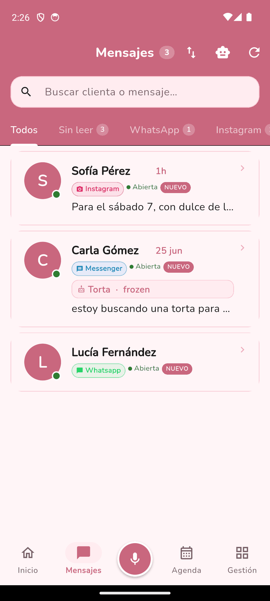
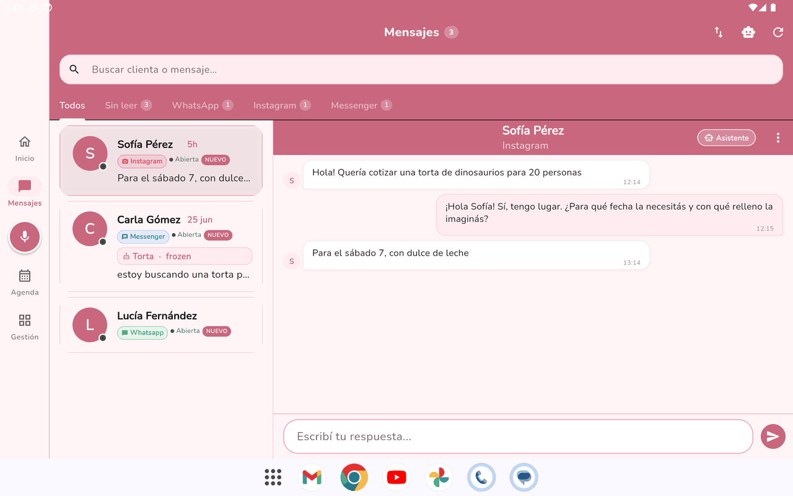
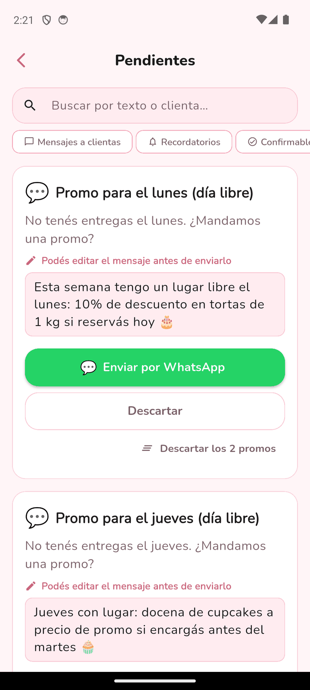
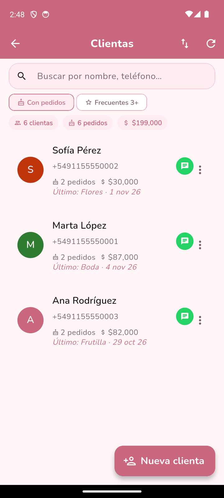
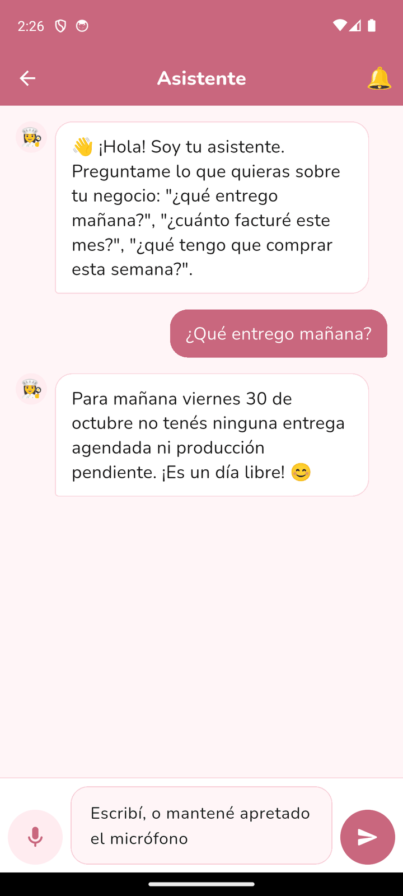
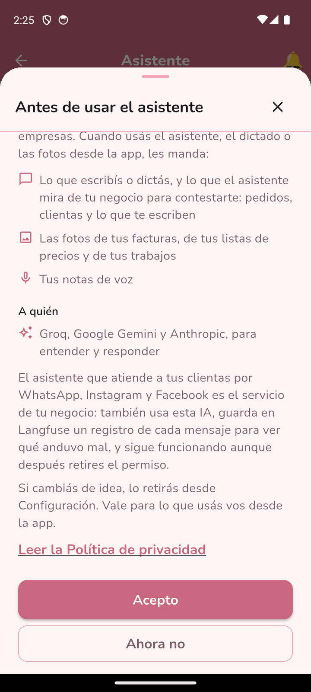
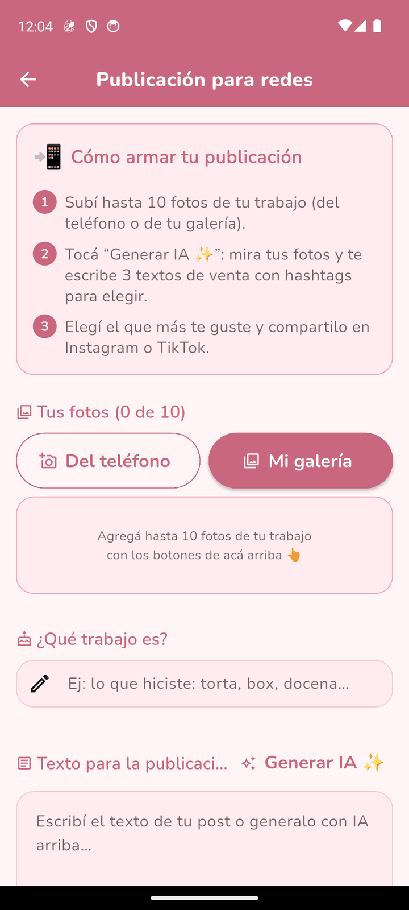

# 2. Atender clientas

[Índice del manual](README.md) · [← Primeros pasos](1-primeros-pasos.md) · [Pedidos, agenda y producción →](3-pedidos-y-agenda.md)

**En esta parte:** [Mensajes y el asistente que atiende solo](#mensajes-y-el-asistente-que-atiende-solo) · [Pendientes](#pendientes-aprobá-todo-con-un-toque) · [Tus clientas](#tus-clientas) · [El asistente por voz](#el-asistente-por-voz) · [Galería](#galería-tus-trabajos-listos-para-publicar)

---

## Mensajes y el asistente que atiende solo

<table>
  <tr>
    <td width="25%" valign="top"> Mensajes: las conversaciones de tus tres canales en un solo lugar, con el buscador arriba y las pestañas Todos / Sin leer / WhatsApp / Instagram.</td>
  </tr>
</table>

**Mensajes** (el segundo lugar de la barra de abajo) junta todas tus conversaciones de WhatsApp, Instagram y Messenger en un solo lugar. Ya no tenés que andar saltando de una app a otra.

### Cómo se ve

- Arriba hay pestañas para filtrar: **Todos**, **Sin leer**, **WhatsApp**, **Instagram**, **Messenger**.
- Cada conversación muestra: la foto o inicial de la clienta, su nombre, por qué canal te escribió (con un color: WhatsApp verde, Instagram rosa, Messenger azul), en qué estado está y la última línea del mensaje.
- Si hay un pedido en esa charla, ves un resumen chiquito (la tortita, las porciones, la fecha).
- Las conversaciones **nuevas o sin leer** tienen un cartelito de aviso para que no se te pasen.

**En tablet** ([pantalla partida](1-primeros-pasos.md#en-tablet-y-en-la-web)) Mensajes se ve partida: a la izquierda la lista de conversaciones y a la derecha el chat que tocás, que queda marcado en la lista; lo leés y le respondés ahí mismo, sin perder la lista de vista. Lo que escribiste para responder y todavía no mandaste no se pierde: sigue ahí si girás la tablet y, también en el teléfono, si salís del chat y lo volvés a abrir, mientras no te vayas de Mensajes. Cada conversación guarda lo suyo.

<table>
  <tr><td> Mensajes partida en la tablet acostada: a la izquierda la lista de conversaciones (la elegida queda marcada) y a la derecha el chat, con su pastilla Asistente y el campo para responder.</td></tr>
</table>

### El buscador que encuentra lo dicho hace tiempo

Arriba tenés un **buscador** que no busca solo por nombre: busca **dentro de las conversaciones**, en todo el historial. ¿Te acordás de que alguien te habló de una "torta de unicornio" hace dos meses pero no te acordás quién? Escribí "unicornio" y SousChef revisa todos tus chats (lo hace la base de datos, así que es al instante) y te muestra la conversación **con el mensaje exacto donde apareció**. También podés ordenar la lista con el ícono **⇅** (más recientes o por nombre).

### Cómo atiende el asistente (solo, por vos)

Este es el corazón de SousChef. Cuando una clienta te escribe, pasa esto **automáticamente**:

1. **Espera unos segundos** por si la clienta manda varios mensajes seguidos, así responde una sola vez a todo junto (y no la bombardea con respuestas sueltas).
2. **Entiende qué quiere** la clienta: si es un saludo, si pregunta horarios, si quiere hacer un pedido, si tiene un reclamo, etc.
3. **Responde según el caso:**
   - Si pregunta algo simple (horarios, si tenés lugar tal fecha, ubicación), **le contesta al toque**.
   - Si quiere hacer un pedido, **mira tu catálogo y pregunta solo lo que hace falta**: para una **torta**, la fecha, las porciones (o los kilos), la temática y el relleno — y si la clienta pide **pisos**, anota el bizcochuelo y los rellenos **de cada piso**. Para una **docena o una caja**, pregunta solo **cuántas y para cuándo**, y el pedido cierra.
   - Si la clienta dice **a dónde hay que llevarle el pedido**, esa **dirección de entrega queda anotada en el pedido** solita.
   - Si manda una **nota de voz**, la escucha y la entiende igual.
   - Si manda una **foto de una torta**, la mira, reconoce qué tan compleja es y te la deja anotada como referencia del pedido.

### Lo que el asistente NUNCA hace

**Nunca da NINGÚN precio.** Esto abarca todo:

- El precio de tus productos: si preguntan "¿cuánto sale?", responde algo como *"El presupuesto exacto te lo confirma [tu nombre] 💕 Contame los detalles y se lo paso para que te pase el precio."*
- El precio de los **combos**: dice **qué incluye** cada combo y que *"conviene más que por separado"*, pero el monto no.
- El recargo de los **rellenos premium**: los nombra como *"(premium)"*, sin decir cuánto es el adicional.

La **única excepción** es la **lista de rellenos**: esa se manda **tal cual** la tenés cargada, porque es la misma lista que vos copiás y pegás desde la app.

Así vos ponés el precio con toda la información y sin apuros.

### Tus datos para cobrar: los manda el asistente por vos

Cuando una clienta ya cerró el pedido y quiere **transferirte o señar**, muchas veces te pide "pasame tu alias / CBU". Para que no tengas que estar copiando y pegando siempre lo mismo, cargás **una sola vez** tus datos de cobro y el asistente se los manda solo a la clienta cuando se los pide.

- Andá a **Configuración** y cargá tu bloque de datos de cobro de **Mercado Pago**: titular de la cuenta, **Alias**, **CBU/CVU** y **CUIT**.
- Listo. Cuando una clienta pida los datos para pagar, el asistente se los pasa **tal cual los cargaste** (sin que la inteligencia artificial los toque, así es imposible que se deformen).
- Si en algún momento cambian tus datos, los actualizás ahí mismo y el asistente ya empieza a mandar los nuevos.

> **Ojo:** esto es solo para pasar tus datos de cobro. El asistente **sigue sin dar precios**: el monto se lo confirmás vos.

Lo mismo pasa con tu **dirección de retiro**: si la cargaste en Configuración, el asistente la manda **letra por letra como la escribiste**. Y si no la cargaste, no comparte ninguna dirección y te deriva la consulta (más detalle en la [sección «Configuración»](6-configuracion-y-ayuda.md#configuración-cómo-atiende-tu-asistente)).

### Cuándo te pasa la conversación a vos

El asistente sabe cuándo tiene que llamarte. Te pasa la conversación (y te avisa) cuando:

- La clienta se enoja, tiene un reclamo o **pide hablar con vos directamente**.
- Ya tiene todos los datos del pedido y hace falta que vos pongas el precio. Para ahorrarte las cuentas, te deja armado un **borrador de presupuesto** con los precios de **TU catálogo** y **TUS recargos de rellenos** (no una lista fija). Es un borrador para vos: la clienta no ve ningún precio hasta que vos lo mandes.
- **Pasaron 15 minutos** y la conversación te quedó esperando sin respuesta: te manda un aviso urgente *"🔔 [Clienta] sigue esperando"* para que no se te escape.

Si te pasó la conversación y pasan unas **6 horas** sin que le hayas escrito nada a la clienta, el asistente le manda **una sola vez** un "perdón la demora": le cuenta que estás con las manos en la masa y que apenas te desocupes le confirmás el presupuesto. No cotiza ni dice ningún precio, y lo ves en el chat. Este mensaje sale solo, sin pasar por Pendientes.

### Rechazar un presupuesto

Dentro del chat, la tarjeta del pedido tiene la opción de **rechazarlo** (por ejemplo, si no llegás con esa fecha). Cuando rechazás:

- El pedido **se cierra siempre**, pase lo que pase.
- SousChef intenta avisarle a la clienta con un mensaje amable. Si no se puede avisar (WhatsApp solo deja responder dentro de las 24 horas del último mensaje de la clienta — es una regla de Meta, no de SousChef), **el pedido queda cerrado igual** y la app te lo aclara con un cartel, para que sepas que a la clienta no le llegó el aviso y le escribas vos si querés.

### Pausar el asistente

En la parte de arriba de Mensajes hay un botón con un robotito 🤖. Si lo tocás, **pausás las respuestas automáticas** en todos los canales (queda naranja para que sepas que está pausado). Útil si querés atender todo vos por un rato. Tocalo de nuevo para reactivarlo.

Cada chat tiene además, arriba a la derecha, una pastilla que dice **Asistente** o **Manual**. Cuando respondés a mano en una conversación, el asistente se calla **en esa charla** para no pisarte, y la pastilla pasa a **Manual** (en naranja). Si querés que la vuelva a atender, tocá la pastilla y vuelve a **Asistente**. Y si pausaste el asistente con el robotito, la pastilla de todos los chats dice **Pausado**: ahí no hay nada que tocar en el chat, lo reactivás con el robotito.

---

## Pendientes: aprobá todo con un toque

<table>
  <tr>
    <td width="25%" valign="top"> Acá SousChef te deja las cosas listas para que vos las apruebes. Cuando hay varias del mismo tipo, abajo de la tarjeta aparece «Descartar los N…» para sacarlas todas de una.</td>
  </tr>
</table>

**Pendientes** es donde SousChef te deja preparadas cosas para que vos las revises y confirmes. La regla de oro es simple:

> **SousChef propone, vos decidís.** Nada se envía ni se ejecuta sin que vos lo apruebes.

### Qué vas a encontrar acá

- **Mensajes ya escritos, listos para enviar.** Por ejemplo, un seguimiento a una clienta que pidió presupuesto y no volvió a responder. El mensaje ya está redactado con tu estilo; vos lo leés, lo editás si querés, y tocás **Enviar por WhatsApp** o **Descartar**.
- **Acciones preparadas.** Por ejemplo, reprogramar un pedido a otra fecha, o aplicar nuevos precios. Vos tocás **✅ Confirmar** (o **✅ Aplicar**) o **Descartar**.
- **Recordatorios:** el cumpleaños de una clienta, o algo que pospusiste. Los resolvés con **Hecho** o los dejás para mañana con **Posponer**.

**Los agradecimientos, las promos y los avisos de saldo solo aparecen si los prendés.** De fábrica vienen apagados, para que Pendientes no se te llene de tarjetas que no pediste. Si los querés, están en **Configuración → Asistente proactivo**:

- **Agradecer después de entregar:** al marcar un pedido entregado te deja un gracias listo para mandar, pidiendo una foto o una reseña.
- **Promos para días libres:** los lunes, si te queda un día sin pedidos en la semana, te deja una promo armada.
- **Avisar el saldo a la clienta:** el día de la entrega te deja un mensaje listo para recordarle lo que falta pagar. Lo mandás vos.

### Cómo lo usás

1. Entrá a **Pendientes** desde **Gestión → Tu asistente → Pendientes**, desde la campanita 🔔 del asistente, o tocando el aviso que te llegó al celular.
2. Leé cada tarjeta con calma. Arriba tenés un buscador (*Buscar por texto o clienta…*) y los filtros **Mensajes a clientas**, **Recordatorios** y **Confirmables**.
3. Si es un mensaje: revisalo, editalo si querés cambiar algo, y **Enviá** o **Descartá**.
4. Si es una acción: tocá **Confirmar** para que se haga, o descartala.
5. Si es un recordatorio y no lo querés resolver ahora, **Posponer** te lo vuelve a mostrar al día siguiente.

### Descartar varias de una

Si tenés varias tarjetas del mismo tipo, abajo de cada una aparece un botón como **Descartar los 5 agradecimientos** (o *los 3 seguimientos*, *los 2 avisos de cobro*…). Te pregunta antes —*"Desaparecen de Pendientes. Los pedidos no se tocan."*— y las saca todas juntas.

### Lo viejo se va solo

No hace falta que limpies: los pendientes **vencen solos** cuando ya no tienen sentido. Un agradecimiento, a la semana; una promo, a los diez días; el seguimiento de un presupuesto, cuando el pedido se confirma, se cancela o se le pasa la fecha; un recordatorio de cobro, cuando la clienta ya pagó. Lo demás, al mes sin tocarlo.

---

## Tus clientas

<table>
  <tr>
    <td width="25%" valign="top"> Tu agenda de clientas, con el buscador y los chips "Con pedidos" y "Frecuentes 3+" (acá, con "Con pedidos" activo).</td>
  </tr>
</table>

*(Gestión → Tu negocio → Clientas, o **Clientas** en Mis herramientas del Inicio)*

Es tu **agenda de clientas**. De cada una guardás:

- Nombre y teléfono de WhatsApp.
- Historial de pedidos (los últimos, cuánto gastó en total, en qué estado están).
- Desde cuándo es clienta y su primer pedido.

Tenés un **buscador** para encontrar a cualquiera al instante, el ícono **⇅** para ordenar la lista, y dos chips muy útiles: **"Con pedidos"** (las que alguna vez te compraron) y **"Frecuentes 3+"** (las que ya te hicieron tres pedidos o más — tus mejores clientas, para mimarlas). Al lado de su nombre, el botoncito verde abre WhatsApp con ella. También podés editar o borrar sus datos (una clienta con pedidos cargados no se puede borrar: primero borrá sus pedidos o pasáselos a otra). Así nunca te olvidás de una clienta ni de lo que le gusta pedir.

**Una clienta, una sola ficha.** Si cargás una clienta con un teléfono que ya tenés anotado, la app te avisa en vez de crearla de nuevo, aunque el número esté escrito distinto (con o sin el 15, el 0 o el +54 9). En Clientas aparece *«Ya tenés a Lucía con ese teléfono»* debajo del número. Si la cargás con **Nueva clienta** desde un pedido, aparece *«Ya la tenías: Lucía»* y el botón cambia a **Elegir a Lucía**, así el pedido queda en su ficha de siempre. Cuando una clienta que ya tenés anotada te escribe por WhatsApp, el asistente también la reconoce por el número. Las fichas repetidas que ya tenías se juntaron en una sola, con todos sus pedidos. Si de verdad es otra persona con el mismo número (por ejemplo, mamá e hija), cargala sin teléfono.

**En tablet** ([pantalla partida](1-primeros-pasos.md#en-tablet-y-en-la-web)) Clientas se ve partida: a la izquierda la lista, con el buscador y los chips, y a la derecha la **ficha** de la clienta que tocás, que queda marcada en la lista; con el lápiz y el tacho de arriba de la ficha la editás o la borrás. Ahí el botón **Nueva clienta** va abajo de la lista.

---

## El asistente por voz

<table>
  <tr>
    <td width="25%" valign="top"> Le preguntás hablando o escribiendo y te contesta (antes de la primera pregunta te ofrece unas sugeridas para empezar). El micrófono para mantener apretado está abajo a la izquierda, al lado de donde escribís.</td>
  </tr>
</table>

*(Tocá el botón redondo del micrófono, en el medio de la barra de abajo: se abre la pantalla **Asistente**.)*

¿Tenés las manos en la masa? Hablale a SousChef en vez de escribir. Preguntale cosas como:

- *"¿Qué entrego mañana?"*
- *"¿Quién me debe hoy?"*
- *"¿Qué compro esta semana?"*
- *"¿Cómo me fue este mes?"*

### La primera vez: «Antes de usar el asistente»

<table>
  <tr>
    <td width="25%" valign="top"> La hoja «Antes de usar el asistente»: qué le manda SousChef a la inteligencia artificial y a quién, el aviso sobre el asistente que atiende a tus clientas, el enlace a la política y los botones Acepto / Ahora no.</td>
  </tr>
</table>

La primera vez que le hablás o le escribís, antes de mandar nada aparece la hoja **Antes de usar el asistente**. Te cuenta que, para entenderte y contestarte, SousChef usa inteligencia artificial de otras empresas; qué les manda (lo que escribís o dictás y lo que el asistente mira de tu negocio para contestarte, las fotos de tus facturas, de tus listas de precios y de tus trabajos, y tus notas de voz) y a quiénes (Groq, Google Gemini y Anthropic, para entender y responder). También te cuenta que el asistente que atiende a tus clientas usa esa misma inteligencia artificial y guarda en Langfuse un registro de cada mensaje para ver qué anduvo mal. Abajo está **Leer la Política de privacidad**.

- **Acepto:** sigue con lo que ibas a hacer y no te lo vuelve a preguntar. Vale para tu cuenta, también si entrás desde otro teléfono.
- **Ahora no** (o la X, o bajar la hoja): no se manda nada y te dice *"Sin eso el asistente no puede trabajar."* Si habías escrito algo, vuelve al campo. La próxima vez que lo uses, te lo pregunta de nuevo.

Es una sola hoja para todo lo que la app le manda a la inteligencia artificial cuando la usás vos, y con aceptar una vez alcanza para todo:

- el asistente, hablando o escribiendo;
- **Contame qué lleva** (y su **Grabar y mandar**), en las recetas y en Costos por kilo;
- **Escanear factura**, en Mis ingredientes, antes de abrir la cámara o la galería;
- importar tu lista de precios de una foto o del texto, en Lo que vendés y en el alta;
- **Generar IA ✨**, los textos para tus fotos de la Galería;
- **Conectar canales** ([sección «Conectar tus canales»](1-primeros-pasos.md#conectar-tus-canales)).

Vale para lo que usás vos desde la app. El asistente que atiende a tus clientas por WhatsApp, Instagram y Facebook es el servicio de tu negocio y sigue trabajando igual (si querés que no conteste, lo pausás con el robotito de Mensajes, [sección «Mensajes»](#mensajes-y-el-asistente-que-atiende-solo)). Lo retirás cuando quieras desde **Configuración → Legal** ([sección «Configuración»](6-configuracion-y-ayuda.md#configuración-cómo-atiende-tu-asistente)). Si lo retiraste desde otro teléfono, la hoja vuelve a aparecer la próxima vez y, si aceptás, lo que estabas mandando sale igual: no lo tenés que repetir.

### Apretar para hablar, soltar para mandar

- Ya en la pantalla Asistente, **mantené apretado el micrófono** de abajo a la izquierda (al lado de donde escribís) y hablá: mientras hablás, vas viendo escrito lo que entiende (*"Te escucho… soltá para mandar 🎙️"*).
- **Soltá** y se manda. Si soltás sin haber dicho nada, no manda nada.
- Un toque corto no lo prende: te recuerda *"Mantené apretado el micrófono para hablar 🎙️"*. Así un toque sin querer nunca lo deja escuchando.

El asistente te responde por escrito y **también en voz alta** (ideal cuando estás cocinando). Mientras habla ves *"Estoy hablando · tocá para cortar"*: si la tocás, se calla y te vuelve a escuchar; si apretás el micrófono, se calla y te escucha mientras lo tengas apretado.

**Manos libres.** Cuando termina de leerte una respuesta en voz alta, **vuelve a escuchar solo** (*"Te escucho… hacé una pausa cuando termines 🎙️"*) y manda cuando hacés una pausa larga; un toque corto en el micrófono también lo manda. Es la única vez que el micrófono se prende sin que lo toques: al abrir la pantalla nunca escucha solo, y si te ponés a escribir con el teclado, el manos libres se apaga.

> En **iPhone, desde el navegador**, el teléfono no deja escuchar en vivo: mantenés apretado igual, la app graba (*"Grabando… soltá para mandar 🎙️"*) y al soltar pasa tu nota de voz a texto y la manda. La primera vez, la hoja **Antes de usar el asistente** aparece mientras apretás: después de **Acepto** te dice *"Listo. Ahora mantené apretado el micrófono para hablar 🎙️"* y lo volvés a apretar.

Y no solo contesta preguntas — también **hace**:

- Le podés pedir que **cree un producto o un combo**, y lo deja completito: con su categoría y cómo se vende, y los componentes del combo que ya están en tu catálogo enganchados, con su costo. Si alguno no está (o le dictaste el combo sin decirle qué trae), el combo se crea igual y te avisa que te falta completarlo en la pestaña **Combos y promos**.
- Si le preguntás por tus combos, te dice **qué incluye cada uno y cuánto te cuesta**.
- Si le preguntás por tu plan, te responde el que **de verdad** tenés (Pro o Gratis), sin inventos.
- Y te habla en tu idioma: de "tu alacena" y de "tus ingredientes", no de "stock de insumos".
- Si la respuesta está en otra pantalla, te deja el botón **Abrir pantalla**: te lleva cuando lo tocás, nunca sola.

Si le pedís que haga algo importante (por ejemplo, reprogramar un pedido), te lo va a mostrar como una tarjeta para que **confirmes o descartes** antes de hacerlo. Otra vez: nunca hace nada sin tu OK.

---

## Galería: tus trabajos, listos para publicar

<table>
  <tr>
    <td width="25%" valign="top"> Los tres pasos para armar un posteo: subís fotos, tocás "Generar IA" y elegís el texto que más te gusta.</td>
  </tr>
</table>

**Galería** (*"Posteos para Instagram y TikTok"*) está en **Gestión → Tu negocio**: tus fotos y videos de trabajos, listas para publicar en redes, organizadas por las categorías de tu catálogo. Para sumar una sin entrar acá, usá **Guardar foto de un trabajo** en el Inicio.

**En tablet** ([pantalla partida](1-primeros-pasos.md#en-tablet-y-en-la-web)) la Galería se ve partida: a la izquierda tus fotos, de a tres por fila, y a la derecha en grande la que tocás, que queda marcada, con sus datos y los botones **Armar link** (el link para pasársela a quien te edita el contenido) y **Eliminar**; si tocás la foto grande, se abre encima de todo, como en el teléfono.

---

[Índice del manual](README.md) · [← Primeros pasos](1-primeros-pasos.md) · [Pedidos, agenda y producción →](3-pedidos-y-agenda.md)
