# 3. Pedidos, agenda y producción

[Índice del manual](README.md) · [← Atender clientas](2-atender-clientas.md) · [Catálogo, recetas y costos →](4-catalogo-recetas-y-costos.md)

**En esta parte:** [Tus pedidos](#tus-pedidos) · [La agenda](#la-agenda) · [Producción](#producción)

---

## Tus pedidos

<table>
  <tr>
    <td width="25%" valign="top">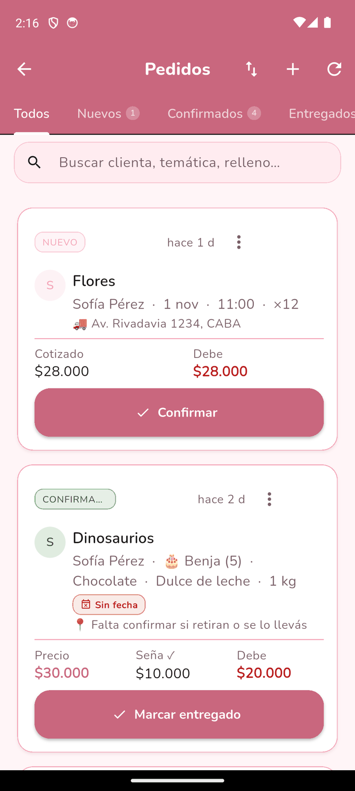 La lista de pedidos con la tarjeta de siempre: estado, clienta, fecha y hora, relleno y kilos, la fila Precio / Seña / Debe y el botón grande Confirmar o Marcar entregado.</td>
  </tr>
</table>

Acá tenés **todos tus pedidos ordenados**, con pestañas para verlos por estado.

### Para hoy: tu día en una sola pantalla

<table>
  <tr>
    <td width="25%" valign="top">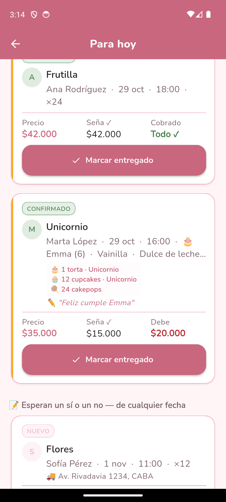 Para hoy como pantalla propia: cada grupo con sus pedidos y el botón que corresponde (acá, 🚚 Entregás hoy con Marcar entregado y 📝 Esperan un sí o un no). En la tarjeta ves la cantidad (×24, ×12), lo que debe, la dirección si se envía y, si el pedido lleva más de una cosa, la lista con la cantidad de cada una.</td>
  </tr>
</table>

**Para hoy** junta los pedidos que necesitan que hagas algo **ahora**, con un botón para cada caso. Lo ves **arriba de todo en el Inicio** (hasta cinco por grupo) y también como **pantalla propia**, que se abre con **Ver todo ›**, con el número **Pedidos hoy** del Inicio o desde **Gestión → Tu negocio → Para hoy**. Te ordena lo que importa en **cuatro grupos**:

- 🔴 **Vencidos — marcá si ya entregaste:** entregas que quedaron atrás sin marcar. Casi siempre ya las entregaste y te faltó el toque: **Marcar entregado** y listo.
- 🚚 **Entregás hoy:** las entregas de la jornada, cada una con su **Marcar entregado**.
- 📝 **Esperan un sí o un no — de cualquier fecha:** los presupuestos sin respuesta, para que ningún "¿te confirmo mañana?" quede en el olvido. Cada uno tiene **Confirmar** y **Canceló** (antes de cancelar te pregunta).
- 📅 **Sin fecha de entrega — ponele una:** pedidos confirmados que llegaron sin fecha (los del asistente o los viejos). Sin fecha no aparecen en la Agenda ni en los días de Producción (ahí solo te avisa cuántos hay), así que **Ponerle fecha** te abre el formulario para cargarla.

Las tarjetas son **las mismas de Pedidos y de la Agenda** (te las cuento más abajo), pero sin el menú ⋮: acá cada una trae solo el botón que corresponde. Tocás una y se abre la **ficha** del pedido (en *Sin fecha*, el formulario, para que cargues la fecha).

**En tablet** ([pantalla partida](1-primeros-pasos.md#en-tablet-y-en-la-web)) la pantalla Para hoy se ve partida: la lista a la izquierda y, a la derecha, la ficha del pedido que tocaste, que queda marcado en la lista (también los de *Sin fecha*: la fecha se la ponés con su botón **Ponerle fecha**). Para cambiar algo del pedido, el lápiz de arriba de la ficha (**Editar pedido**) abre el formulario.

<table>
  <tr><td>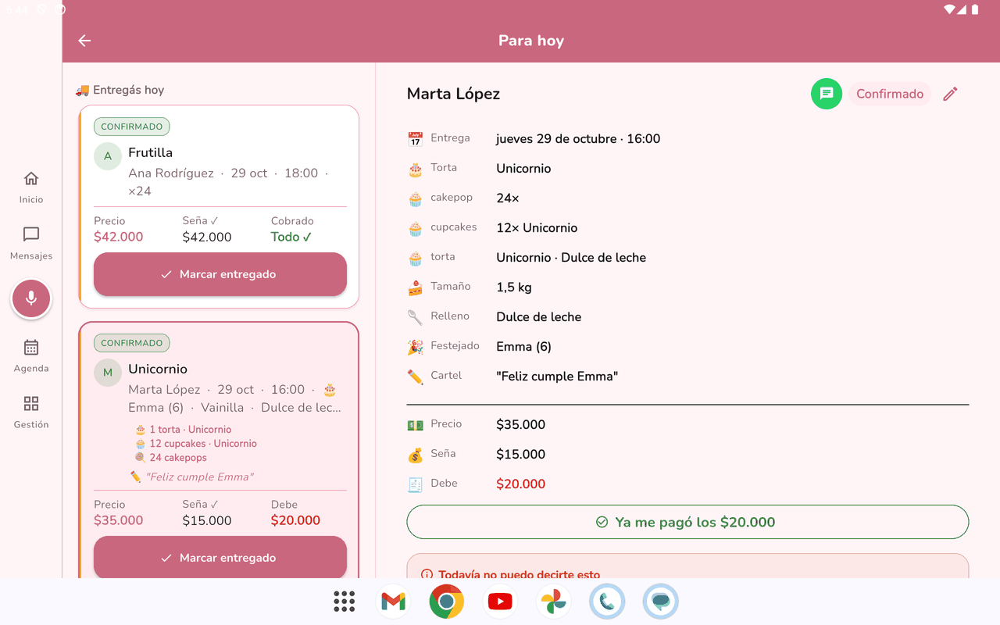 Para hoy partida: la lista a la izquierda, con la torta y lo que lleva (1 torta · 12 cupcakes · 24 cakepops), y a la derecha la ficha del pedido que tocaste.</td></tr>
</table>

En la pantalla propia, cuando tenés **cinco o más** pedidos esperando, arriba aparece el buscador (*Buscar clienta o temática…*) y el orden por **Fecha** o **Clienta**. Cuando no queda nada, te dice **¡Estás al día! 🎉**

### Cómo llegás a todos tus pedidos

Tenés la pantalla de "todos los pedidos" siempre a mano:

- Desde el **Inicio**: con el número **Pedidos abiertos**, con **Pedidos** en las acciones rápidas, o con **Pedidos** en Mis herramientas.
- Desde **Gestión**, en la sección **Tu negocio**, tocando **Pedidos**.
- Desde la **Agenda**, con el botón **Ver todos**.

### Las pestañas

Un pedido tiene **cuatro estados** —Nuevo, Confirmado, Entregado y Cancelado— y las pestañas te los muestran:

- **Todos**
- **Nuevos** (presupuestos: falta el sí de la clienta)
- **Confirmados**
- **Entregados**
- **Cancelados**

Cada pestaña te cuenta sola cuántos pedidos hay. Y arriba tenés el **buscador** (por clienta, temática, festejado, relleno o dirección) y el ícono **⇅** para ordenar por fecha de entrega, más nuevos, precio o clienta ([sección «Buscar y ordenar en cualquier lista»](1-primeros-pasos.md#buscar-y-ordenar-en-cualquier-lista)).

**En tablet** ([pantalla partida](1-primeros-pasos.md#en-tablet-y-en-la-web)) Pedidos se ve partida: a la izquierda la lista de siempre, con el buscador, y a la derecha la **ficha** del pedido que tocás, que queda marcado en la lista. Para editarlo, el lápiz de arriba de la ficha (**Editar pedido**) abre el formulario de siempre. Si el pedido sale de la lista que estás viendo (otra pestaña, la búsqueda, lo borraste), la ficha se cierra sola.

<table>
  <tr><td>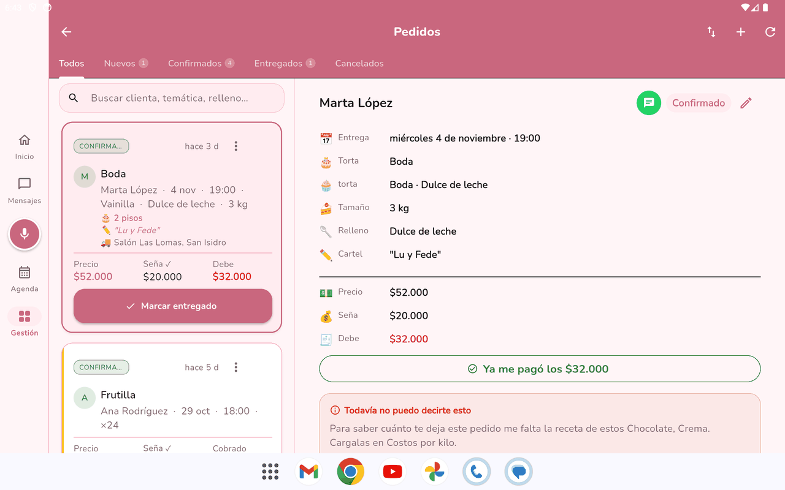 Pedidos partida: a la izquierda la lista con el buscador y las pestañas, con el pedido tocado marcado; a la derecha su ficha (entrega, torta, tamaño, relleno, cartel, la plata y el botón «Ya me pagó»), con el lápiz arriba para editarlo.</td></tr>
</table>

### Cómo se ve cada pedido: la misma tarjeta en todos lados

Un pedido se ve con **la misma tarjeta** en Pedidos, en la Agenda y en Para hoy, así lo reconocés al toque esté donde esté:

- Arriba, el **estado**: NUEVO, CONFIRMADO, ENTREGADO o CANCELADO, y el menú de los **tres puntos ⋮** para cambiarlo (en Pedidos y en la Agenda). En Pedidos, también hace cuánto entró.
- La **temática** y, debajo, la **clienta**, la **fecha y la hora** de entrega, el **festejado** con su edad, la cantidad (×2, ×3…), el **bizcochuelo**, el **relleno** y los **kilos**.
- Si es de varios pisos, *"🎂 3 pisos"* (y cuántos son falsos); si el pedido lleva **más de una cosa**, la lista completa con la **cantidad de cada una** (*"🎂 1 torta · Unicornio"*, *"🧁 12 cupcakes · Flores"*, *"🍭 24 cakepops"*); el texto del **cartel**; y si se envía, la **dirección** con el camioncito 🚚 (o *"🚚 Se lo llevás — falta la dirección"*). Si todavía no se sabe, *"📍 Falta confirmar si retiran o se lo llevás"*.
- Si un pedido abierto todavía no tiene fecha, un cartelito ámbar **Sin fecha**.
- La plata en una fila: **Precio** (o **Cotizado**, si todavía no hay uno acordado), la **Seña** que dejó (o *No dejó*) y lo que **Debe**, en rojo —o **Cobrado: Todo ✓**—. Un pedido abierto que todavía no tiene precio dice **Sin precio**, en ámbar: es lo primero que tenés que resolver.
- Un botón grande para el paso que sigue: **Confirmar** en los nuevos y **Marcar entregado** en los confirmados.
- Si ya lo entregaste y te quedó debiendo, en Pedidos y en la Agenda aparece **Me pagó los $…**: lo tocás cuando te transfiere y el pedido queda saldado.

La tarjeta **no tiene tacho**: para borrar un pedido lo abrís y bajás hasta el final del formulario (te lo cuento más abajo, en *El botón "Eliminar pedido"*).

El **borde de color** de la izquierda te avisa la urgencia:
- **Rojo:** el pedido está vencido (la fecha pasó y no lo marcaste entregado).
- **Ámbar:** es para hoy o mañana.
- **Sin color:** todo tranquilo.

### La ficha del pedido

Desde **Para hoy** y desde **Producción**, tocar un pedido abre su **ficha**: todo el pedido de un vistazo y sin riesgo de cambiar nada sin querer —la entrega, la torta, los productos, el tamaño, el relleno, el festejado, el cartel, las notas, el precio, la seña y lo que debe—, con un botón **Ya me pagó los $…** si queda saldo. Al lado del nombre de la clienta, el botoncito verde abre WhatsApp con ella (si tiene su número cargado). Si el pedido tiene precio, también ves **Lo que te queda**: el precio menos los ingredientes, el armado y tu mano de obra; si falta una receta o el precio de algún ingrediente, en vez del número te dice qué falta. Al pie están **todas las fotos de referencia**: la portada grande y las demás en una tira de miniaturas; tocás cualquiera y se ve en grande. En tablet, Para hoy y Pedidos la muestran al costado de la lista, sin hoja: el lápiz de arriba (**Editar pedido**) abre el formulario y, si la ficha no pudo cargar el pedido (por la señal), **Reintentar** lo vuelve a buscar; en Producción se sigue abriendo desde abajo. (En el teléfono y con la tablet parada, desde Pedidos tocar un pedido abre directamente el formulario para editarlo; desde la Agenda, siempre.)

### Compartir una foto desde WhatsApp (Android)

<table>
  <tr>
    <td width="25%" valign="top">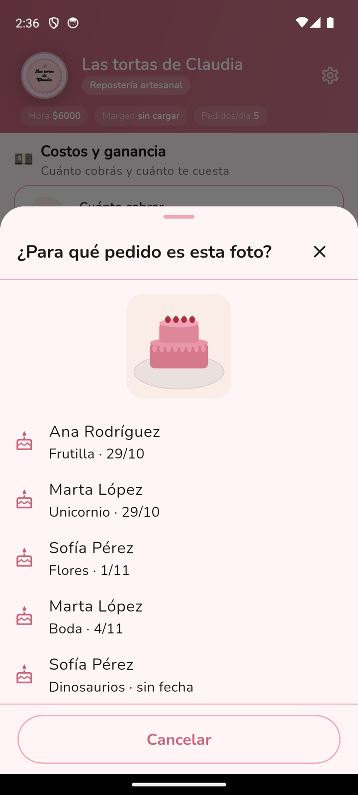 La hoja que abre SousChef cuando compartís una foto desde WhatsApp: «¿Para qué pedido es esta foto?», con la miniatura y la lista de tus pedidos abiertos; tocás uno y la foto queda como referencia de ese pedido.</td>
  </tr>
</table>

¿La clienta te mandó por WhatsApp la foto de la torta que quiere? No hace falta guardarla y buscarla después:

1. En WhatsApp, mantené apretada la foto y tocá **Compartir**.
2. Elegí **SousChef** en la lista de apps.
3. Se abre SousChef con la pregunta **¿Para qué pedido es esta foto?** y la lista de tus pedidos abiertos. Tocás el de esa clienta.
4. Listo: *"Foto guardada en el pedido de…"*. La vas a ver en la ficha y en el formulario del pedido.

Si el pedido de esa clienta todavía no está, cerrá con **Cancelar**, anotalo y volvé a compartir la foto (y si no tenés ningún pedido abierto, la app misma te lo dice). Cada pedido guarda hasta **10 fotos**. Por ahora esto anda solo en Android.

### Cargar un pedido: el formulario se adapta a lo que vendés

<table>
  <tr>
    <td width="25%" valign="top">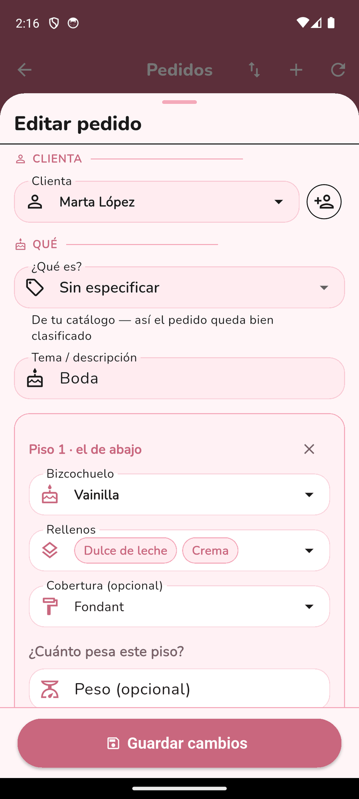 Anotar un pedido (acá, editando uno ya cargado: el formulario es el mismo): arriba, la clienta y qué es: el tema y, piso por piso, el bizcochuelo, los rellenos y la cobertura.</td>
    <td width="25%" valign="top">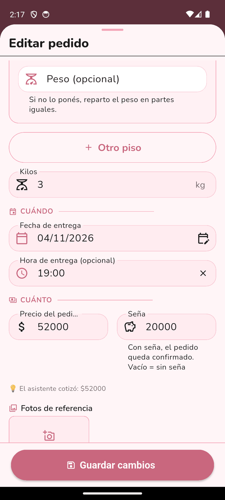 Enseguida, «Otro piso» y los kilos, y después cuándo y cuánto: la fecha y la hora de entrega, el precio y la seña, y las fotos de referencia.</td>
    <td width="25%" valign="top">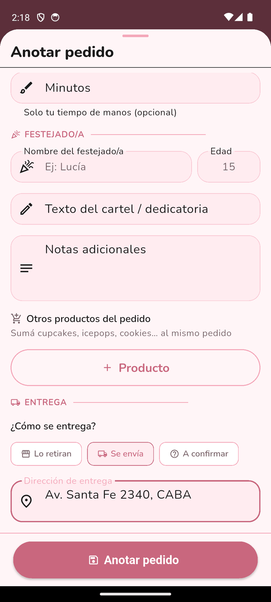 El final del formulario: cómo se entrega (Lo retiran / Se envía / A confirmar) y el botón Anotar pedido.</td>
  </tr>
</table>

El formulario sigue el orden de la charla con la clienta: **Clienta → Qué → Cuándo → Cuánto → Fotos**, y después lo que se completa más tarde (minutos de armado, festejado, cartel, notas, otros productos y cómo se entrega). Así lo que se pacta primero queda arriba, a la vista.

Arriba de todo elegís la **clienta**. Tocás el campo y se abre una ventanita con un **buscador**: escribís las primeras letras del nombre y la encontrás al toque, tengas 5 clientas o 200. También podés dejar el pedido **Sin clienta asignada**, o crear una nueva con el botoncito de al lado.

Después viene el selector **"¿Qué es?"**: elegís el producto de **tu catálogo** (la torta, la docena de cupcakes, la caja de alfajores…). Y según lo que elijas, **el formulario cambia solo** para pedirte únicamente lo que hace falta:

**Si es algo que se vende por cantidad (docenas, cajas, boxes):**

Aparece solamente **"¿Cuántas?"**, con botones **−** y **+** para ajustar el número. Eso, más la fecha, la entrega y los precios. **Dos datos y listo** — nada de porciones ni rellenos para una caja de alfajores.

**Si es una torta (se vende por tamaño):**

Aparece el **bloque de la torta**, que se arma piso por piso:

- Cada **piso** es una tarjetita rosada. Con un solo piso ni te enterás (la palabra "piso" no aparece); si la torta lleva más, tocás **"Otro piso"** y agregás hasta **6**.
- El piso tiene **dos campitos iguales**: **Bizcochuelo** y **Rellenos**. Tocás cualquiera de los dos y se abre una ventanita baja con las opciones para tocar.
- En **Bizcochuelo** están **Chocolate**, **Vainilla**, los sabores que **ya usaste antes** (la app se los acuerda), **Falso**, y la ficha **"Otro…"** para los que salen poco (marmolado, red velvet…). Tocás uno y la ventanita se cierra sola.
- En **Rellenos** aparecen los tuyos como fichas: tocás los que lleva (hasta **3 por piso**) y **Listo**. Nada de tipear "ddl con nuez" de memoria: tocás y queda.
- Si improvisaste uno que no está en tu lista, tocás la ficha **"Otro…"** y lo escribís. Es una ficha más, al lado de los otros.
- **"Otro…"** abre otra ventanita igual, desde abajo, con el campo listo para escribir y **Cancelar / Agregar**. Todas las ventanitas del pedido se ven iguales y ninguna te tapa la pantalla: si tenés muchos rellenos, la lista scrollea adentro de la ventanita.
- Abajo de los rellenos está la **Cobertura (opcional)** y, si la torta tiene varios pisos, **¿Cuánto pesa este piso?** (si no lo ponés, el peso se reparte en partes iguales). Las dos se pueden dejar vacías.
- En **Cobertura** elegís con qué va cubierto ese piso: **Sin cobertura**, las que ya cargaste en **Costos por kilo** y, de arranque, **Buttercream**, **Fondant** y **Ganache**. Una de las de arranque se puede elegir aunque todavía no tenga receta, pero hasta que cargues qué lleva un kilo no cuenta en lo que te deja el pedido: la ficha te avisa que le falta.

**¿Qué es el piso "falso"?** En criollo: es un piso **de mentira, solo decorativo** — el clásico piso de telgopor forrado que se pone para que la torta se vea más alta e imponente. Como no lleva torta de verdad: **no gasta insumos, no suma porciones y no te pide rellenos**. Por eso "Falso" es una opción más del bizcochuelo: lo elegís y ese piso queda marcado como decorativo, listo.

Todo esto queda guardado **bien estructurado** (piso por piso), y el resumen se ve clarito en la tarjeta del pedido y en tu producción.

### La entrega: ¿lo retiran o se lo llevás?

Cada pedido tiene sus chips de **entrega**: **Lo retiran** / **Se envía** / **A confirmar**.

- Si elegís **"Se envía"**, aparece el campo de la **dirección de entrega**. Esa dirección después se ve en la tarjeta del pedido (🚚) y hasta podés **buscar pedidos por dirección**.
- Si la clienta le dijo la dirección al asistente por chat, **ya viene anotada** — no la tenés que copiar de la conversación.

### Cuándo, cuánto y las fotos

- **Cuándo:** la **Fecha de entrega** y la **Hora de entrega (opcional)**. La fecha es obligatoria para anotar un pedido nuevo: si te la olvidás, el formulario te lleva hasta el campo y te pide *"Elegí la fecha de entrega"*. Un pedido sin fecha no aparece en la Agenda ni en los días de Producción; en Para hoy lo ves en el grupo **Sin fecha de entrega — ponele una** (o en **Esperan un sí o un no**, si todavía no lo confirmaste), para que no se pierda. (Los viejos que quedaron sin fecha se ven con el cartelito **Sin fecha**.)
- **Cuánto:** el **Precio del pedido** y la **Seña**. Si cargás seña, el pedido queda **confirmado** solo; vacío, queda como nuevo hasta que lo confirmes. Si lo que cargaste es un **combo**, su precio se propone solo: lo dejás o lo pisás. Si el asistente ya había cotizado, abajo te lo recuerda (*"💡 El asistente cotizó: $…"*).
- **Fotos de referencia:** hasta **10** por pedido. La primera es la portada (la que se ve grande en la ficha del pedido); tocás una para verla grande y la ✕ la saca.

Al anotar un pedido **no hay que elegir el estado**: nace como nuevo (o confirmado, si tiene seña). El desplegable **Estado** aparece recién cuando lo editás, junto con el **historial de cambios** (qué se modificó y cuándo).

### El detalle del pedido (lo demás)

Más abajo completás lo que no hace falta pactar en el momento:

- Los **minutos de armado y decoración** (solo tu tiempo de manos; es opcional).
- El **festejado/a**, su **edad** y el **texto del cartel / dedicatoria**, más **notas adicionales** (alergias, colores especiales…).
- **Otros productos del pedido** (te lo cuento acá abajo).
- **¿Cómo se entrega?** (lo viste arriba).

### Un pedido puede tener varios productos

A veces una clienta no te pide solo una torta: te pide **una torta + 12 cupcakes + 24 ice pops** y algún adicional, todo para el mismo día. Podés cargar todo eso dentro del mismo pedido.

En el formulario, más abajo, vas a ver la sección **"Otros productos del pedido"**. Ahí sumás cada producto extra:

- Elegís **qué es** (las categorías salen de **tu** catálogo) o directamente un producto tuyo.
- Le ponés la **cantidad**, y si querés la **temática** y el **relleno**.
- Repetís para cada producto que lleve el pedido.

Así el pedido queda completo de verdad: en la tarjeta del pedido (en Pedidos, en la Agenda y en Para hoy) ves **la lista entera con la cantidad de cada cosa** —*"🎂 1 torta · Unicornio"*, *"🧁 12 cupcakes"*, *"🍧 24 paletas"*—, y después esos cupcakes y esos ice pops también aparecen en tu **producción** y en la **lista de compras**, no solo la torta principal.

### El botón "Eliminar pedido"

Las tarjetas no tienen tacho. Si necesitás borrar un pedido, lo abrís desde Pedidos o la Agenda y el botón **"Eliminar pedido"** está **abajo de todo**, grande y bien separado del botón **Guardar cambios**. Así no lo tocás sin querer: para borrar tenés que bajar a propósito hasta el final del formulario.

### Los estados de un pedido (el camino que recorre)

Un pedido pasa por **cuatro estados**, así de simple:

1. **Nuevo** → un presupuesto: el asistente está juntando los datos, o ya le pasaste un precio a la clienta y falta el sí.
2. **Confirmado** → la clienta dijo que sí (o dejó seña).
3. **Entregado** → se lo diste a la clienta. ✅

(O **Cancelado**, si no se concretó.)

**Al entregar, te pregunta por la plata.** Cuando tocás **Marcar entregado** en un pedido con precio, aparece *"Entregado ✓"* con la cuenta hecha (el pedido, lo que dejó de seña y lo que le cobrás hoy) y la pregunta *"¿[Clienta] te pagó todo?"*:

- **Sí, me pagó $…** → queda todo cobrado y los avisos de cobranza de ese pedido se apagan solos.
- **Me quedó debiendo** → escribís cuánto, y lo vas a ver en el pedido y en Saldos hasta que te pague (ahí lo saldás con **Me pagó**).

Si cerrás la pregunta sin elegir, el pedido queda como cobrado, que es lo que pasa casi siempre.

Podés avanzar el estado con el botón grande de la tarjeta, o con el menú de los **tres puntos ⋮** en Pedidos y en la Agenda, sin tener que abrir el detalle. Cuando marcás un pedido como **Confirmado**, SousChef te reserva el cupo de producción de ese día y te avisa si el día quedó muy cargado.

---

## La agenda

<table>
  <tr>
    <td width="25%" valign="top">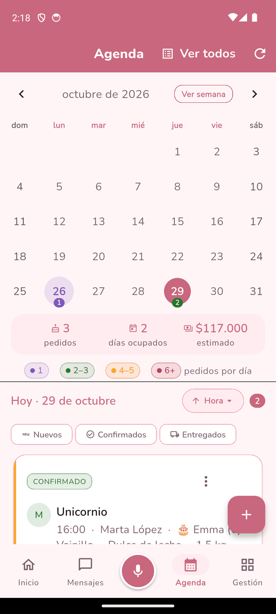 El calendario del mes: cada día con entregas muestra cuántos pedidos hay, con el color según qué tan cargado está. Abajo, la barra con sus cinco lugares.</td>
    <td width="25%" valign="top">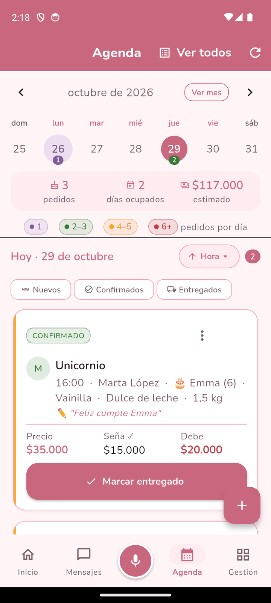 Abajo del calendario, los pedidos del día que tocaste, con la misma tarjeta de Pedidos (la hora primero).</td>
  </tr>
</table>

El calendario te muestra **cuándo tenés entregas** y qué tan cargado está cada día.

- Podés verlo por **semana** o por **mes**. **En tablet** ([pantalla partida](1-primeros-pasos.md#en-tablet-y-en-la-web)) la Agenda se ve partida: a la izquierda el mes entero, con su resumen y los colores de cada día, y a la derecha los pedidos del día que tocaste, así ves las dos cosas a la vez; tocar un pedido lo abre para editarlo, como siempre. En una de 8" acostada el mes entero no entra: ahí se ve sólo la semana, y al pararla vuelve el botón para ver el mes.
- Cada día con entregas se pinta según **cuántos pedidos tiene**: lila (tranquilo), verde, ámbar (cargado) y rojo (te pasaste de tu máximo). Abajo del calendario, la leyenda *pedidos por día* te dice cuántos son cada color. En la lista del día, el estado de cada pedido va con su color: NUEVO con el de tu paleta, CONFIRMADO en verde y ENTREGADO en gris.
- Los colores de **carga** de cada día (qué tan lleno está) son **proporcionales a TU máximo de pedidos por día**, el que configuraste en Configuración. Si tu máximo son 6, un día con 6 se ve completo; si tu máximo son 2, con 2 ya está al tope. La agenda se adapta a tu ritmo, no al de otra.
- Debajo de cada día con entregas ves **el número de pedidos** (un día con ocho dice 8).
- Si tocás un día, ves **los pedidos de ese día** con **la misma tarjeta de Pedidos** ([sección «Tus pedidos»](#tus-pedidos)): como el día ya está elegido, en vez de la fecha arranca por la **hora**. Tiene el mismo botón **Confirmar** o **Marcar entregado**, y **Me pagó los $…** si te quedaron debiendo. Arriba, los **filtros por estado** (**Nuevos**, **Confirmados**, **Entregados**) para quedarte solo con lo que te interesa, y el orden: **Hora**, **Estado**, **Monto** o **Clienta**.
- Con el botón **"Ver todos"** saltás a la lista completa de pedidos.

<table>
  <tr><td>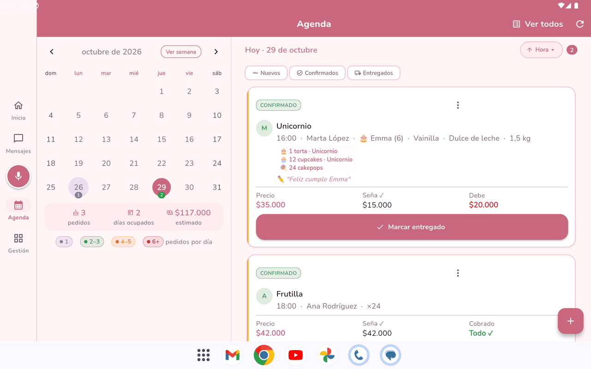 La Agenda partida: a la izquierda el mes entero con su resumen y los colores de cada día; a la derecha los pedidos del día que tocaste, con la misma tarjeta de siempre.</td></tr>
</table>

Sirve para ver de un pantallazo tu semana sin abrir pedido por pedido.

---

## Producción

<table>
  <tr>
    <td width="25%" valign="top">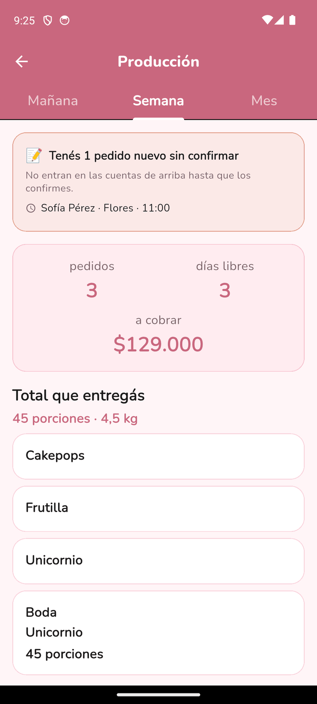 El plan de la semana: cuántos pedidos, cuántos días libres y cuánta plata hay a cobrar.</td>
  </tr>
</table>

*(Se abre desde el Inicio —la tarjeta **Mañana**, la tarjeta **Producción** ("Planificá tu semana y tu mes") o **Producción** en Mis herramientas— o desde **Gestión → Tu negocio → Producción**.)*

Es una pantalla completa para planear tu trabajo, con **tres pestañas**: **Mañana**, **Semana** y **Mes**. Es tu tablero para saber qué te espera y no llevarte sorpresas.

### Las tres pestañas

- **Mañana:** las entregas de mañana y todo lo que tenés que producir para ese día.
- **Semana:** los próximos días de un tirón, para organizar la semana completa.
- **Mes:** el mes entero, pero **ordenado semana por semana** (no 31 tarjetas sueltas), así lo leés cómodo y ves cómo se reparte el trabajo.

### Qué te muestra cada pestaña

- **Alertas primero (lo que necesita tu atención):**
  - Un **día muy cargado**, que se pasó de lo que podés producir.
  - Pedidos **sin precio** todavía.
  - Pedidos **confirmados que no tienen fecha de entrega**, para que les pongas fecha.
- **Los pedidos nuevos que todavía no confirmaste** van aparte: *"Tenés 2 pedidos nuevos sin confirmar"*. No entran en las cuentas hasta que los confirmes.
- **Un resumen general:** cuántos pedidos hay, cuántas porciones (o kilos), cuánto tenés para cobrar y cuántos días libres te quedan.
- **Total que entregás**: el resumen de lo que hay que hacer, por tipo de producto y bien clarito, por ejemplo: *"🧁 12 cupcakes · 🎂 2 tortas"*. Incluye **todos los productos** del pedido (los cupcakes, los ice pops, no solo la torta principal). Los **pisos falsos no suman**: son decorativos, no se hornean.
- **El día más cargado** del período, para que lo tengas presente.
- **El detalle día por día** (en el mes, **Semana por semana**): en cada día, lo que **Preparás** (lo que se hornea antes) y lo que **Decorás y entregás**. Un día sin nada dice **Día libre**.

Es la mejor forma de arrancar la semana sabiendo exactamente qué te espera, y de no quedarte sin tiempo un día que se te llenó de pedidos.

---

[Índice del manual](README.md) · [← Atender clientas](2-atender-clientas.md) · [Catálogo, recetas y costos →](4-catalogo-recetas-y-costos.md)
