# 4. Catálogo, recetas y costos

[Índice del manual](README.md) · [← Pedidos, agenda y producción](3-pedidos-y-agenda.md) · [Compras y plata →](5-compras-y-plata.md)

**En esta parte:** [Lo que vendés](#lo-que-vendés-catálogo-combos-y-promos) · [Rellenos que ofrecés](#rellenos-que-ofrecés) · [Cuánto cobrar y precios atrasados](#cuánto-cobrar-y-precios-atrasados) · [Recetas](#recetas) · [Costos por kilo](#costos-por-kilo) · [Armado y entrega](#armado-y-entrega)

---

## Lo que vendés: catálogo, combos y promos

<table>
  <tr>
    <td width="25%" valign="top">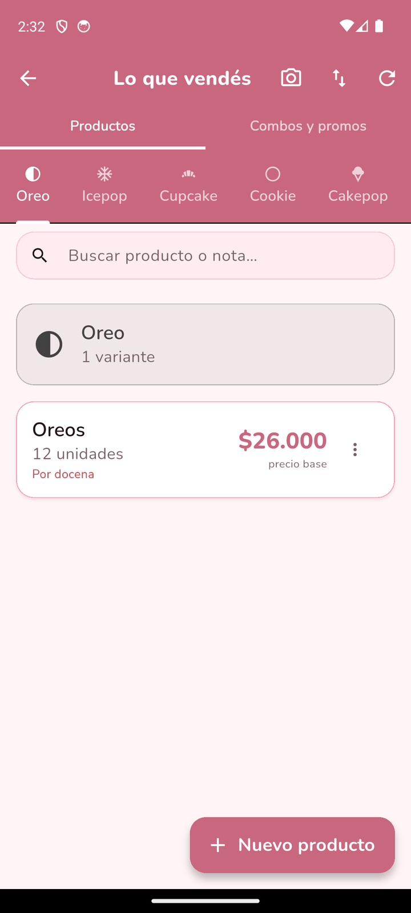 Lo que vendés: una sola pantalla con las pestañas Productos y Combos y promos. En Productos, las categorías arriba, el buscador y cada producto con su precio base; abajo, Nuevo producto.</td>
    <td width="25%" valign="top">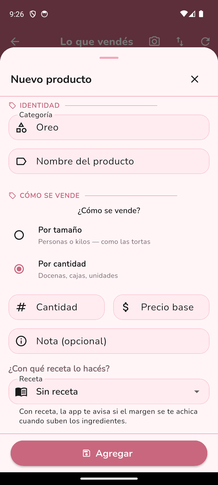 Cargar un producto a mano: categoría, nombre, y si se vende por tamaño (personas o kilos) o por cantidad (docenas, unidades).</td>
  </tr>
</table>

**Lo que vendés** es la lista de lo que ofrecés: tortas, docenas de cupcakes, cajas de alfajores, boxes, promos… Es lo que tu asistente usa para ofrecer y para saber **qué preguntarle** a cada clienta. Es **una sola pantalla con dos pestañas**: **Productos** (tu catálogo) y **Combos y promos**. La encontrás en **Gestión** (Tu negocio → Lo que vendés) o como **Lo que vendés** en Mis herramientas, al final del Inicio.

**En tablet** ([pantalla partida](1-primeros-pasos.md#en-tablet-y-en-la-web)) Lo que vendés se ve partida, en las dos pestañas: a la izquierda la lista —en Productos, con las categorías arriba y el buscador— y a la derecha el formulario del producto o del combo que tocás (o que elegís con **Editar** en el ⋮), que queda marcado en la lista. Lo cambiás ahí mismo y lo guardás: la lista se pone al día y lo seguís viendo al lado (en Productos, **Cancelar** vacía el lado derecho). **Nuevo producto** y **Nuevo combo** van abajo de la lista y abren el formulario vacío a la derecha; al guardarlo, el nuevo queda marcado. En un combo, al lado del precio ves cuánto te cuesta hacerlo.

### La estrella: importar tu lista de precios de una foto 📸

Si ya tenés tu lista de precios armada (en papel, en una imagen, en un posteo de Instagram), **no hace falta tipear nada**. Miralo así: le sacás una foto y listo.

1. Tocá el botón **📸** — lo tenés en **Lo que vendés** (bien grande si está vacío, y siempre en la barra de arriba) y también en el alta, en el paso "¿Cómo cobrás?", eligiendo **Tengo precios fijos**.
2. Elegí **Sacale una foto a tu lista** (y después **"Sacar la foto ahora"** o **"Elegir de la galería"**) o, si lo que tenés es el texto —por ejemplo, el posteo de Instagram con tus precios—, **Pegá el texto** y tocá **Leer la lista**.
3. SousChef lee la lista y te muestra **todos los productos que encontró**, con su nombre y su precio. Si en la lista figuraban tus **rellenos**, también los reconoce — y si tenían **recargo premium**, se lo anota.
4. Revisás la ventanita **Esto encontré en tu lista**: cada producto tiene su **tilde** ✔️. Destildá lo que no quieras cargar.
5. Tocá **Cargar N productos** (o *Cargar N productos y M rellenos*), y todo cae en tu **catálogo**, donde después editás cualquier cosa con los formularios normales.

> **Tres cosas para que estés tranquila:**
> - **Nada se guarda sin tu confirmación.** Vos siempre ves la lista antes y elegís qué entra.
> - **SousChef jamás inventa un precio.** Solo copia lo que se ve en la foto o en el texto. Si algo no tiene precio visible, queda sin precio para que lo completes vos.
> - **No duplica nada.** Si un producto de la foto ya está en tu catálogo, lo saltea y te avisa. Podés importar la misma lista dos veces sin miedo.
>
> Si la foto salió borrosa o no se entiende, te lo dice y le sacás otra. Sin drama.

### Cómo se vende cada producto (esto es importante)

Cada producto de tu catálogo declara **cómo se vende**, y eso cambia lo que el asistente pregunta:

- **Por tamaño** — *personas o kilos, como las tortas*. El asistente pregunta para cuántas personas (o cuántos kilos), la temática y el relleno.
- **Por cantidad** — *docenas, cajas, unidades*. El asistente pregunta solo **cuántas** y **para cuándo**. Nada de porciones ni relleno: una caja de alfajores no lleva relleno a elección.

Cuando creás o editás un producto lo elegís con dos tarjetas bien claras. Si lo importaste de una foto, SousChef lo deduce solo y vos lo corregís si hace falta. Y al elegir la **categoría**, el selector te sugiere el vocabulario de tu rubro (tortas, cupcakes, postres…), para que todo tu catálogo hable el mismo idioma.

### La receta de cada producto: el puente a tus costos

En el formulario de cada producto está la pregunta **¿Con qué receta lo hacés?**, con el selector **Receta**. Enganchale su receta y ese producto queda conectado a tus **costos reales**. Ese enganche es el puente que enciende todo lo demás:

- **Precios atrasados** puede avisarte cuando ese producto pierde margen.
- Los **combos** que lo incluyen pueden calcular su costo.
- La **actualización de precios de 1 toque** puede recalcularle el precio.

Sin receta, el producto se vende igual; solo que SousChef no puede decirte cuánto te cuesta.

### La pestaña "Combos y promos"

<table>
  <tr>
    <td width="25%" valign="top">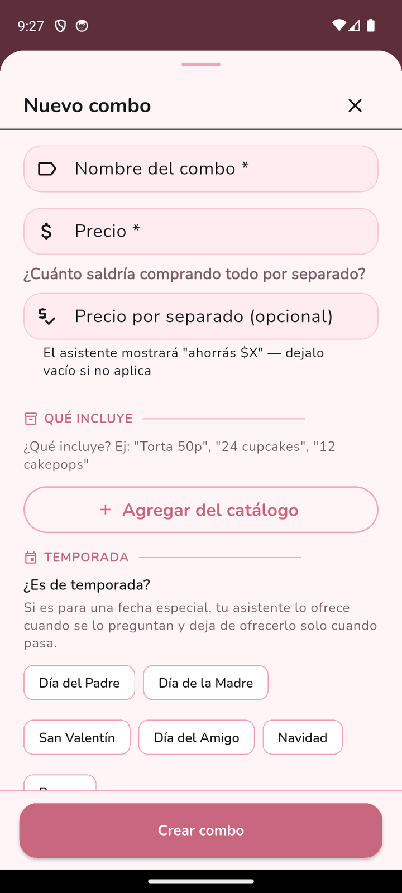 Un combo nuevo: nombre, precio, cuánto saldría por separado y qué lleva.</td>
  </tr>
</table>

Los combos y las promos viven en la **segunda pestaña** de esta misma pantalla.

- Un combo se arma **eligiendo productos de tu catálogo**: así SousChef sabe qué incluye y cuánto te cuesta.
- Abajo de cada combo ves **cuánto te cuesta hacerlo y cuánto te queda**, por ejemplo *"Te cuesta $9.918 · queda $20.082 (67%)"*: en verde si te queda 40 % o más. Si a algún producto le falta la receta o tiene ingredientes sin precio, no te muestra lo que te queda (sería un número inventado): te dice *"Te cuesta al menos $9.918"* y qué falta completar, *"Falta la receta de Budín, o sus ingredientes no tienen precio"* (fijate que el producto tenga su receta y que sus ingredientes tengan precio) o *"Crema mantecol tiene ingredientes sin precio"*. Si no puede calcular nada, te dice *"No sé cuánto te cuesta: falta la receta de…"*.
- Si un combo quedó escrito como **texto libre** (sin productos enganchados), lo ves con un cartelito: **"sin costo — tocá Editar y elegí los productos"**. Lo abrís, elegís los productos, y listo: ya tiene costo.
- El asistente puede ofrecerlos: dice **qué incluye** cada combo y que conviene más que por separado — **nunca el precio** ([sección «Mensajes»](2-atender-clientas.md#mensajes-y-el-asistente-que-atiende-solo)).

### Promos por ocasión (campañas)

Tus productos y combos pueden tener una **ocasión** (día del padre, san valentín, día del amigo…) y una **fecha de fin**. Con eso:

- Cuando una clienta pregunta *"¿tenés algo para el día del padre?"*, el asistente **ofrece lo que está vigente** para esa ocasión.
- Las promos **vencidas dejan de ofrecerse solas**: no tenés que acordarte de borrarlas, y el asistente nunca ofrece la promo del año pasado.
- Lo que no tiene ocasión ni fechas es tu catálogo de todo el año, y se comporta como siempre.

**Cómo se carga.** Al final del formulario de un producto o de un combo hay una sección **"¿Es de temporada?"**: tocás la ocasión (Día del Padre, Día de la Madre, San Valentín, Día del Amigo, Navidad, Pascua) y, si querés, elegís **hasta cuándo lo ofrecés**. Si no tocás nada, es de todo el año.

En la lista, los de campaña muestran un renglón chico con la ocasión y la fecha; cuando la fecha ya pasó dice **"ya pasó, no se ofrece"** — así entendés por qué el asistente dejó de ofrecerlo, sin abrir nada. Para volver a usarlo el año que viene, entrás y le cambiás la fecha. Y el botón de **copiar la lista de combos** deja afuera los vencidos, para que no pegues la promo de San Valentín en julio.

---

## Rellenos que ofrecés

<table>
  <tr>
    <td width="25%" valign="top">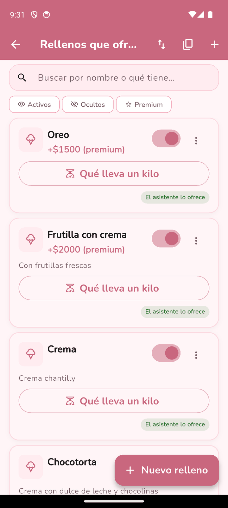 Tu carta de rellenos, con los filtros Activos / Ocultos / Premium.</td>
    <td width="25%" valign="top">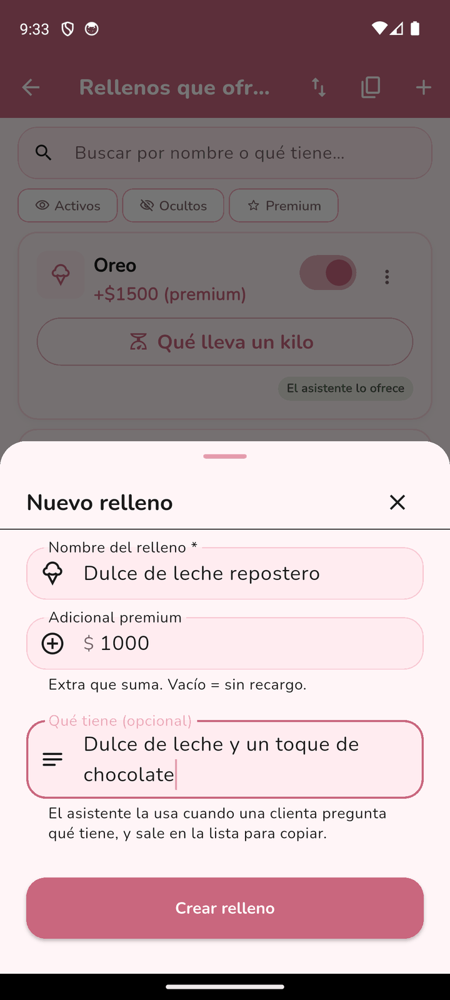 Cargar un relleno nuevo son tres campos: el nombre, el adicional premium y qué tiene.</td>
  </tr>
</table>

**Rellenos que ofrecés** (*"Los rellenos que elegís en cada pedido"*) está en **Gestión → Tu negocio**, y como **Rellenos** en Mis herramientas del Inicio. Son los sabores disponibles, así el asistente responde con opciones reales. Son los mismos que después elegís tocando en el formulario del pedido.

---

## Cuánto cobrar y precios atrasados

<table>
  <tr>
    <td width="25%" valign="top">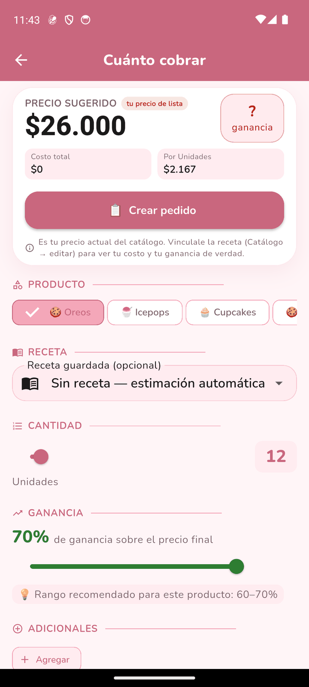 Cuánto cobrar: elegís el producto, la cantidad (porciones o unidades) y la ganancia, y te devuelve el precio sugerido con el costo detallado.</td>
  </tr>
</table>

### Cuánto cobrar

Desde **Gestión → Costos y ganancia** (o desde las acciones rápidas del Inicio) entrás a **Cuánto cobrar**. Sirve para poner precio en 10 segundos:

1. Elegí el producto: la calculadora usa **los productos y precios de TU catálogo** (no una lista fija), así que lo que ves es lo tuyo.
2. Poné la cantidad (porciones, kilos o docenas, según cómo se venda el producto).
3. SousChef te muestra el **costo base + el costo de tu trabajo + tu margen = precio final**.
4. Sumá adicionales si corresponde: **Velas**, **Topper**, **Packaging**, **Moño**, **Flores** (y los tuyos, con **Nuevo adicional**). Cada uno suma al precio.

La calculadora ya tiene en cuenta cuánto cobrás por hora y tu margen, así que el precio te sale justo, sin que trabajes gratis.

**¿De dónde sale el costo?** Depende del producto que elijas:

- Si el producto tiene su **receta enganchada** ([sección «Lo que vendés»](#lo-que-vendés-catálogo-combos-y-promos)), el **costo real** aparece solo, calculado con tus ingredientes.
- Si **no tiene receta**, la calculadora te muestra **tu precio de lista**, con su cartelito ("tu precio de lista") y la ganancia en **"?"** — porque sin receta no hay costo con qué comparar. Lo que **nunca** hace es multiplicar un precio como si fuera un costo: mejor un "?" honesto que un número inventado.

> **El cartelito del valor hora:** si todavía no cargaste TU valor de la hora de trabajo, la calculadora está usando el **valor de ejemplo ($800)** y te lo avisa con un cartel arriba de todo. Tocá el cartel y te lleva directo a **Configuración** para poner el tuyo. Hasta que no lo cargues, el costo de tu mano de obra es "de mentira" — vale la pena el minuto que lleva.

### Precios atrasados (cuando sube la inflación)

Cuando suben tus ingredientes, SousChef revisa los productos que tienen receta y, si alguno quedó por debajo de tu margen mínimo, te avisa: *"📈 Tenés precios atrasados"*. En **Precios atrasados** (Gestión → Tu asistente) ves cada producto con su margen, el precio de **Ahora**, el **Sugerido** y lo que te cuesta, y el botón **Aplicar $…** para cambiarlo. Nada cambia hasta que lo tocás.

---

## Recetas

<table>
  <tr>
    <td width="25%" valign="top">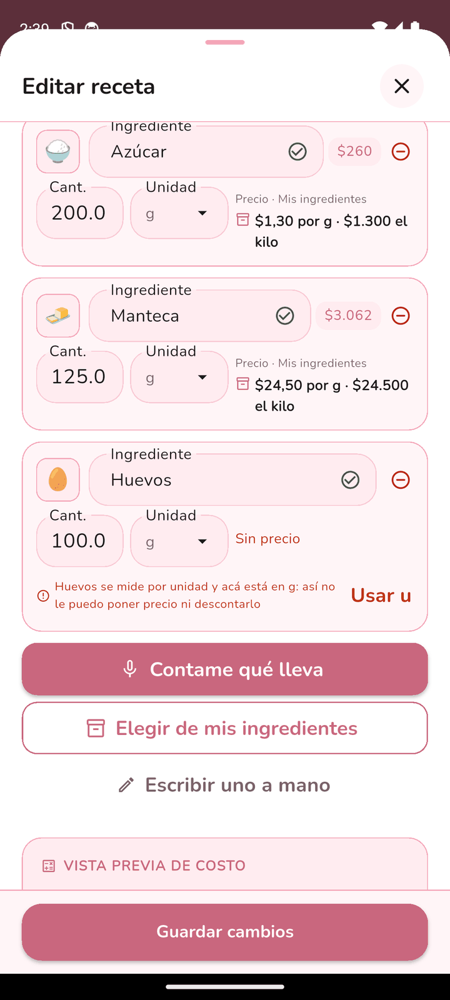 Editar una receta: los ingredientes con su precio sacado de Mis ingredientes, el botón «Contame qué lleva» y la vista previa de costo.</td>
  </tr>
</table>

Cargá tus recetas con sus **ingredientes y cantidades**. SousChef te calcula solo el **costo total** y el **costo por porción**. Sin recetas cargadas, es difícil saber cuánto cobrar; con ellas, tenés el número exacto.

- Tocá **Nueva receta** para crear una.
- Elegí un emoji, ponele nombre y agregá los ingredientes con su cantidad y unidad: con **Contame qué lleva** (la dictás), **Elegir de mis ingredientes** o **Escribir uno a mano**.
- La **categoría** se elige con **un solo desplegable**: se abre una hoja con las **familias** como secciones (Tortas, Individuales, Postres, Horno y budines, Para eventos), una sección **"Tuyas"** con tus categorías propias, y una ficha **"➕ Crear otra"** que se convierte en un campito: escribís el nombre, Enter, y listo.
- Tocá una receta para editarla. En el listado, cada ingrediente aparece con **su emoji real**, y los precios se leen enteros, nunca partidos en dos renglones.
- Para **eliminar** una receta tenés su botón, que te pide confirmación en un recuadro antes de borrar nada.
- Si una receta es en realidad la de un relleno o un bizcochuelo, en su **⋯** está **Es un relleno o bizcochuelo — moverla**: la pasa a **Costos por kilo**.
- Con el buscador podés buscar **por nombre o por ingrediente** ("¿qué recetas llevan frutilla?"), ordenarlas por **nombre, costo o más nuevas** (⇅), y filtrarlas por **familia** — **Tortas · Individuales · Postres · Horno y budines · Para eventos**, más **Otro** para lo que no encaja — o con **Sin costo**, que te muestra las que todavía no se pueden costear porque les faltan ingredientes o precios.

**En tablet** ([pantalla partida](1-primeros-pasos.md#en-tablet-y-en-la-web)) Recetas se ve partida: a la izquierda la lista, con el buscador y los filtros, y a la derecha la receta que tocás entera —sus ingredientes, cuánto cuesta hacerla y el desglose—, que queda marcada en la lista; arriba de la receta tenés **Editar**, **Otro tamaño** y el **⋯** para moverla o eliminarla. Ahí el botón **Nueva receta** va abajo de la lista.

### "Contame qué lleva": dictá la receta

<table>
  <tr>
    <td width="25%" valign="top">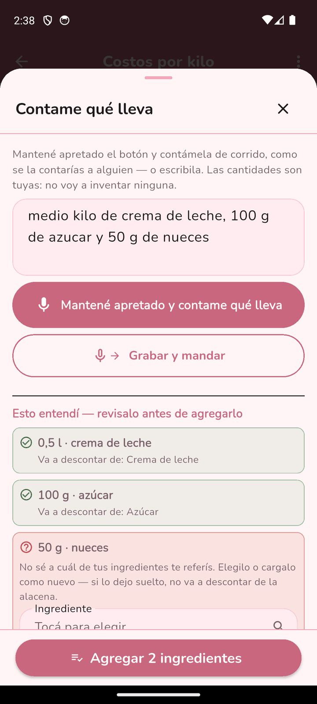 Contame qué lleva: arriba lo que dictaste (o escribiste) y el botón para mantener apretado; debajo, «Esto entendí — revisalo antes de agregarlo»: dos ingredientes reconocidos con lo que se va a descontar y uno en ámbar porque no sabe a cuál de tus ingredientes te referís.</td>
  </tr>
</table>

En la receta (y en Costos por kilo) tocá **Contame qué lleva**. **Mantené apretado el botón, hablá y soltá** cuando termines: *"medio kilo de crema, 300 g de dulce de leche y 100 de nueces"* (también la podés escribir). Al soltar, la app la interpreta y te muestra **Esto entendí — revisalo antes de agregarlo**; revisás y tocás **Agregar N ingredientes**.
Las cantidades son tuyas: no inventa ninguna. Si en algún ingrediente no dijiste la cantidad, queda marcado *"falta la cantidad"* y no se agrega: sumala al texto (por ejemplo, *"200 g de nueces"*) y tocá **Volver a interpretar**. Si no sabe a cuál de tus ingredientes te referís, **te pregunta**: lo elegís o lo cargás como nuevo. Y no repite: aunque hagas pausas, lo que sale dos veces igual (mismo ingrediente y misma cantidad) lo ves una sola vez; si nombrás el mismo ingrediente con cantidades distintas (100 g para el bizcochuelo y 50 g para el almíbar), quedan dos filas, una por cada uso.

**Grabar y mandar**, para cuando el dictado se corta. Debajo del botón de dictar está **Grabar y mandar**: lo tocás una vez, contás la receta entera con las pausas que necesites (el botón se pone rojo y cuenta: *Grabando… 0:12 · tocá para mandar*) y lo volvés a tocar. La app pasa el audio a texto (*Transcribiendo…*), lo suma a lo que ya había en el campo y lo interpreta igual que lo dictado. Usalo cuando el dictado te corta a la mitad o no te entiende: necesita internet y graba hasta dos minutos (a los dos minutos se manda sola). Si no entendió el audio te avisa y lo que habías escrito queda como estaba.

### El precio de cada ingrediente sale de Mis ingredientes

Cuando enganchás un ingrediente de tu lista, su precio **no se escribe**: aparece como un dato (*Precio · Mis ingredientes*). Si está mal, lo corregís en Mis ingredientes. Si la receta lo pide en otra medida (gramos de algo que comprás por unidad), la fila te avisa en ámbar y te ofrece **Usar u** (o la medida que corresponda): cambia la unidad y vacía la cantidad para que la escribas de nuevo. Y como los precios cambian, en el menú **⋮** de Recetas tenés **Actualizar costos con los precios de hoy**: primero te muestra qué va a cambiar y recién si aceptás lo guarda.

**Centímetros cúbicos.** Un cc (o cm³) es lo mismo que un ml: en el selector de unidad lo ves como **ml (cc)**, y si dictás *"200 cc de leche"* queda en 200 ml. Las medidas de cocina —**taza**, **cucharada** y **cucharadita**— se pueden poner en la receta, pero no se convierten a gramos ni a ml (una taza de harina y una de leche no pesan lo mismo): una fila así no toma el precio de tu ingrediente ni se descuenta de la alacena hasta que la pases a g o ml.

### El botón "Otro tamaño": la misma receta, para otro rinde

<table>
  <tr>
    <td width="25%" valign="top">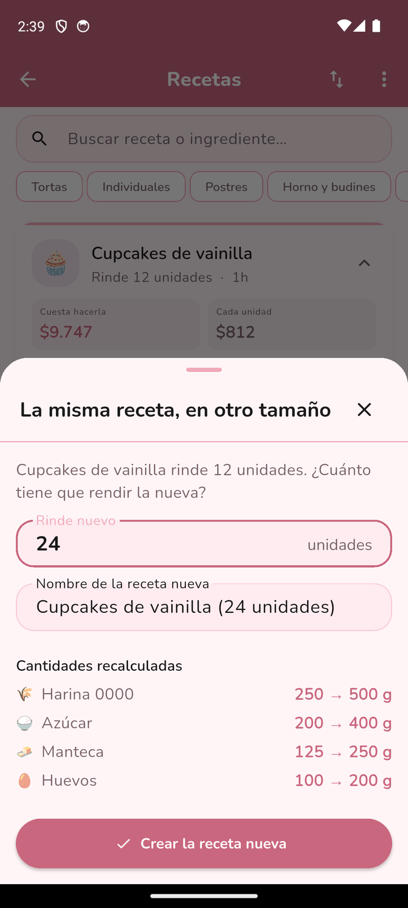 Otro tamaño: le decís cuánto tiene que rendir la receta nueva y, antes de crearla, te muestra el nombre que le va a poner y las cantidades recalculadas, ingrediente por ingrediente.</td>
  </tr>
</table>

¿Tenés la receta de tu budín para 1 kg y te piden uno más grande? No la copies a mano: abrí la receta y tocá **"Otro tamaño"**.

1. Elegís el **rinde nuevo** (las porciones o los kilos que querés).
2. Ves las **cantidades recalculadas** en proporción, antes de confirmar.
3. Lo que se cuenta **por pedido** (la caja, la vela) **no se multiplica**: sigue siendo uno.
4. Al confirmar, **se crea como una receta nueva** — la original queda intacta.

---

## Costos por kilo

<table>
  <tr>
    <td width="25%" valign="top">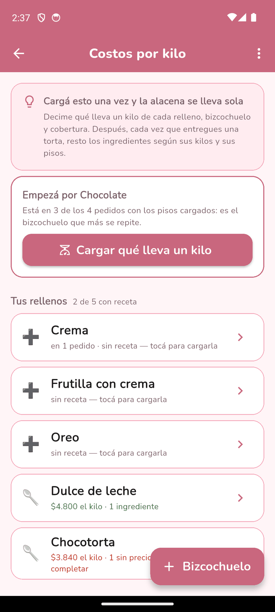 Costos por kilo: arriba, «Empezá por…» con el que más se repite en tus pedidos y todavía no tiene receta; después tus rellenos con el contador "N de M con receta", cada uno con lo que te cuesta el kilo o "sin receta — tocá para cargarla", y, deslizando, más abajo tus bizcochuelos y tus coberturas, con las que usaste y todavía no tienen receta.</td>
    <td width="25%" valign="top">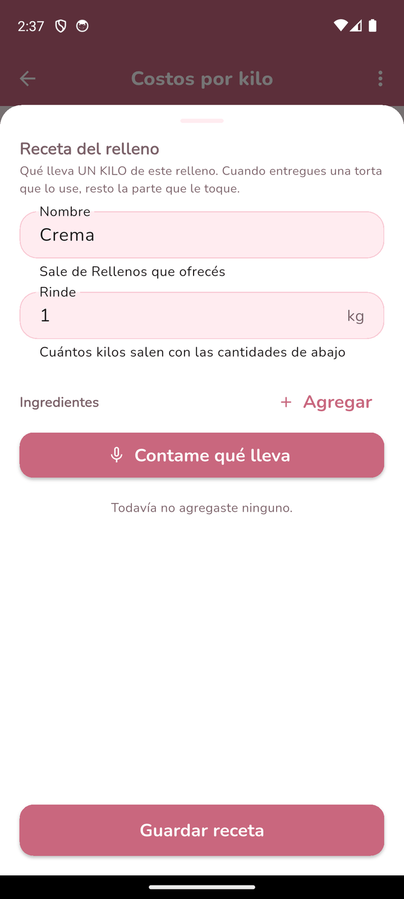 La receta de UN KILO de un relleno (o de una cobertura): cuántos kilos rinde y qué lleva. Si no querés ir ingrediente por ingrediente, «Contame qué lleva» te deja dictarla.</td>
  </tr>
</table>

Esta es la parte que te saca de encima el trabajo de anotar cada cosa que usás.

Una torta no se hace con "una receta de torta": se arma con un **bizcochuelo** y uno o varios **rellenos** y, si lleva, una **cobertura** por encima (buttercream, fondant, ganache). Cada uno se mide **por kilo**. Por eso viven en su propia pantalla (**Gestión → Costos y ganancia → Costos por kilo**, o desde el menú **⋮** de Recetas), separados de las recetas de producto como los cupcakes o las cookies.

Ahí ves tu lista de rellenos, cuáles ya tienen receta cargada y cuáles no, tus bizcochuelos y tus coberturas, y los que usaste en pedidos reales pero todavía no cargaste. Tocá cualquiera y decile qué lleva **un kilo** de ese relleno, bizcochuelo o cobertura (también podés dictarlo con **Contame qué lleva**).

- Mientras te quede alguno sin receta que ya usaste en un pedido, arriba te sugiere **por cuál empezar**: *"Empezá por Dulce de leche"*, el que más se repite en tus pedidos (puede ser un relleno, un bizcochuelo o una cobertura), con el botón **Cargar qué lleva un kilo**.
- Cada uno con receta muestra **cuánto te cuesta el kilo**: *"$9.918 el kilo · 2 ingredientes"* en verde. Si a alguno de sus ingredientes le falta el precio, lo marca en ámbar: *"$7.202 el kilo · 1 sin precio — tocá para completar"*. Mientras tanto, los pedidos que llevan ese relleno no te muestran cuánto te dejan —con ese ingrediente en $0 la ganancia saldría de más—: la ficha del pedido te dice cuál es y por qué (*"No le puedo poner precio a Mantecol en Crema mantecol: la receta lo mide distinto de como lo comprás"*) y el **Resumen del mes** te lleva directo a corregirlo con **Revisar Crema mantecol**. Con las coberturas es igual: lo que te cuesta el kilo, el ámbar si falta un precio, y en el Resumen del mes, si es la receta que más pedidos frena, *"Lo que más falta: Buttercream"* con el botón **Cargar qué lleva un kilo**.
- En el menú **⋮** está **Actualizar costos con los precios de hoy**, igual que en Recetas.

**Las coberturas.** Están más abajo, en **Tus coberturas**: las que ya tienen receta y, en **Las usaste y no tienen receta**, las que elegiste en tus pedidos y todavía no cargaste. Tocá una de esas y se abre su receta con el nombre ya puesto; para una que todavía no usaste, tocá **Otra cobertura**. La cobertura va por encima de la torta: cuento unos 150 g por cada kilo de torta (lo dice ahí mismo, debajo de **Tus coberturas** y en su receta), así que vos decime qué lleva **un kilo** de cobertura, como con un relleno, y yo calculo la parte de cada pedido.

**Cargala con el mismo nombre que elegís en el pedido** (si en el pedido dice *Buttercream*, la receta se llama *Buttercream*): así la encuentro. Las mayúsculas no importan. Si después le cambiás el nombre, los pedidos que ya la tenían dejan de encontrarla; por eso, al guardar con otro nombre te pregunto **¿Le cambiás el nombre?**: **Dejar «Buttercream»** guarda lo demás con el nombre de siempre, y **Cambiar igual** la guarda con el nuevo.

**En tablet** ([pantalla partida](1-primeros-pasos.md#en-tablet-y-en-la-web)) Costos por kilo se ve partida: a la izquierda la lista, con la explicación y «Empezá por…» arriba, y a la derecha la receta del relleno, el bizcochuelo o la cobertura que tocás, abierta para cargarla o corregirla, que queda marcado en la lista; al tocar **Guardar receta** la lista se pone al día y te avisa **Receta guardada ✓**. **Cargar qué lleva un kilo** también la abre al costado, si es un relleno. Para uno nuevo, el botón **Bizcochuelo** va abajo de la lista y abre la hoja de siempre; **Otra cobertura** y las coberturas que usaste sin receta también la abren desde abajo.

Al cargar cada ingrediente elegís **cómo se gasta**, que es lo que hace que las cuentas den bien:

| | Cuándo usarlo | Ejemplo |
|---|---|---|
| **Según el tamaño** | cuanto más grande la torta, más lleva | harina, dulce de leche, crema |
| **Uno por piso** | uno por cada piso, sin importar el peso | el cartón, las varillas |
| **Uno por pedido** | uno solo, sea del tamaño que sea | la caja, la cinta, la vela |

Esto resuelve algo que en la práctica cambia el costo: **una torta de 4 kg de un solo piso y una de 4 kg de tres pisos pesan lo mismo pero no cuestan lo mismo.** La de tres pisos lleva tres cartones y varillas; la de un piso, uno. Marcando el cartón como "por piso", SousChef descuenta tres y no uno y medio.

Y si el mismo cartón te quedó anotado en la receta del bizcochuelo **y** en la del relleno de ese piso, no te preocupes: sigue siendo un cartón. SousChef no lo cuenta dos veces.

**La merma.** En cada receta podés cargar un **porcentaje de merma**: lo que se pierde en el bol, en la manga y en el molde, y nunca llega a la torta. SousChef lo descuenta de más en todo lo que se mide **en peso o en volumen** — harina, crema, esencia. En lo que se cuenta por unidad —cartones, cajas, velas— no lo aplica: un cartón que se te arruina no es merma de preparación, eso lo arreglás con un ajuste de stock. La misma merma se usa para calcular el costo, así que el precio y el stock hablan el mismo idioma.

Si no sabés cuánta merma tenés, **dejala en cero**. Una merma inventada ensucia el costo y el stock a la vez; siempre podés cargarla después, cuando la midas.

---

## Armado y entrega

En **Gestión → Costos y ganancia → Armado y entrega** tenés juntos los materiales que no son masa ni relleno pero también cuestan plata: lo de **armar** cada torta (el cartón, las varillas de cada piso) y lo de **entregar** cada pedido (la caja, la cinta, el moño). Son los mismos que en las recetas se cuentan "uno por piso" o "uno por pedido" — acá los tenés en un solo lugar, para que ningún costo se te escape.

---

[Índice del manual](README.md) · [← Pedidos, agenda y producción](3-pedidos-y-agenda.md) · [Compras y plata →](5-compras-y-plata.md)
