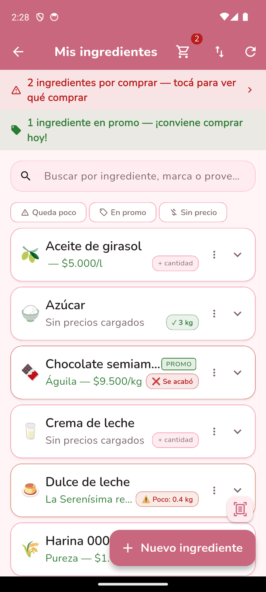
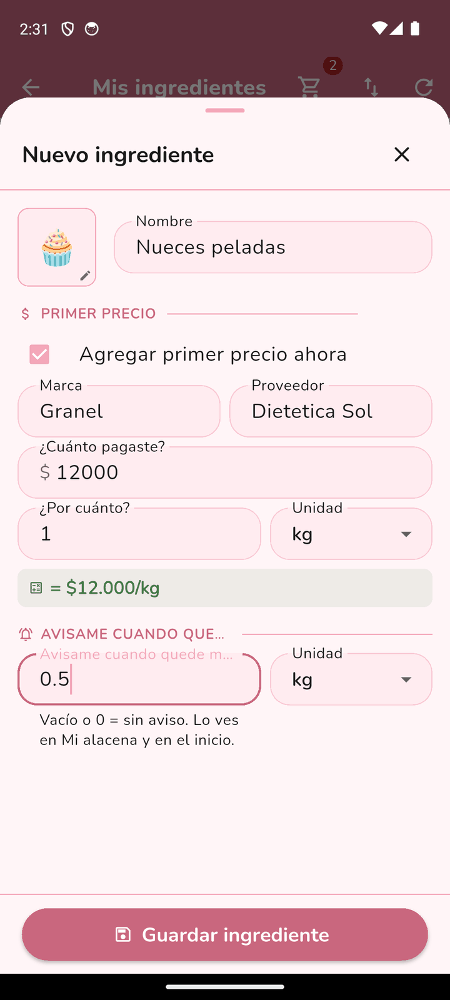
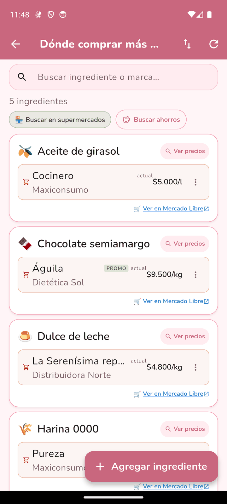
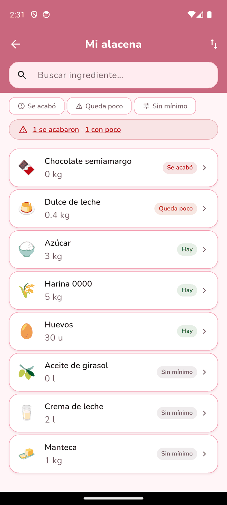
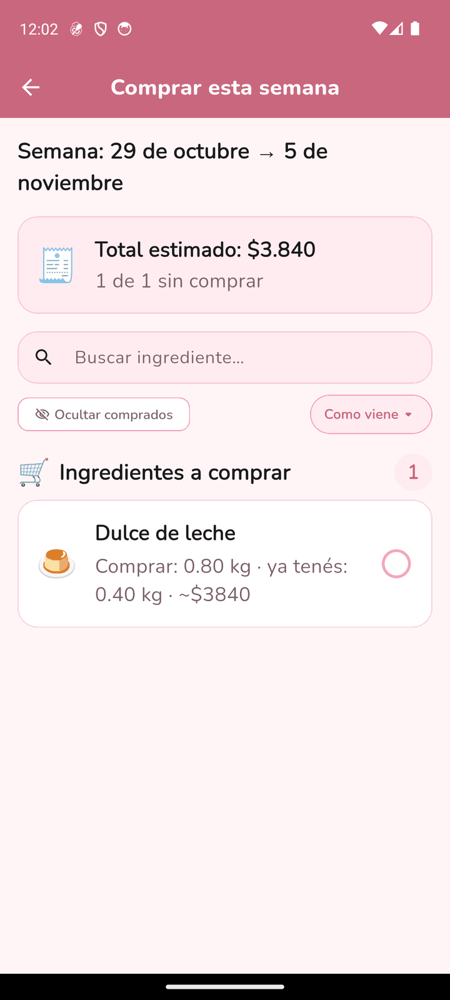
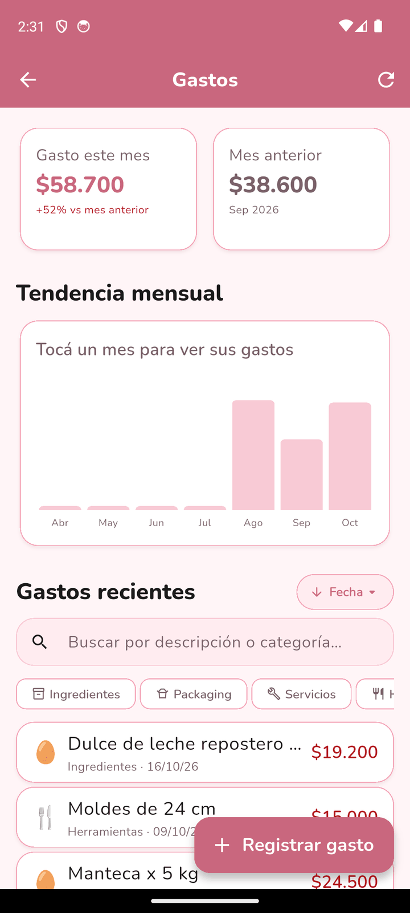
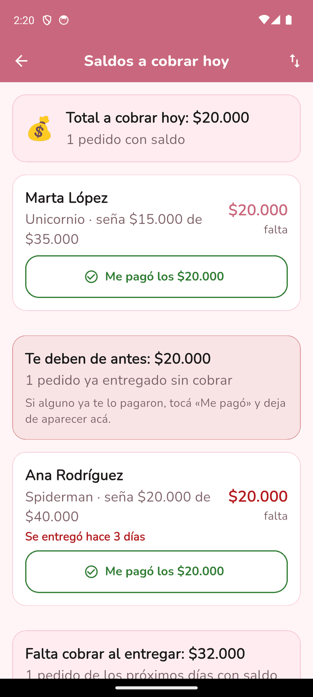

# 5. Compras y plata

[Índice del manual](README.md) · [← Catálogo, recetas y costos](4-catalogo-recetas-y-costos.md) · [Configuración, avisos y ayuda →](6-configuracion-y-ayuda.md)

**En esta parte:** [Mis ingredientes](#mis-ingredientes) · [Dónde comprar más barato](#dónde-comprar-más-barato) · [Mi alacena](#mi-alacena) · [Que la alacena se descuente sola](#que-la-alacena-se-descuente-sola) · [Comprar esta semana](#comprar-esta-semana) · [Gastos](#gastos) · [Cobros y saldos pendientes](#cobros-y-saldos-pendientes)

---

## Mis ingredientes

<table>
  <tr>
    <td width="25%" valign="top"> Mis ingredientes: tus insumos con la marca y el precio actual de cada uno. Arriba buscás y filtrás con Queda poco, En promo o Sin precio.</td>
    <td width="25%" valign="top"> La hoja Nuevo ingrediente: el nombre, el primer precio (marca, proveedor, cuánto pagaste y por qué cantidad, con el precio por kilo calculado) y, al final, si querés, «Avisame cuando quede…» con el mínimo.</td>
  </tr>
</table>

Es la lista de tus **insumos con sus precios actuales**. Podés:

- Ver cuáles están **en oferta**, con **poco stock** o **sin stock** — y filtrar con los chips **Queda poco**, **En promo** y **Sin precio**.
- Buscar cualquier ingrediente, también **por marca o por proveedor** ("¿qué le compro a Distribuidora López?").
- **Escanear una factura** con la cámara: SousChef lee los ítems y los precios solo, así no cargás nada a mano. Abajo, al lado de **Importar**, está la casilla **Anotar esta compra en Gastos**, ya tildada y con el monto: si la dejás así, al importar la compra queda anotada en Gastos (lo que tildaste, no la lechuga ni el detergente). Destildá la casilla si es una lista de precios o una compra que ya anotaste a mano. Si te olvidaste, en la pantalla final está **No era un gasto, sacarlo**.
- Debajo de esa casilla está la **Fecha del gasto**: es la fecha con que se va a anotar la compra, y te dice si es la del ticket o la de hoy. Si el ticket es viejo o la fecha se leyó mal, tocala y elegí la correcta en el calendario. Cuando SousChef no pudo leer bien la fecha del ticket, te lo avisa para que la revises. Si importaste sin anotar el gasto, la fecha vuelve a aparecer en la pantalla final, junto a **Registrar como gasto**.
- Las facturas que escaneaste antes sin cargar el gasto están en **Facturas escaneadas** (el ícono de arriba en la pantalla de escanear). Con **Cargar las N como gasto** van todas de una, cada una con la fecha que ves en la lista. Quedan aparte, para que las abras y decidas, las que parecen el mismo ticket escaneado dos veces y las que dicen **revisá la fecha**. Al abrir una factura, antes de registrarla ves su **Fecha del gasto** y la podés cambiar. Y las que importaste sin anotar el gasto, las que sacaste con **No era un gasto** y las que volviste a cargar al stock porque ya las habías cargado figuran como **No es un gasto**: no se cargan en tanda, pero si abrís una la podés registrar igual.

La **unidad** en que medís cada ingrediente (kilos, gramos, litros, unidades…) **se guarda siempre** — también cuando lo cargás a mano — y los botones de **Compré** y **Usé** te ofrecen las unidades correctas para ese ingrediente. Con eso, el costeo convierte bien entre kilos y gramos, y el costo de tus recetas da lo que tiene que dar.

Tener los precios al día es lo que hace que el costo de tus recetas sea real.

Al cargar o editar un ingrediente, al final está **Avisame cuando quede menos de**: ponés la cantidad y la unidad, y cuando el stock baja de ahí lo ves en Mi alacena, en el Inicio y en el aviso de las 10:05 ([sección «Los avisos automáticos»](6-configuracion-y-ayuda.md#los-avisos-automáticos)). Vacío o en 0, no avisa.

**En tablet** ([pantalla partida](1-primeros-pasos.md#en-tablet-y-en-la-web)) Mis ingredientes se ve partida: a la izquierda la lista, con los avisos, el buscador y los filtros, y a la derecha el ingrediente que tocás, que queda marcado en la lista: cuánto tenés, en qué se mide y sus marcas, con **Editar ingrediente**, **Agregar precio**, **Anotar lo que tengo** y **Eliminar ingrediente** arriba (lo mismo que el menú ⋮). Lo que guardás en esas hojas se ve enseguida en la lista y al lado. Ahí los botones **Nuevo ingrediente** y de escanear van abajo de la lista. **Facturas escaneadas** también: a la izquierda la lista y a la derecha la factura que tocás, con su **Fecha del gasto** y el botón para registrarla; al registrarla, la lista se pone al día y la factura sigue a la vista.

---

## Dónde comprar más barato

<table>
  <tr>
    <td width="25%" valign="top"> El comparador: cada insumo con su marca, proveedor y precio por kilo.</td>
  </tr>
</table>

**Dónde comprar más barato** (*"Qué te cobra cada súper y proveedor"*) está en **Gestión → Costos y ganancia**: es el comparador de precios por proveedor.

**En tablet** ([pantalla partida](1-primeros-pasos.md#en-tablet-y-en-la-web)) se ve partido: a la izquierda tus ingredientes, cada uno con su marca más barata en un renglón, y a la derecha la tarjeta entera del que tocás, que queda marcado, con todas sus marcas, los precios online y los mismos botones; lo que cambiás ahí se ve enseguida en la lista. **Agregar ingrediente** va abajo de la lista.

---

## Mi alacena

<table>
  <tr>
    <td width="25%" valign="top"> Mi alacena, el "qué tengo hoy": arriba, el aviso de lo que se acabó o queda poco (y si te alcanza para los pedidos de esta semana); abajo, cada insumo con lo que te queda y su cartelito (Hay, Queda poco, Se acabó o Sin mínimo).</td>
  </tr>
</table>

Es el **"qué tengo hoy"** de cada insumo. Muestra la cantidad que tenés y el mínimo que configuraste, con un cartelito que te lo dice con todas las letras:

- **Hay:** estás por encima del mínimo.
- **Queda poco:** bajaste del mínimo.
- **Se acabó:** no te queda nada.
- **Sin mínimo:** todavía no le pusiste un mínimo, así que no te puede avisar.

Arriba de todo te dice si **te alcanza para los pedidos de esta semana** o, si no, qué te falta (*"harina: te faltan 2 kg"*). Así no te agarra desprevenida a la hora de producir. Podés ajustar las cantidades ahí mismo.

**En tablet** ([pantalla partida](1-primeros-pasos.md#en-tablet-y-en-la-web)) Mi alacena se ve partida: a la izquierda la lista, con el buscador, los avisos y los filtros, y a la derecha el ingrediente que tocás, con **¿Cuánto tenés?** y su **Historial** como en la hoja, que queda marcado en la lista. Lo que corregís o anotás ahí se ve enseguida en la lista; si un filtro o la búsqueda lo saca de la lista, el lado derecho se vacía.

**Los mínimos, con una sola pregunta.** La primera vez que entrás a Mi alacena te pregunta: *"¿Te aviso cuando quede menos de un cuarto de lo que compraste?"*. Si tocás **Sí, avisame**, SousChef mira la última compra de cada ingrediente y les pone ese mínimo a todos de una (lo que ya hayas puesto a mano no se toca). Si todavía no tenés compras registradas, te lo vuelve a preguntar después de tu próxima compra (cuando escanees un ticket o anotes una compra en la alacena). Con **Ahora no**, no insiste: el mínimo lo ponés cuando quieras desde cada ingrediente, en **Avisame cuando quede menos de**.

**Cambiar cómo se mide.** Tocando un ingrediente, abajo de la cantidad está **Cambiar cómo se mide** (también lo encontrás al editarlo en Mis ingredientes). Sirve para pasar, por ejemplo, la leche de **unidades** a **litros**: elegís **Litros**, te pregunta *"¿Cuánto trae cada unidad?"* (lo que dice el envase: 1 l, 0,5 l…) y pasa juntos lo que tenés, el aviso de poco y el precio. Antes de guardar te muestra cómo queda (*"4 u → 2 l"*, *"$800 la unidad → $1.600 el litro"*).

- **Tus recetas no se tocan.** Si el cambio mueve el precio a otra unidad, te avisa qué recetas usan ese ingrediente: sus costos y el costo por kilo de tus rellenos quedan como están hasta que toques **Actualizar costos con los precios de hoy** o edites esa receta. Las filas que lo piden en la unidad vieja (por ejemplo, "1 u de leche") van a quedar sin precio hasta que las pases a ml o litros; las que lo piden en ml empiezan a costearse.
- **Si está en Armado y entrega**, no te deja cambiarlo de familia (de unidades a kilos, por ejemplo): el costo del armado de cada pedido saldría mal. Sacalo de ahí, cambiá la unidad y volvé a agregarlo.
- Si un ingrediente quedó **partido** —en la alacena se cuenta en unidades pero el precio está por litro— te lo marca en amarillo: las recetas que lo usan en ml no lo pueden descontar. Tocando el aviso lo igualás.

Los desplegables de **Unidad** (al corregir, comprar o usar) te ofrecen sólo unidades de la misma familia —kilos y gramos, litros y ml, unidades y docenas— porque entre familias hace falta saber cuánto trae cada envase, y eso lo pregunta **Cambiar cómo se mide**.

---

## Que la alacena se descuente sola

En **Configuración → Asistente proactivo** prendés **Descontar ingredientes al entregar**. A partir de ahí no tenés que anotar nada.

**Cuándo baja.** El stock sale cuando marcás el pedido como **Entregado**. Y si ese día no llegaste a tocar nada, tampoco importa: **varias veces por día SousChef repasa las entregas de la jornada y pone al día lo que falte**. Por eso conviene cargarle siempre **la fecha de entrega** al pedido: sin fecha, ese repaso no lo ve, y el stock solo baja si vos movés el pedido de estado.

**Se descuenta una sola vez.** Podés abrir el pedido, editarlo y guardarlo las veces que quieras: no baja dos veces.

**Desde cuándo cuenta.** El descuento arranca **el día que prendés el interruptor**. Los pedidos con fecha de entrega anterior quedan como están, porque ese consumo ya está reflejado en el stock que venís llevando a mano — si SousChef los descontara todos juntos te dejaría el inventario en cero de un saque. Si lo apagás y lo volvés a prender, vuelve a arrancar desde ese día.

**Si algo no se pudo descontar**, te lo dice en el detalle del pedido con nombre y apellido: un relleno fuera de carta, un bizcochuelo o una cobertura sin receta, una receta que no dice cuánto rinde, un insumo que no tenías cargado, o uno que no te alcanzó. Y si no te alcanzaba, **el stock nunca queda en negativo**: lo baja hasta cero y te avisa cuánto faltó.

**Si un pedido vuelve para atrás** —lo volvés de Entregado a Confirmado, por ejemplo— los insumos **vuelven al stock**: fue un cambio de planes, no un gasto.

**Pero si lo cancelás cuando los insumos ya se habían descontado, no vuelven**: esa mercadería ya la usaste. En el detalle del pedido te queda anotado que se canceló con los insumos ya consumidos, para que entiendas por qué el stock quedó como quedó.

Los ajustes y las compras que cargás a mano **conviven** con todo esto: SousChef nunca los pisa ni los cuenta dos veces.

---

## Comprar esta semana

<table>
  <tr>
    <td width="25%" valign="top"> Comprar esta semana: la semana que viene, el total estimado y, por ingrediente, cuánto comprar y cuánto ya tenés. Si el stock alcanza, te lo dice con todas las letras.</td>
  </tr>
</table>

*(Gestión → Lo que comprás → Comprar esta semana, o **Comprar** en Mis herramientas del Inicio)*

SousChef mira los pedidos de la semana, cruza lo que necesitás con lo que ya tenés en stock, y te arma **solita la lista de lo que hay que comprar**, con la cantidad y el costo estimado.

- Cada ítem tiene su **casilla para tachar** mientras vas comprando.
- Está con letra grande y emojis para que sea cómoda de leer en el supermercado.

Ya no te vas a olvidar de nada ni vas a comprar de más.

---

## Gastos

<table>
  <tr>
    <td width="25%" valign="top"> Gastos: cuánto llevás gastado este mes contra el anterior, con la tendencia mes a mes.</td>
  </tr>
</table>

**Gastos** (*"Lo que gastaste"*) está en **Gestión → Lo que comprás** y en Mis herramientas del Inicio: sirve para anotar gastos varios. La **categoría** la elegís con **chips de un tap** (la de Ingredientes va con su 🥚). Y en la **Tendencia mensual**, si tocás un mes, **los dos recuadros de arriba pasan a ese mes** (cuánto gastaste ese mes y el anterior) y **la lista de abajo se filtra** a ese mes — lo tocás de nuevo y volvés al mes de hoy y a todos los gastos.

---

## Cobros y saldos pendientes

<table>
  <tr>
    <td width="25%" valign="top"> Saldos en tres partes: lo que cobrás hoy, lo que te deben de antes y lo que falta cobrar al entregar. Cada pedido con su botón «Me pagó».</td>
  </tr>
</table>

*(Gestión → Tu negocio → Saldos, o **Saldos** en Mis herramientas del Inicio)*

Acá ves **la plata que te deben**, pedido por pedido, en la pantalla **Saldos a cobrar hoy**. Está partida en tres:

1. **Total a cobrar hoy:** los pedidos que entregás hoy y todavía tienen saldo. Es el mismo número del aviso de la mañana.
2. **Te deben de antes:** pedidos que ya entregaste y quedaron sin cobrar, con *"Se entregó hace 3 días"* en rojo. Quedan acá hasta que los saldes.
3. **Falta cobrar al entregar:** pedidos ya confirmados de los próximos días que todavía tienen saldo (por ejemplo, los que dejaron seña), con *"Entrega el 19/10"*. No suman en el total de hoy: se cobran el día de la entrega.

Cada pedido muestra la clienta, qué es, la seña sobre el total y lo que **falta**, y un botón **Me pagó los $…**: lo tocás cuando te paga (o si te adelantó el saldo) y sale de la lista. Con el ícono **⇅** ordenás por saldo, clienta o total del pedido.

Es tu control de caja: siempre sabés quién te debe y cuánto.

> **Al entregar, te pregunta.** Cuando marcás un pedido como **Entregado**, SousChef te pregunta si te pagó todo ([sección «Tus pedidos»](3-pedidos-y-agenda.md#tus-pedidos)). Si le decís que sí, la deuda se salda sola y los avisos de cobranza de ese pedido se apagan; si te quedó debiendo, ese saldo aparece acá, en *Te deben de antes*, hasta que toques **Me pagó**.

---

[Índice del manual](README.md) · [← Catálogo, recetas y costos](4-catalogo-recetas-y-costos.md) · [Configuración, avisos y ayuda →](6-configuracion-y-ayuda.md)
