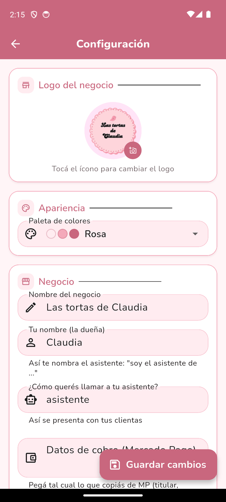
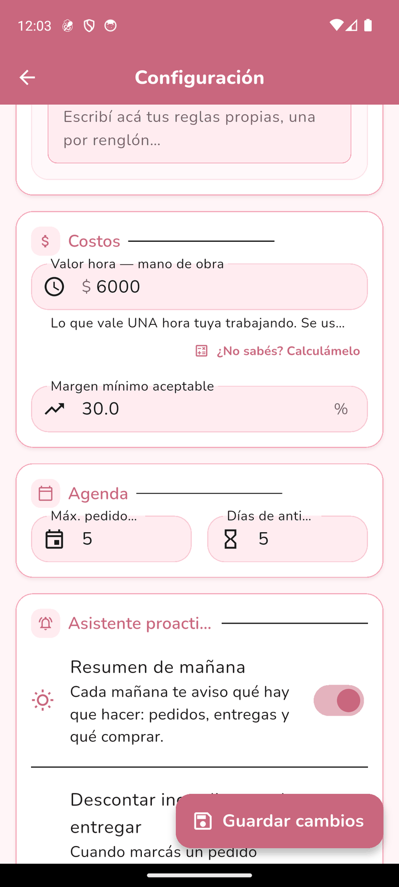
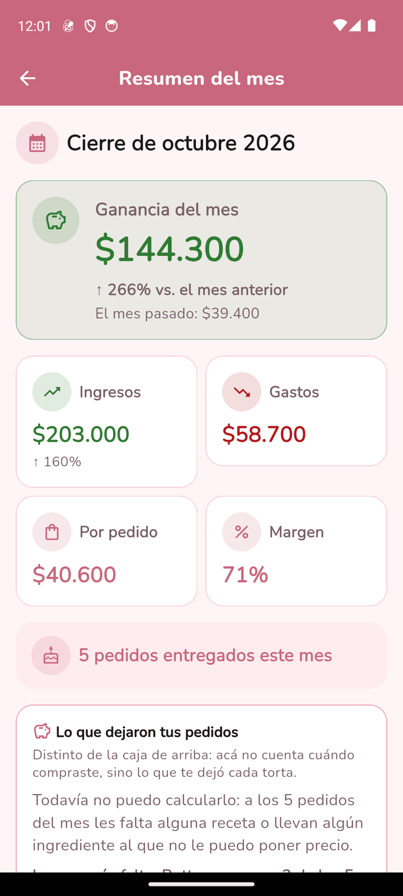
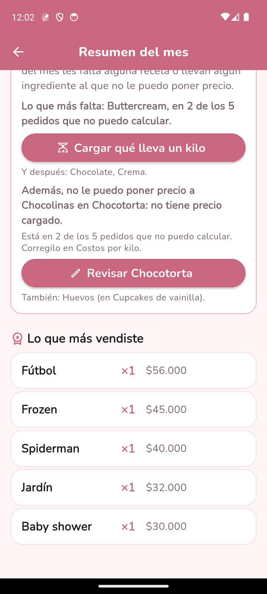
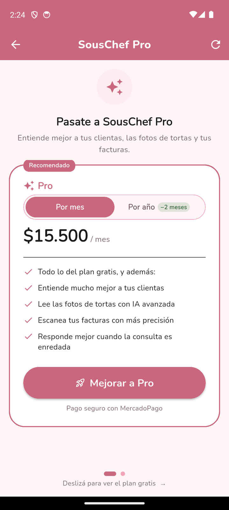

# 6. Configuración, avisos y ayuda

[Índice del manual](README.md) · [← Compras y plata](5-compras-y-plata.md)

**En esta parte:** [Configuración](#configuración-cómo-atiende-tu-asistente) · [Los avisos automáticos](#los-avisos-automáticos) · [Tu plan](#tu-plan-free-y-pro) · [Preguntas frecuentes](#preguntas-frecuentes) · [Si algo no anda](#si-algo-no-anda)

---

## Configuración: cómo atiende tu asistente

<table>
  <tr>
    <td width="25%" valign="top"> El logo de tu negocio, la paleta de colores, tu nombre y cómo se llama tu asistente («¿Cómo querés llamar a tu asistente?»).</td>
    <td width="25%" valign="top"> Tu valor por hora, tu margen mínimo, cuántos pedidos por día aceptás y con cuánta anticipación.</td>
  </tr>
</table>

En **Configuración**, la tarjeta **Lo que tu asistente tiene que saber** 🧠 le enseña a tu asistente cómo trabajás vos, para que responda como lo harías vos. Todo con botoncitos — sin escribir párrafos.

### Cómo cobrás las tortas

Arriba de todo, *¿Cómo cobrás lo que hacés a pedido?*: **Por kilo**, **Por porciones** o **Por tamaño** (kilo y porciones se pueden marcar juntas). Con kilo aparece **De 1 kilo saco … porciones**: con ese número el asistente pasa *"una torta para 20 personas"* a kilos.

### Los envíos: elegí tu modalidad

¿Hacés envíos? Elegí **una de las cuatro opciones** con un toque, y mirá qué le va a decir el asistente a tus clientas en cada caso:

| Opción | Qué dice el asistente |
|---|---|
| **Lo retiran** | Que no hacés envíos: los pedidos se retiran. |
| **Con envío, lo paga la clienta** | Que hacés envíos a donde la clienta quiera, y que el envío corre por cuenta de ella. |
| **Sin cargo en algunas zonas** | Aparece un campo para que escribas **tus zonas** (ej: "Caballito, Flores"). El asistente dice que a esas zonas el envío va sin cargo, y que a otras zonas se cobra aparte. |
| **A convenir** | Que los envíos los coordinás vos con cada clienta. |

> En **ningún** caso el asistente dice **cuánto** sale un envío. Explica la modalidad, y el monto (si lo hay) lo hablás vos.

### La seña: el "generalmente" es a propósito

Elegís con chips cómo cobrás la reserva: **Pido 30%** / **Pido 50%** / **Otro** (con su campo para poner lo tuyo) / **No pido seña**.

Con eso, el asistente les dice a las clientas: *"**Generalmente** pido X% de seña para reservar la fecha."* ¿Por qué "generalmente" y no "siempre"? Porque la excepción existe: esa clienta de años a la que no le pedís seña. **Esa decisión es tuya** — el asistente da la regla general y no negocia; si alguien pide una excepción, te lo deriva a vos.

Si elegiste "No pido seña", dice que se paga al retirar. Simple.

### La dirección de retiro

Tiene su **campo propio** en Configuración. Y funciona con una regla de oro:

- Si la cargaste, el asistente la manda **TAL CUAL la escribiste**, letra por letra — no pasa por la inteligencia artificial, así que es **imposible** que la deforme y mande a una clienta a otra cuadra.
- Si la dejás **vacía**, el asistente **no comparte ninguna dirección**: cuando le pregunten dónde retirar, te deriva la consulta a vos. Ideal si preferís pasar tu dirección personalmente.

### Tus datos de cobro

Como viste en la [sección «Mensajes»](2-atender-clientas.md#mensajes-y-el-asistente-que-atiende-solo): cargás una vez el bloque de Mercado Pago (titular, Alias, CBU/CVU, CUIT) y el asistente lo manda tal cual cuando una clienta pide los datos para transferir. Nunca confirma que un pago llegó — eso lo verificás vos.

### Lo demás de Configuración

- **Horario de atención** (*Desde* y *Hasta*): fuera de ese horario el asistente responde igual, pero le aclara a la clienta que lo ves vos cuando abrís.
- **Asistente proactivo:** las llaves de los avisos y de Pendientes, **Descontar ingredientes al entregar** ([sección «Que la alacena se descuente sola»](5-compras-y-plata.md#que-la-alacena-se-descuente-sola)) y, cuando SousChef lo active, **Tu WhatsApp para avisos** ([sección «Los avisos automáticos»](#los-avisos-automáticos)).
- **Upsell automático:** el asistente sugiere productos complementarios (por ejemplo, cupcakes junto con la torta).
- Al final, **Cerrar sesión**, **Eliminar cuenta** ([sección «Preguntas frecuentes»](#preguntas-frecuentes)) y la versión de la app ([sección «Si algo no anda»](#si-algo-no-anda)).

### Legal: la política, los términos y los datos que usa la IA

Casi al final de Configuración, arriba de **Cerrar sesión**, está la tarjeta **Legal**, con tres filas:

- **Política de privacidad** (*"Qué datos guardamos, para qué y cómo pedir que se borren"*): se abre en el navegador, y ahí está qué datos guarda SousChef (los tuyos y los de tus clientas), para qué los usa, con quién los comparte, cuánto tiempo los guarda y cómo pedir que se borren. Es la misma que ves al entrar, al crear tu cuenta, en **Conectar canales** y en la hoja **Antes de usar el asistente**.
- **Términos del servicio** (*"Las condiciones para usar SousChef"*): también en el navegador. Son los que aceptaste al crear tu cuenta.
- **Datos que usa la IA:** dice *"Aceptaste el d/m/aaaa"*, con el día en que aceptaste la hoja **Antes de usar el asistente** ([sección «El asistente por voz»](2-atender-clientas.md#el-asistente-por-voz)), o *"Todavía no aceptaste"* (mientras lo está leyendo, no dice ninguna de las dos). Si aceptaste, al lado está **Retirar**: lo tocás y te dice *"Listo. La próxima vez que uses el asistente te lo vamos a preguntar de nuevo."*, y te aclara que el asistente que atiende a tus clientas sigue funcionando. Desde ese momento, lo que usás vos desde la app (el asistente, el dictado de recetas, las fotos de facturas y de tu lista de precios, los textos de la Galería) no se le manda a la inteligencia artificial hasta que vuelvas a aceptar. Si no hay conexión, te avisa *"No se pudo retirar. Revisá tu conexión y probá de nuevo."*

Si el teléfono no puede abrir la política o los términos, la app te lo avisa con un cartel: probá de nuevo en un rato.

---

## Los avisos automáticos

<table>
  <tr>
    <td width="25%" valign="top"> El cierre del mes: tu ganancia y cómo viene contra el mes pasado, más ingresos, gastos y margen.</td>
    <td width="25%" valign="top"> Y el ranking de lo que más vendiste, con la cantidad y el importe de cada uno.</td>
  </tr>
</table>

SousChef te manda avisos al celular **en el momento justo**, sin que tengas que estar mirando la app. Los textos son claros y completos: te dicen la clienta, el pedido y la fecha con todas las letras (nada de avisos crípticos a medio armar). Estos son los que vas a recibir:

| Cuándo | Qué te dice |
|---|---|
| **Una vez por día, a la hora que elegiste** | **Tu plan de mañana** — Un resumen de las entregas y lo que tenés que producir. La hora la elegís en Configuración (**Hora del resumen**). Tocándolo entrás a **Producción**, en la pestaña **Mañana**. Si no hay nada, no te molesta. |
| **Todos los días a las 8:05** | **📦 Hoy entregás 2 pedidos** — con hasta tres clientas y lo que llevan (*"Lucía (torta unicornio), Martina (cupcakes)"*). Tocándolo se abre **Para hoy**. Si ese día no entregás nada, no llega. |
| **A las 8:00 y de nuevo a las 17:00** | **Saldos a cobrar hoy** — Los pedidos que entregás hoy con plata pendiente. Si a esa hora ya no queda nada por cobrar, no llega. |
| **A las 9:00 y de nuevo a las 18:00** | **Precios atrasados** — Si algún producto quedó con poco margen por la suba de costos, para que ajustes. |
| **Todos los días a las 10:05** | **🧺 Te queda poco de…** — Hasta tres ingredientes que bajaron del mínimo que les pusiste (*Avisame cuando quede menos de*, en Mis ingredientes), con lo que te queda. Tocándolo se abre **Mi alacena**. No te repite el mismo aviso, salvo que vuelva a bajar. |
| **Los domingos a las 20:00** | **Lista de compras de la semana** — Lo que tenés que comprar. Si no hay nada, silencio. |
| **El primer día del mes** | **Cierre de mes** — Cuánto facturaste, cuánto gastaste, tu ganancia y la comparación con el mes anterior. |
| **Cuando una clienta te escribe** | **💬 Sofía escribió por Instagram** — Te avisa cuando una clienta empieza a escribir o vuelve después de unas horas, aunque el asistente le conteste solo, así sabés qué está pasando sin entrar a mirar. Si el asistente la está atendiendo, el aviso vibra sin sonar. Si esa charla la tenés vos (o apagaste el asistente), suena y te dice que te está esperando. Tocándolo se abre **Mensajes**. |
| **Cuando alguien te deja esperando** | Aviso urgente si una conversación te quedó pendiente más de 15 minutos. |
| **Cuando una clienta no responde** | Te propone un mensaje de seguimiento (en Pendientes) para reflotar un presupuesto. |
| **Los lunes, si lo prendiste** | **Promos para días libres** — Si te queda un día sin pedidos en la semana, te deja en Pendientes una promo armada y un posteo en borrador. Viene **apagado**: lo prendés en Configuración. |
| **Al entregar, si lo prendiste** | **Agradecer después de entregar** — Te deja en Pendientes un gracias listo para mandar a la clienta. Viene **apagado**: lo prendés en Configuración. |
| **Cuando vence una conexión** | Te avisa que reconectes WhatsApp/Instagram/Facebook antes de que deje de andar. |
| **Cumpleaños y recordatorios** | Te recuerda seguimientos que pospusiste (ej: cumpleaños al año siguiente). |

> **Importante:** todos estos avisos son **solo para vos**. SousChef **no le escribe a tus clientas** con nada de esto sin tu aprobación: los seguimientos, las promos, los agradecimientos y los avisos de saldo pasan primero por **Pendientes** para que los revises. La única excepción es el "perdón la demora" de la [sección «Mensajes»](2-atender-clientas.md#mensajes-y-el-asistente-que-atiende-solo) (una sola vez, sin precio).

**Cómo apagarlos.** Casi todos dependen de una sola llave: **Resumen de mañana**, en **Configuración → Asistente proactivo**. Si la apagás, dejan de llegar todos —también los de las 8:05 y las 10:05— menos los que son para no perder mensajes (una clienta que te está esperando y una conexión que vence) y el de un ingrediente que subió de precio, que llega cuando entrás a la app. Los agradecimientos van aparte: dependen solo de su propia llave, **Agradecer después de entregar**. Las promos necesitan las dos prendidas: **Resumen de mañana** y **Promos para días libres**; los avisos de saldo a la clienta, **Resumen de mañana** y **Avisar el saldo a la clienta**. Los agradecimientos y las promos vienen apagados.

**También por WhatsApp (cuando SousChef lo active).** Si cargás **Tu WhatsApp para avisos** en **Configuración → Asistente proactivo** —tu número personal, como +54 9 11 1234-5678, no el que atiende tu asistente—, los avisos de las 8:05 y de las 10:05 te llegan además por WhatsApp, desde el número de tu negocio; si lo dejás vacío, siguen llegando sólo al celular. Revisá el número dígito por dígito antes de guardarlo: estos avisos llevan los nombres de tus clientas y lo que te encargaron, y si falta o sobra un dígito le llegan a otra persona. Si no te llega el primero, corregilo en Configuración. Son avisos para leer: no hace falta que los respondas (si respondés, tu asistente te toma como una clienta nueva).

**Cuáles suenan.** Suenan los avisos de una clienta que te está esperando (un pedido listo para confirmar, alguien que te necesita, una charla sin respuesta). Los demás llegan sin sonido: en Android vibran (el de una conexión que vence sí suena); **en el iPhone** no suenan ni prenden la pantalla, y los encontrás en las notificaciones cuando las mires.

**El Resumen del mes.** El aviso del cierre abre **Resumen del mes** (también está en Gestión → Tu asistente y en Mis herramientas): la **Ganancia del mes** y cómo viene contra el mes anterior, **Ingresos**, **Gastos**, **Por pedido** y **Margen**, **Lo que más vendiste** y **Lo que dejaron tus pedidos** (lo que vendiste menos lo que te costó hacerlo).

---

## Tu plan: Free y Pro

<table>
  <tr>
    <td width="25%" valign="top"> La pantalla del plan: qué mejora exactamente el Pro y el precio del mes.</td>
  </tr>
</table>

SousChef viene en dos versiones: **Free** (gratis) y **Pro**. Con Free ya tenés toda la app funcionando. **Pro hace que tu asistente entienda más**: cuando está activo, entiende mejor a las clientas, responde con más criterio cuando la consulta es enredada, lee mejor las fotos de las tortas que te mandan y escanea tus facturas con más precisión. En otras palabras, con Pro tu asistente atiende todavía más parecido a como lo harías vos.

Lo importante: **todo lo demás sigue igual** (tus pedidos, tu agenda, tus precios, tus avisos). Pro no agrega pantallas nuevas que tengas que aprender; simplemente hace que el asistente que ya conocés trabaje mejor.

### Cómo ver tu plan y suscribirte

1. Andá a **Gestión** y, casi al final, en **Tu plan**, tocá **SousChef Pro**.
2. Se abre la pantalla de **SousChef Pro**, que te muestra qué mejora.
3. Si querés activarlo, tocá **Mejorar a Pro**: el pago se hace con **Mercado Pago** y es una suscripción que se renueva sola. Si el plan también se vende por año, arriba elegís **Por mes** o **Por año** (con el anual te dice cuánto te queda por mes).
4. Cuando el pago queda confirmado, tu asistente pasa a trabajar en modo Pro. No tenés que tocar nada más.

En esa misma pantalla siempre ves en qué estás: si tenés Pro activo, dice **"Se renueva el {fecha}"**.

### Cómo cancelar (y qué pasa después)

Podés dar de baja el Pro **cuando quieras, desde la misma app**, sin llamar a nadie ni mandar mails:

1. Entrá a **Gestión → Tu plan → SousChef Pro**.
2. Tocá **Cancelar suscripción** y confirmá con **Sí, cancelar**.

**Muy importante y tranquilizador:** cuando cancelás, **no se te corta en el acto**. Seguís con **Pro hasta que termine el período que ya pagaste** (el mes, o el año si pagaste por año). Recién ahí volvés a Free. La pantalla te lo aclara con un cartel: **"Cancelada · seguís con Pro hasta el {fecha}"**. Así nunca pagás de más ni perdés lo que ya abonaste.

> **Nota:** si tu Pro es una **cortesía** que te dieron (no lo estás pagando con Mercado Pago), esa no se cancela desde acá.

> **En el iPhone** (y en la app de Google Play, si algún día la bajás de ahí) el renglón se llama **Tu plan de SousChef** y la pantalla, **Tu plan**: te muestra qué plan tenés, qué incluye y, si es Pro, hasta cuándo. Desde esas apps no se contrata ni se cancela el Pro: eso se hace desde la web de SousChef o desde la app para Android que se instala directo.

---

## Preguntas frecuentes

**¿SousChef le pasa el precio a mis clientas?**
No, nunca. Ni el de los productos, ni el de los combos (dice qué incluyen y que convienen, sin el monto), ni el recargo de un relleno premium (solo dice "premium"). La única excepción es la lista de rellenos, que se manda tal cual la cargaste. El asistente le pide los datos a la clienta y te los pasa para que vos cotices.

**¿Cómo cargo mi lista de precios sin tipear todo?**
Sacale una foto 📸. Desde **Lo que vendés** (o en el alta, en el paso "¿Cómo cobrás?" → **Tengo precios fijos**), tocás el botón de la foto, la sacás o la elegís de la galería (o pegás el texto de tu posteo), y SousChef te muestra los productos que leyó para que confirmes con las tildes. Nada se guarda sin tu OK, jamás inventa un precio, y si un producto ya estaba en tu catálogo lo saltea y te avisa: nada se duplica.

**¿Qué es eso del piso "falso"?**
Es el piso decorativo de toda la vida (el de telgopor forrado, para que la torta se vea más alta). En el formulario lo elegís como una opción más del bizcochuelo: ese piso no gasta insumos, no suma porciones y no lleva rellenos.

**¿Puede mandar mensajes a mis clientas sin que yo sepa?**
No sin que quede a la vista en el chat. Las respuestas de atención (saludos, horarios, pedir datos) las manda solo, y si una conversación que te pasó queda unas 6 horas sin respuesta tuya, le manda a la clienta un único "perdón la demora" (sin precio). Cualquier otro mensaje "de tu parte" (seguimientos, promos) primero aparece en **Pendientes** para que lo apruebes.

**¿Cómo hago para que el asistente le pase mi alias o CBU a una clienta?**
Cargá una sola vez tus datos de cobro de Mercado Pago (titular, Alias, CBU/CVU y CUIT) en **Configuración**. A partir de ahí, cuando una clienta pida los datos para transferir o señar, el asistente se los manda solo, tal cual los escribiste, sin que copies y pegues nada.

**¿El asistente le pasa mi dirección a las clientas?**
Solo si vos la cargaste. La **dirección de retiro** tiene su campo en Configuración y se manda **tal cual la escribiste**. Si la dejás vacía, el asistente no comparte ninguna dirección y te deriva la consulta.

**¿Puedo cargar una torta y también cupcakes en el mismo pedido?**
Sí. En el formulario del pedido, en **"Otros productos del pedido"**, agregás todos los productos que quieras (cupcakes, ice pops, cookies, adicionales), cada uno con su cantidad. La tarjeta del pedido los lista a todos con su cantidad, y después aparecen en tu producción y en la lista de compras.

**Rechacé un presupuesto pero no le llegó el aviso a la clienta. ¿Quedó colgado?**
No: el pedido queda **cerrado siempre**, aunque el aviso no haya podido salir (WhatsApp solo deja responder dentro de las 24 horas del último mensaje — regla de Meta). La app te lo aclara con un cartel para que, si querés, le escribas vos por otro lado.

**¿Qué pasa si quiero atender todo yo un día?**
Tocá el botón del robotito 🤖 en Mensajes para pausar el asistente. Cuando quieras, lo reactivás.

**¿Y si una clienta se enoja o quiere hablar conmigo?**
El asistente lo detecta y te pasa la conversación enseguida, sin meterse.

**¿Se me pueden perder mensajes?**
No. Si una charla te queda esperando más de 15 minutos, te llega un aviso urgente para que no se te escape. Y con el buscador de Mensajes podés encontrar cualquier cosa que se haya dicho, aunque haya sido hace meses.

**¿Cuánto tiempo se guardan las charlas?**
Para cuidar los datos de tus clientas, los mensajes de alguien que nunca te encargó nada se borran solos cuando cumplen 6 meses. La charla con una clienta que tiene pedidos o presupuestos se guarda entera, con sus fotos, mientras ella tenga pedidos cargados. Y la foto de cada pedido se guarda mientras exista el pedido.

**¿Puedo usar dos cuentas en el mismo teléfono?**
Sí. Al **cerrar sesión**, la cuenta que entra después no ve en las pantallas pedidos, clientas ni precios de la anterior. En el teléfono quedan, entre otras cosas, el correo para entrar (si dejaste tildado **Recordar mi email**; viene tildado), el color que elegiste y las copias de las fotos que pasaron por la app, que la otra cuenta no ve. Esas fotos se borran del teléfono si eliminás la cuenta. Y los avisos de la cuenta que salió dejan de llegar a ese teléfono (si cerraste sesión con conexión a internet; y de todas formas, apenas otra cuenta entra en ese teléfono).

**¿Cómo elimino mi cuenta?**
Al final de **Configuración**, **Eliminar cuenta**. Te pregunta dos veces (**Continuar** y **Eliminar todo**) y borra para siempre tu negocio, pedidos, clientas, recetas, conversaciones y canales conectados: no se puede deshacer. Si pagás el Pro con Mercado Pago, la suscripción se da de baja en ese momento, aunque te queden días pagos, y lo que quedaba no se devuelve: la primera pregunta te avisa hasta cuándo lo tenías pago.

**¿Qué diferencia hay entre Free y Pro?**
Con Free tenés toda la app. Con Pro el asistente entiende más: entiende mejor a las clientas y lee mejor las fotos. Lo activás y lo cancelás desde **Gestión → Tu plan → SousChef Pro**, y si cancelás seguís con Pro hasta que termine el período que ya pagaste.

**¿Tengo que revisar la app todo el tiempo?**
No hace falta. SousChef te avisa lo importante en el momento justo. Vos entrás cuando te llega un aviso o cuando querés.

---

## Si algo no anda

Antes de asustarte: **casi nada de lo que ves en esta lista significa que perdiste
información.** Tus pedidos, tus clientas y tus recetas están guardados.

### "Sin conexión" o "Revisá tu conexión y deslizá para reintentar"

La app no pudo hablar con el servidor. Casi siempre es la señal del celular.

**Deslizá la pantalla hacia abajo** con el dedo y soltá: eso la recarga. Si sigue, probá con
wifi. Nada de lo que habías cargado se pierde por esto.

### "Tu sesión no está activa. Cerrá la app y volvé a iniciar sesión"

Aparece a veces mientras hacés los primeros pasos de configuración. **No perdiste nada** y tu
cuenta está bien: lo que pasó es que la app se quedó sin permiso para guardar, normalmente
porque estuvo mucho rato abierta sin uso.

Cerrá la app del todo —no solo la minimices—, abrila de nuevo, entrá con tu correo y seguí
donde estabas.

### El asistente no le contesta a mis clientas

Repasá en este orden, que va de lo más común a lo menos:

1. **¿Está pausado?** Si tocaste el robotito 🤖 de Mensajes, el asistente no
   responde en ningún canal y la pastilla de cada chat dice **Pausado**. Volvé a
   tocar el robotito.
2. **¿Vos le escribiste a esa clienta?** Cuando respondés un chat a mano, el asistente se
   calla **en esa conversación** para no pisarte. Es a propósito: arriba del chat la pastilla
   pasa a **Manual**; tocala para que vuelva a atender.
3. **¿Es fuera de tu horario de atención?** Ahí también contesta, pero le aclara a la clienta
   que lo ves vos cuando abrís: no es que no ande.
4. **¿Conectaste el canal?** Si nunca conectaste WhatsApp, Instagram o Messenger, no hay por
   dónde recibir los mensajes.

Si nada de eso es, avisanos: puede ser que la conexión con WhatsApp o Instagram se haya
vencido y haya que renovarla.

### No me llega ningún aviso al celular

Los avisos llegan **a un solo teléfono**: el último donde iniciaste sesión. Si entraste en un
celular nuevo, el anterior deja de recibirlos.

### No me bajó de la alacena

Está explicado en detalle en la [sección «Que la alacena se descuente sola»](5-compras-y-plata.md#que-la-alacena-se-descuente-sola). Lo más común,
en orden: el interruptor está apagado; el pedido no tiene fecha de entrega; o la receta le
falta algún dato. **Abrí el pedido**: si algo no se pudo descontar, ahí te lo dice con nombre
y apellido.

### La leche me aparece en unidades y la quiero en litros

Pasa cuando el ticket no decía cuántos litros traía cada envase: el escáner la carga **por
unidad** (1 u = 1 envase), que es lo único que puede saber. Para pasarla a litros, en **Mi
alacena** tocá la leche → **Cambiar cómo se mide** → **Litros**, y contestá cuánto trae cada
unidad. Está explicado en la [sección «Mi alacena»](5-compras-y-plata.md#mi-alacena).

Una vez en litros, si escaneás un ticket que no dice cuántos litros trae cada envase, el
escáner **no le cambia el precio** (no lo inventa) y te lo dice al terminar: *"A este no le
cambié el precio"*. Esa compra tampoco la puede sumar a la alacena: anotala tocando la leche
en **Mi alacena** → **Compré**, y si ponés **cuánto pagaste**, el precio también queda al día.

### "Hay una versión nueva de SousChef"

Aparece, como mucho una vez por día, cuando salió una versión con arreglos que te conviene
tener. Tocá **Pedirla por WhatsApp** y te la mandamos: se instala encima de la que tenés y no
perdés nada, porque tus datos están guardados en el servidor y no en el teléfono. Si tocás
**Ahora no**, te lo vuelve a recordar otro día. En la versión web el botón dice **Recargar**, y
con eso alcanza.

Si en cambio dice **"Esta versión de SousChef quedó vieja"**, la app no deja seguir hasta que
tengas la nueva. Pasa sólo cuando una versión puede guardar mal algún dato. Lo que ya cargaste
está a salvo.

**¿Qué versión tengo?** Está al final de **Configuración**, abajo de todo y en letra chiquita
(por ejemplo, *Versión del 2/10/2026 15:30*). Si te lo preguntamos, es ese dato.

---

[Índice del manual](README.md) · [← Compras y plata](5-compras-y-plata.md)
